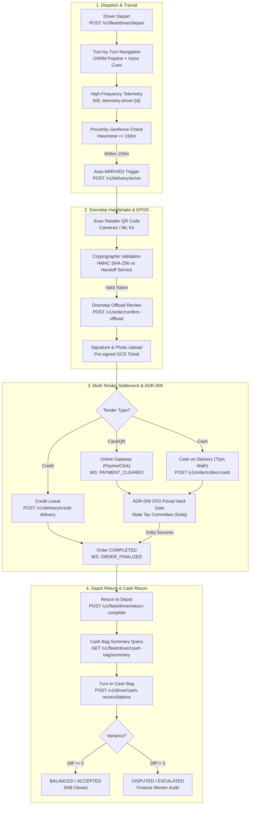
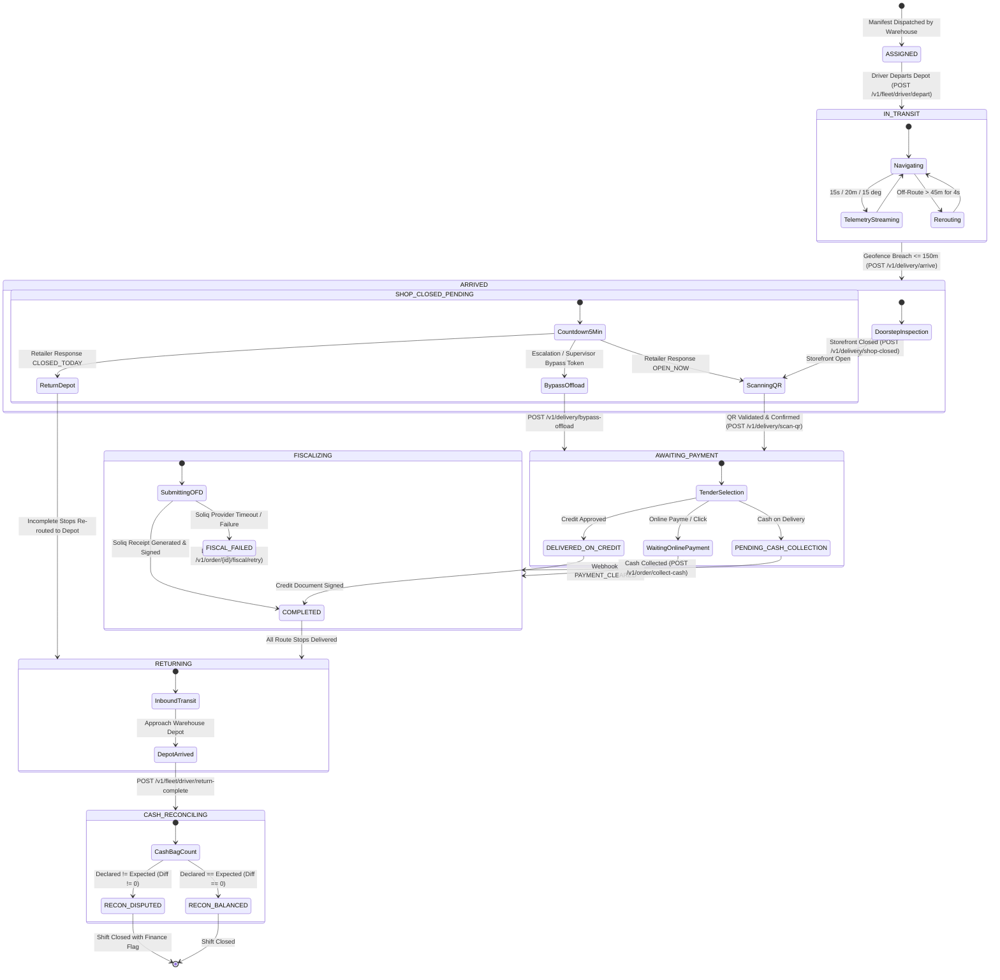

# Role 7 Specification: Carrier & Fleet Driver Operations

> **Role Number**: Role 7 of 9  
> **Persona ID**: `ROLE_DRIVER` / `FACTORY_DRIVER`  
> **Specification Level**: Authoritative Production Engineering Audit  
> **Operational Overview**: [`docs/roles/DETAILED_ROLE_OPERATIONS_AND_FEATURES.md`](file:///Users/shakhzod/Desktop/pegasusx/docs/roles/DETAILED_ROLE_OPERATIONS_AND_FEATURES.md)  
> **Target Codebases:**
- Native Android: [`apps/driver-app-android`](file:///Users/shakhzod/Desktop/pegasusx/apps/driver-app-android)
- Native iOS: [`apps/driver-app-ios`](file:///Users/shakhzod/Desktop/pegasusx/apps/driver-app-ios)
- Barcode Scanner Kit: [`packages/mobile-android-barcode-scanner`](file:///Users/shakhzod/Desktop/pegasusx/packages/mobile-android-barcode-scanner)
- Handoff Cryptographic Engine & Service: [`packages/handoff`](file:///Users/shakhzod/Desktop/pegasusx/packages/handoff), [`apps/handoff-service`](file:///Users/shakhzod/Desktop/pegasusx/apps/handoff-service)
- Cloud Spanner & Backend Go Subsystems:
  - [`apps/backend-go/driverroutes`](file:///Users/shakhzod/Desktop/pegasusx/apps/backend-go/driverroutes)
  - [`apps/backend-go/driver`](file:///Users/shakhzod/Desktop/pegasusx/apps/backend-go/driver)
  - [`apps/backend-go/deliveryroutes`](file:///Users/shakhzod/Desktop/pegasusx/apps/backend-go/deliveryroutes)
  - [`apps/backend-go/telemetryroutes`](file:///Users/shakhzod/Desktop/pegasusx/apps/backend-go/telemetryroutes)
  - [`apps/backend-go/telemetry`](file:///Users/shakhzod/Desktop/pegasusx/apps/backend-go/telemetry)
  - [`apps/backend-go/etaroutes`](file:///Users/shakhzod/Desktop/pegasusx/apps/backend-go/etaroutes)
  - [`apps/backend-go/routing`](file:///Users/shakhzod/Desktop/pegasusx/apps/backend-go/routing)
  - [`apps/backend-go/cashreconroutes`](file:///Users/shakhzod/Desktop/pegasusx/apps/backend-go/cashreconroutes)
  - [`apps/backend-go/cashrecon`](file:///Users/shakhzod/Desktop/pegasusx/apps/backend-go/cashrecon)
  - [`apps/backend-go/orderroutes`](file:///Users/shakhzod/Desktop/pegasusx/apps/backend-go/orderroutes)
  - [`apps/backend-go/order`](file:///Users/shakhzod/Desktop/pegasusx/apps/backend-go/order)

---

## Executive Summary & Metrics Ledger

| Category | Metric Count | Details |
| :--- | :--- | :--- |
| **Native Android Screens & Views** | **22** (16 Screens/Views, 6 Dialogs/Sheets) | Compose screens, Navigation routes, dialogs, sheets in [`com.pegasusx.driver`](file:///Users/shakhzod/Desktop/pegasusx/apps/driver-app-android/app/src/main/java/com/pegasusx/driver) |
| **Native iOS Views & Sheets** | **26** (18 Views, 8 Sheets/Dialogs) | SwiftUI views, sheets, and interactive modals in [`driverappios`](file:///Users/shakhzod/Desktop/pegasusx/apps/driver-app-ios/driverappios/driverappios) |
| **Driver HTTP API Endpoints** | **80** (49 driverroutes, 3 deliveryroutes, 1 telemetryroutes, 5 cashrecon, 13 orderroutes, 2 etaroutes, 2 handoff-service, 5 common) | Complete driver mutation and query surface across Backend-Go & Handoff-Service |
| **WebSocket / SSE Event Types** | **38** (31 Driver WS received, 4 Telemetry/Sensor, 3 Emitted ACKs/Locations) | Real-time events fanned out via Redis/WS hubs (`driver:{id}`, `telemetry:driver:{id}`) |
| **Spanner Database Tables Touched** | **28** Cloud Spanner Tables + **4** Android Room Tables + **2** iOS SwiftData Models | Core entities: `Drivers`, `Vehicles`, `DriverShifts`, `Orders`, `OrderDeliveryProofs`, `CashReconciliations` |

---

## 1. Complete Mobile Surface Catalog

### 1.1 Native Android Screens & Views (`apps/driver-app-android`)

All Android screens are implemented in Jetpack Compose, wired to Hilt ViewModels, and integrated with Room SQLite local staging and the central navigation host in [`DriverNavigation.kt`](file:///Users/shakhzod/Desktop/pegasusx/apps/driver-app-android/app/src/main/java/com/pegasusx/driver/ui/navigation/DriverNavigation.kt).

| # | Screen / View Component | Source Relative Path | Description |
|---|-------------------------|----------------------|-------------|
| 1 | `LoginScreen` | `app/src/main/java/com/pegasusx/driver/ui/screens/auth/LoginScreen.kt` | Driver PIN / Phone authentication and token acquisition |
| 2 | `MainTabView` | `app/src/main/java/com/pegasusx/driver/ui/navigation/MainTabView.kt` | 4-tab container (Home, Map, Rides, Profile) + `PegasusCollapsibleRail` for tablets |
| 3 | `HomeScreen` | `app/src/main/java/com/pegasusx/driver/ui/screens/home/HomeScreen.kt` | Daily dashboard: remaining stops stepper, departure control, stats, vehicle info |
| 4 | `RemainingStops` | `app/src/main/java/com/pegasusx/driver/ui/screens/home/RemainingStops.kt` | Remaining stops summary card & list preview on dashboard |
| 5 | `RequestRescueSheet` | `app/src/main/java/com/pegasusx/driver/ui/screens/home/RequestRescueSheet.kt` | Emergency breakdown / accident rescue request bottom sheet |
| 6 | `RescueAcceptanceDialog` | `app/src/main/java/com/pegasusx/driver/ui/screens/home/RescueAcceptanceDialog.kt` | Interactive dialog to accept/reject dispatch rescue for disabled nearby truck |
| 7 | `ManifestScreen` (Rides) | `app/src/main/java/com/pegasusx/driver/ui/screens/manifest/ManifestScreen.kt` | Route stop sequence, order list, status pills, pull-to-refresh, early complete |
| 8 | `DeliveryCorrectionScreen` | `app/src/main/java/com/pegasusx/driver/ui/screens/manifest/DeliveryCorrectionScreen.kt` | Batch line-item delivery reconciliation before offload handoff |
| 9 | `EarlyCompleteDialog` | `app/src/main/java/com/pegasusx/driver/ui/screens/manifest/components/EarlyCompleteDialog.kt` | Driver fatigue or vehicle issue early return request dialog |
| 10 | `ModificationSheetContent`| `app/src/main/java/com/pegasusx/driver/ui/screens/manifest/components/ModificationSheetContent.kt` | Stop reordering & route sequence adjustments sheet |
| 11 | `MapScreen` | `app/src/main/java/com/pegasusx/driver/ui/screens/map/MapScreen.kt` | Turn-by-turn navigation, GoogleMap Compose polyline, OSRM cues, camera lock FAB |
| 12 | `DriverNotificationInboxScreen` | `app/src/main/java/com/pegasusx/driver/ui/screens/notifications/DriverNotificationInboxScreen.kt` | System notification inbox with deep links, mark-as-read, portal fallbacks |
| 13 | `OfflineVerifierScreen` | `app/src/main/java/com/pegasusx/driver/ui/screens/offline/OfflineVerifierScreen.kt` | Offline delivery terminal: loads daily SHA-256 hashes, scans QR, HMAC verification |
| 14 | `OffloadReviewScreen` | `app/src/main/java/com/pegasusx/driver/ui/screens/offload/OffloadReviewScreen.kt` | Doorstep offload review: line items verification, damages reporting, shop closed |
| 15 | `PaymentWaitingScreen` | `app/src/main/java/com/pegasusx/driver/ui/screens/offload/PaymentWaitingScreen.kt` | Real-time payment settlement monitor (Card / Online / Payme / Click / Cash transition) |
| 16 | `CashCollectionScreen` | `app/src/main/java/com/pegasusx/driver/ui/screens/offload/CashCollectionScreen.kt` | Cash counting, exact change calculation, shortfall/overage ledger, ADR-009 fiscal gate |
| 17 | `ShopClosedWaitingScreen` | `app/src/main/java/com/pegasusx/driver/ui/screens/offload/ShopClosedWaitingScreen.kt` | Shop closed countdown timer (grace period), photo evidence, bypass offload token input |
| 18 | `ProfileScreen` | `app/src/main/java/com/pegasusx/driver/ui/screens/profile/ProfileScreen.kt` | Driver stats, lifetime earnings, vehicle assignment, pending sync count, logout |
| 19 | `EndSessionSheet` | `app/src/main/java/com/pegasusx/driver/ui/screens/profile/EndSessionSheet.kt` | End of shift sheet: availability reason codes, break/offline declaration |
| 20 | `ScannerScreen` | `app/src/main/java/com/pegasusx/driver/ui/screens/scanner/ScannerScreen.kt` | Full-screen CameraX QR code scanner with haptics & ML Kit barcode detection |
| 21 | `SupplyTransfersScreen` | `app/src/main/java/com/pegasusx/driver/ui/screens/supply/SupplyTransfersScreen.kt` | Factory-to-warehouse inter-facility supply legs assigned to driver |
| 22 | `SyncQueueScreen` | `app/src/main/java/com/pegasusx/driver/ui/screens/sync/SyncQueueScreen.kt` | Inspect pending offline mutation queue, dead letter items, manual re-sync |

---

### 1.2 Native iOS Views & Sheets (`apps/driver-app-ios`)

Implemented with SwiftUI, SwiftData offline models, Combine/Task asynchronous network layers, and Apple MapKit in [`driverappios`](file:///Users/shakhzod/Desktop/pegasusx/apps/driver-app-ios/driverappios/driverappios).

| # | View / Sheet Component | Source Relative Path | Description |
|---|------------------------|----------------------|-------------|
| 1 | `LoginView` | `driverappios/Views/LoginView.swift` | Driver phone & PIN authentication with secure token storage |
| 2 | `MainTabView` | `driverappios/Views/MainTabView.swift` | Primary 4-tab host (Home, Rides, Profile) + full-screen Map toggle + network observer |
| 3 | `HomeView` | `driverappios/Views/HomeView.swift` | Daily summary, active truck telemetry, remaining stops stepper, quick action tray |
| 4 | `FleetMapView` | `driverappios/Views/FleetMapView.swift` | MapKit full-screen navigation, GPS dead-reckoning interpolator, OSRM turn cues, zoom focus |
| 5 | `ActiveDeliverySheet` | `driverappios/Views/Components/Map/ActiveDeliverySheet.swift` | Active in-transit stop glass sheet with navigation controls & doorstep trigger |
| 6 | `OrderPickerSheet` | `driverappios/Views/Components/Map/OrderPickerSheet.swift` | Multi-stop selector sheet on the navigation map |
| 7 | `OrderPreviewSheet` | `driverappios/Views/Components/Map/OrderPreviewSheet.swift` | Stop waypoint metadata and destination details preview |
| 8 | `MapMarkerDetailSheet` | `driverappios/Views/Components/MapMarkerDetailSheet.swift` | Retailer destination pin inspector and navigation trigger |
| 9 | `RidesListView` | `driverappios/Views/RidesListView.swift` | Stop manifest view: search, filter, line items preview, early complete trigger |
| 10 | `EarlyCompleteSheet` | `driverappios/Views/Components/Manifest/EarlyCompleteSheet.swift` | Driver early shift completion bottom sheet modal |
| 11 | `DeliveryCorrectionView` | `driverappios/Views/DeliveryCorrectionView.swift` | Pre-offload line quantity amendments and price adjustments |
| 12 | `OffloadReviewView` | `driverappios/Views/OffloadReviewView.swift` | Doorstep offload confirmation, condition report, QR verification |
| 13 | `PaymentWaitingView` | `driverappios/Views/PaymentWaitingView.swift` | Online payment watcher, webhook listener, and cash collection handoff |
| 14 | `CashCollectionView` | `driverappios/Views/CashCollectionView.swift` | Cash on delivery intake, tiyin calculation, fiscalizing state trigger |
| 15 | `ShopClosedWaitingView` | `driverappios/Views/ShopClosedWaitingView.swift` | Shop closed protocol: photo upload, 5-minute timer, bypass code intake |
| 16 | `OfflineVerifierView` | `driverappios/Views/OfflineVerifierView.swift` | Offline cryptographic verification against cached daily manifest hashes |
| 17 | `SyncQueueView` | `driverappios/Views/SyncQueueView.swift` | SwiftData pending offline mutations list and sync executor |
| 18 | `SupplyTransfersView` | `driverappios/Views/SupplyTransfersView.swift` | Factory transfer legs overview and arrival confirmation |
| 19 | `DriverNotificationInboxView` | `driverappios/Views/DriverNotificationInboxView.swift` | In-app notification center with deep linking to map, rides, and orders |
| 20 | `QRScannerView` | `driverappios/Views/QRScannerView.swift` | AVCaptureSession QR scanner with torch toggle and optical framing |
| 21 | `ProfileView` | `driverappios/Views/ProfileView.swift` | Profile details, earnings summary, vehicle status, session termination |
| 22 | `EndSessionView` | `driverappios/Views/EndSessionView.swift` | Shift end form with reason codes and cash turn-in redirect |
| 23 | `RequestRescueSheet` | `driverappios/Views/RequestRescueSheet.swift` | Vehicle breakdown rescue dispatch request form |
| 24 | `RescueAcceptanceDialog` | `driverapp/Views/Home/RescueAcceptanceDialog.swift` | Rescue proposal modal for peer truck assistance |
| 25 | `MissionDetailSheet` | `driverappios/Views/MissionDetailSheet.swift` | Detailed order and item breakdown sheet |
| 26 | `MissionListCard` | `driverappios/Views/MissionListCard.swift` | Compact stop card component for route lists |

---

### 1.3 Barcode & Hardware Scanner Kit (`packages/mobile-android-barcode-scanner`)

| Component | Source Path | Capability & Hardware Protocol |
|---|---|---|
| `EanBarcode` | `packages/mobile-android-barcode-scanner/src/main/java/com/pegasus/barcode/EanBarcode.kt` | GTIN-8, GTIN-12, GTIN-13, GTIN-14 normalization and modulo-10 checksum validation |
| `DataWedgeBarcodeEffect` | `packages/mobile-android-barcode-scanner/src/main/java/com/pegasus/barcode/DataWedgeBarcodeEffect.kt` | Zebra / Motorola Enterprise DataWedge broadcast receiver (`com.symbol.datawedge.api.RESULT_ACTION`) |
| `EanBarcodeScannerPreview` | `packages/mobile-android-barcode-scanner/src/main/java/com/pegasus/barcode/EanBarcodeScannerPreview.kt` | CameraX + Google ML Kit optical barcode scanning with torch controls, 300ms debounce |
| `KeyboardWedgeBarcodeField`| `packages/mobile-android-barcode-scanner/src/main/java/com/pegasus/barcode/EanBarcodeScannerPreview.kt` | Transparent focusable input interceptor for physical Bluetooth/USB/Hardware laser scanners |

---

## 2. API Endpoints Catalog (80 Total Endpoints)

Every endpoint is audited for HTTP Method, URL Path, Go Handler, Required Auth Role, and Tenant Resolution.

| # | Method | Path | Go Handler Function | Auth Role Requirement | Tenant Parameter Resolution |
|---|---|---|---|---|---|
| 1 | `POST` | `/v1/auth/driver/login` | `driver.Service.HandleDriverLogin` | Public (Unauthenticated) | Body `phone`, `pin` -> Claims |
| 2 | `POST` | `/v1/drivers` | `driver.Service.HandleCreateDriver` | `ADMIN`, `WAREHOUSE_ADMIN`, `FACTORY_ADMIN` | Header `Tenant-Supplier-Id` |
| 3 | `GET` | `/v1/drivers/{driverId}` | `driver.Service.HandleGetDriver` | `ADMIN`, `WAREHOUSE_ADMIN`, `FACTORY_ADMIN` | Header `Tenant-Supplier-Id` / Path |
| 4 | `PUT` | `/v1/drivers/{driverId}` | `driver.Service.HandleUpdateDriver` | `ADMIN`, `WAREHOUSE_ADMIN`, `FACTORY_ADMIN` | Header `Tenant-Supplier-Id` / Path |
| 5 | `GET` | `/v1/drivers` | `driver.Service.HandleListDrivers` | `ADMIN`, `WAREHOUSE_ADMIN`, `FACTORY_ADMIN` | Header `Tenant-Supplier-Id` |
| 6 | `POST` | `/v1/vehicles` | `driver.Service.HandleCreateVehicle` | `ADMIN`, `WAREHOUSE_ADMIN`, `FACTORY_ADMIN` | Header `Tenant-Supplier-Id` |
| 7 | `GET` | `/v1/vehicles/{vehicleId}` | `driver.Service.HandleGetVehicle` | `ADMIN`, `WAREHOUSE_ADMIN`, `FACTORY_ADMIN` | Header `Tenant-Supplier-Id` / Path |
| 8 | `PUT` | `/v1/vehicles/{vehicleId}` | `driver.Service.HandleUpdateVehicle` | `ADMIN`, `WAREHOUSE_ADMIN`, `FACTORY_ADMIN` | Header `Tenant-Supplier-Id` / Path |
| 9 | `GET` | `/v1/vehicles` | `driver.Service.HandleListVehicles` | `ADMIN`, `WAREHOUSE_ADMIN`, `FACTORY_ADMIN` | Header `Tenant-Supplier-Id` |
| 10 | `GET` | `/v1/driver/profile` | `driver.Service.HandleProfile` | `DRIVER`, `FACTORY_DRIVER` | JWT Subject (`claims.Subject`) |
| 11 | `GET` | `/v1/driver/history` | `driver.Service.HandleHistory` | `DRIVER`, `FACTORY_DRIVER` | JWT Subject (`claims.Subject`) |
| 12 | `GET` | `/v1/driver/earnings` | `driver.Service.HandleEarnings` | `DRIVER`, `FACTORY_DRIVER` | JWT Subject (`claims.Subject`) |
| 13 | `GET` | `/v1/driver/availability` | `driver.Service.HandleAvailability` | `DRIVER`, `FACTORY_DRIVER` | JWT Subject (`claims.Subject`) |
| 14 | `PATCH`| `/v1/driver/availability` | `driver.Service.HandleAvailability` | `DRIVER`, `FACTORY_DRIVER` | JWT Subject (`claims.Subject`) |
| 15 | `POST` | `/v1/driver/availability` | `driver.Service.HandleAvailability` | `DRIVER`, `FACTORY_DRIVER` | JWT Subject (`claims.Subject`) |
| 16 | `POST` | `/v1/driver/ops/rescue/request` | `driver.Service.HandleRescueRequest` | `DRIVER`, `FACTORY_DRIVER` | JWT Subject (`claims.Subject`) |
| 17 | `POST` | `/v1/driver/ops/rescue/respond` | `driver.Service.HandleRescueRespond` | `DRIVER`, `FACTORY_DRIVER` | JWT Subject (`claims.Subject`) |
| 18 | `GET` | `/v1/driver/pending-collections`| `driver.Service.HandlePendingCollections`| `DRIVER`, `FACTORY_DRIVER` | JWT Subject (`claims.Subject`) |
| 19 | `GET` | `/v1/driver/open-fiscal` | `driver.Service.HandleOpenFiscal` | `DRIVER`, `FACTORY_DRIVER` | JWT Subject (`claims.Subject`) |
| 20 | `GET` | `/v1/driver/manifest-gate` | `driver.Service.HandleManifestGate` | `DRIVER`, `FACTORY_DRIVER` | Query `manifest_id` + JWT |
| 21 | `GET` | `/v1/driver/manifest` | `driver.Service.HandleManifest` | `DRIVER`, `FACTORY_DRIVER` | JWT Subject + Query `date` |
| 22 | `GET` | `/v1/fleet/manifest` | `driver.Service.HandleManifest` | `DRIVER`, `FACTORY_DRIVER` | JWT Subject + Query `date` |
| 23 | `GET` | `/v1/fleet/orders` | `driver.Service.HandleFleetOrders` | `DRIVER`, `FACTORY_DRIVER` | JWT Subject (`claims.Subject`) |
| 24 | `GET` | `/v1/fleet/route/{routeID}/geometry` | `driver.Service.HandleRouteGeometry` | `DRIVER`, `FACTORY_DRIVER` | JWT Subject + Path `routeID` |
| 25 | `POST` | `/v1/fleet/driver/depart` | `driver.Service.HandleDriverDepart` | `DRIVER`, `FACTORY_DRIVER` | JWT Subject + Body `truck_id` |
| 26 | `GET` | `/v1/fleet/driver/cash-bag/summary` | `driver.Service.HandleCashBagSummary` | `DRIVER`, `FACTORY_DRIVER` | JWT Subject (`claims.Subject`) |
| 27 | `POST` | `/v1/fleet/driver/cash-bag/turn-in` | `driver.Service.HandleCashBagTurnIn` | `DRIVER`, `FACTORY_DRIVER` | JWT Subject + Body |
| 28 | `POST` | `/v1/fleet/driver/return-complete` | `driver.Service.HandleDriverReturnComplete` | `DRIVER`, `FACTORY_DRIVER` | JWT Subject + Body |
| 29 | `GET` | `/v1/driver/supply-transfers` | `WarehouseSvc.HandleDriverListSupplyTransfers` | `DRIVER`, `FACTORY_DRIVER` | JWT Subject (`claims.Subject`) |
| 30 | `POST` | `/v1/driver/supply-transfers/{id}/arrive` | `WarehouseSvc.HandleDriverArriveSupplyTransfer` | `DRIVER`, `FACTORY_DRIVER` | JWT Subject + Path `id` |
| 31 | `POST` | `/v1/fleet/route/reorder` | `order.Service.HandleFleetRouteReorder` | `DRIVER`, `FACTORY_DRIVER` | JWT Subject + Body `route_id` |
| 32 | `POST` | `/v1/fleet/route/request-early-complete` | `order.Service.HandleRequestEarlyComplete` | `DRIVER`, `FACTORY_DRIVER` | JWT Subject + Body |
| 33 | `GET` | `/v1/orders/{orderID}` | `driver.Service.HandleOrderGet` | `DRIVER`, `FACTORY_DRIVER` | JWT Subject + Path `orderID` |
| 34 | `PATCH`| `/v1/orders/{orderID}/state` | `driver.Service.HandleOrderStatePatch` | `DRIVER`, `FACTORY_DRIVER` | Deprecated (Returns 501 Not Implemented) |
| 35 | `POST` | `/v1/order/validate-qr` | `order.Service.HandleValidateQR` | `DRIVER`, `FACTORY_DRIVER` | Body `order_id`, `scanned_token` |
| 36 | `POST` | `/v1/order/amend` | `order.Service.HandleAmendOrder` | `DRIVER`, `FACTORY_DRIVER` | Body `order_id`, line adjustments |
| 37 | `POST` | `/v1/fleet/orders/{orderID}/reassign-handshake` | `order.Service.HandleReassignHandshake` | `DRIVER`, `FACTORY_DRIVER` | Path `orderID` + JWT |
| 38 | `POST` | `/v1/driver/orders/{orderId}/shop-closed` | `order.Service.HandleReportShopClosed` | `DRIVER`, `FACTORY_DRIVER` | Path `orderId` + Body |
| 39 | `POST` | `/v1/driver/orders/{orderId}/partial-offload` | `order.Service.HandlePartialOffload` | `DRIVER`, `FACTORY_DRIVER` | Path `orderId` + Body |
| 40 | `POST` | `/v1/driver/orders/{orderId}/credit-leave` | `order.Service.HandleCreditLeave` | `DRIVER`, `FACTORY_DRIVER` | Path `orderId` + Body |
| 41 | `POST` | `/v1/delivery/proximity-unlock` | `order.Service.HandleProximityUnlock` | `DRIVER`, `FACTORY_DRIVER` | Body `order_id`, `latitude`, `longitude` |
| 42 | `POST` | `/v1/delivery/bypass-offload` | `order.Service.HandleBypassOffload` | `DRIVER`, `FACTORY_DRIVER` | Body `order_id`, `bypass_token` |
| 43 | `POST` | `/v1/ws/ack` | `driver.Service.HandleWSAck` | `DRIVER`, `FACTORY_DRIVER` | Body `command_id`, `event_type` |
| 44 | `POST` | `/v1/delivery/negotiate` | `order.Service.HandleProposeNegotiation` | `DRIVER`, `FACTORY_DRIVER` | Body `order_id`, negotiated items |
| 45 | `POST` | `/v1/delivery/credit-delivery` | `order.Service.HandleCreditDelivery` | `DRIVER`, `FACTORY_DRIVER` | Body `order_id` + JWT |
| 46 | `POST` | `/v1/delivery/missing-items` | `order.Service.HandleMissingItems` | `DRIVER`, `FACTORY_DRIVER` | Body `order_id`, missing items, photo |
| 47 | `POST` | `/v1/delivery/exception-report` | `order.Service.HandleExceptionReport` | `DRIVER`, `FACTORY_DRIVER` | Body `order_id`, exceptions, photo |
| 48 | `POST` | `/v1/delivery/split-payment` | `order.Service.HandleSplitPayment` | `DRIVER`, `FACTORY_DRIVER` | Body `order_id`, `cash_minor`, `card_minor` |
| 49 | `POST` | `/v1/delivery/confirm-payment-bypass` | `order.Service.HandleConfirmPaymentBypass` | `DRIVER`, `FACTORY_DRIVER` | Body `order_id`, `token` |
| 50 | `POST` | `/v1/delivery/verify-handshake` | `deliveryroutes.handleVerifyHandshake` | `DRIVER` | Body `order_id`, `token`, `lat`, `lng` |
| 51 | `POST` | `/v1/delivery/update-order-during-delivery` | `deliveryroutes.handleUpdateOrderDuringDelivery`| `DRIVER` | Body `order_id`, `lat`, `lng` |
| 52 | `POST` | `/v1/delivery/submit-offline-pod` | `order.Service.HandleSubmitOfflinePoD` | `DRIVER` | Body `order_id`, `signature`, proof |
| 53 | `POST` | `/v1/telemetry/location` | `telemetryroutes.Deps.handleLocation` | `DRIVER` | JWT Subject (`claims.Subject`) |
| 54 | `POST` | `/v1/driver/cash-reconciliations` | `cashrecon.Handlers.HandleDriverSubmit` | `DRIVER` | JWT Subject (`claims.Subject`) |
| 55 | `GET` | `/v1/driver/cash-reconciliations` | `cashrecon.Handlers.HandleDriverList` | `DRIVER` | JWT Subject (`claims.Subject`) |
| 56 | `GET` | `/v1/supplier/cash-reconciliations`| `cashrecon.Handlers.HandleSupplierList` | `ADMIN` | Header `Tenant-Supplier-Id` |
| 57 | `POST` | `/v1/supplier/cash-reconciliations/{id}/accept` | `cashrecon.Handlers.HandleSupplierAccept` | `ADMIN` | Header `Tenant-Supplier-Id` + Path |
| 58 | `POST` | `/v1/supplier/cash-reconciliations/{id}/write-off` | `cashrecon.Handlers.HandleSupplierWriteOff` | `ADMIN` | Header `Tenant-Supplier-Id` + Path |
| 59 | `POST` | `/v1/delivery/arrive` | `order.Service.HandleMarkArrived` | `DRIVER` | Body `order_id` + JWT |
| 60 | `POST` | `/v1/delivery/shop-closed` | `order.Service.HandleReportShopClosed` | `DRIVER` | Body `order_id`, `reason`, `photo_url` |
| 61 | `POST` | `/v1/delivery/partial-offload` | `order.Service.HandlePartialOffload` | `DRIVER` | Body `order_id`, line items |
| 62 | `POST` | `/v1/order/deliver` | `order.Service.HandleSubmitDelivery` | `DRIVER` | Body `order_id`, `scanned_token` |
| 63 | `POST` | `/v1/sync/batch` | `order.Service.HandleSyncBatch` | `DRIVER` | Body mutations array + Idempotency-Key |
| 64 | `POST` | `/v1/order/confirm-offload` | `order.Service.HandleConfirmOffload` | `DRIVER` | Body `order_id`, `qr_token` |
| 65 | `POST` | `/v1/order/complete` | `order.Service.HandleCompleteOrder` | `DRIVER` | Body `order_id` + JWT |
| 66 | `POST` | `/v1/order/collect-cash` | `order.Service.HandleCollectCash` | `DRIVER` | Body `order_id`, `amount_received_minor` |
| 67 | `POST` | `/v1/order/{orderID}/fiscal/retry` | `order.Service.HandleFiscalRetry` | `DRIVER`, `ADMIN`, `WAREHOUSE_ADMIN` | Path `orderID` + JWT |
| 68 | `POST` | `/v1/delivery/report-damage` | `order.Service.HandleReportDamage` | `DRIVER` | Body `order_id`, `photo_url`, `note` |
| 69 | `POST` | `/v1/delivery/report-condition` | `order.Service.HandleReportCondition` | `DRIVER`, `RETAILER`, `WAREHOUSE` | Body `order_id`, condition payload |
| 70 | `GET` | `/v1/order/{orderID}/condition-reports` | `order.Service.ListConditionReports` | `DRIVER`, `RETAILER`, `ADMIN` | Path `orderID` |
| 71 | `POST` | `/v1/delivery/scan-qr` | `order.Service.HandleDeliveryScanQR` | `DRIVER` | Body `order_id`, `qr_token` |
| 72 | `GET` | `/v1/etas/route/{routeId}` | `etaroutes.handleGetRouteETAs` | `DRIVER`, `ADMIN`, `RETAILER`, ... | Path `routeId` |
| 73 | `GET` | `/v1/etas/stop/{stopId}` | `etaroutes.handleGetStopETA` | `DRIVER`, `ADMIN`, `RETAILER`, ... | Path `stopId` |
| 74 | `POST` | `/internal/v1/handoff/validate` | `handoff-service.main.validate` | Internal (`X-Internal-Api-Key`) | Body `order_id`, `stored`, `presented` |
| 75 | `POST` | `/internal/v1/handoff/public-token`| `handoff-service.main.publicToken` | Internal (`X-Internal-Api-Key`) | Body `order_id`, `status` |
| 76 | `POST` | `/v1/user/device-token` | `platformroutes.HandleRegisterDeviceToken` | Authenticated | JWT Subject (`claims.Subject`) |
| 77 | `GET` | `/v1/user/notifications` | `platformroutes.HandleListNotifications` | Authenticated | JWT Subject (`claims.Subject`) |
| 78 | `POST` | `/v1/user/notifications/read` | `platformroutes.HandleMarkNotificationsRead` | Authenticated | JWT Subject (`claims.Subject`) |
| 79 | `GET` | `/v1/platform/client-policy` | `updateroutes.HandleGetClientPolicy` | Public / Authenticated | Query `role`, `platform`, `version` |
| 80 | `GET` | `/v1/media/upload-ticket` | `platformroutes.HandleMediaUploadTicket` | Authenticated | JWT Subject (`claims.Subject`) |

---

## 3. WebSocket & SSE Event Architecture

### 3.1 Subscribed Event Types & Inbound Channels
When a mobile driver connects to `/v1/ws` with Bearer auth, the backend WebSocket handler subscribes the connection to two primary Redis/in-process pubsub rooms:
1. `driver:{driver_id}` — Order assignments, lifecycle state shifts, cancellations, shop closed responses.
2. `telemetry:driver:{driver_id}` — High-frequency loopback confirmation and peer coordination.
3. `cmd:driver:{driver_id}` — Dedicated low-latency command channel for automated rerouting and supervisor prompts.

| Inbound Event Type | Trigger Origin | Payload Attributes & Action |
|---|---|---|
| `ORDER_ASSIGNED` | Dispatch optimizer / Warehouse seal | Injects new order stop into route; triggers automatic manifest reload |
| `ORDER_REASSIGNED` | Control tower / Supervisor reassignment | Rotates token; triggers `reassignHandshake` flow |
| `ORDER_STATUS_CHANGED` | Backend order state machine mutation | Updates local state pill; triggers screen transitions |
| `ORDER_FINALIZED` | Fiscal success / settlement completion | Transitions stop to completed; triggers next stop navigation |
| `ORDER_COMPLETED` | Delivery lifecycle terminal state | Closes payment waiting screen; updates local progress |
| `ROUTE_CREATED` | Daily dispatch execution | Replaces active route polyline and stop sequence |
| `ROUTE_REORDERED` | Manual driver or supervisor sequence change | Triggers polyline recalculation and re-indexes stops |
| `ROUTE_REPLANNED` | Real-time traffic / dynamic reroute | Emitted over `cmd:driver:{id}`; updates turn-by-turn guidance |
| `PAYMENT_REQUIRED` | Doorstep offload completed | Directs driver to Payment Waiting or Cash Collection |
| `PAYMENT_CLEARED` | Payment gateway webhook (Payme/Click/Online) | Automatically triggers fiscalization transition |
| `PAYMENT_SETTLED` | Cash or Card confirmed | Auto-completes payment waiting screen |
| `FISCAL_RECEIPT_REQUESTED`| ADR-009 fiscal service attempt | Sets UI state to `FISCALIZING` with animated progress |
| `FISCAL_RECEIPT_SUCCEEDED`| State tax committee (Soliq) approved | Stores Soliq QR receipt URL; marks order `COMPLETED` |
| `FISCAL_RECEIPT_FAILED` | Fiscal printer / OFD network error | Sets UI state to `FISCAL_FAILED`; displays Retry button |
| `MANIFEST_DISPATCHED` | Warehouse dock releases truck | Enables route start and vehicle departure button |
| `MANIFEST_COMPLETED` | All stops completed or returned | Prompts driver to return to depot for cash turn-in |
| `SHOP_CLOSED_RESPONSE` | Retailer received shop closed alert | Carries retailer choice (`OPEN_NOW`, `5_MIN`, `CALL_ME`, `CLOSED_TODAY`) |
| `SHOP_CLOSED_RESOLVED` | Supervisor resolved shop closed | Closes countdown timer sheet; provides disposition instructions |
| `SHOP_CLOSED_ESCALATED`| Grace period timer expired without reply | Escalates stop to control tower; enables supervisor bypass input |
| `BYPASS_TOKEN_ISSUED` | Supervisor generated offload bypass | Populates bypass token into driver input field |
| `NEGOTIATION_RESOLVED` | Retailer quantity change finalized | Updates manifest line quantities |
| `DELIVERY_SESSION_UPDATED`| Digital twin state update | Synchronizes active session parameters |
| `REASSIGN_HANDSHAKE_COMPLETED`| Handshake token exchanged | Confirms order transfer between trucks |
| `DRIVER_AVAILABILITY_CHANGED`| Shift status updated | Syncs status toggle across devices |
| `RESCUE_PROPOSED` | Nearby truck requested breakdown rescue | Displays rescue acceptance modal with distance and cargo volume |
| `RESCUE_ACCEPTED` | Warehouse supervisor assigned rescue | Appends rescued orders to active route manifest |
| `RESCUE_REJECTED` | Rescue offer timed out or declined | Dismisses rescue alert dialog |
| `CASH_COLLECTION_REQUIRED`| Retailer chose Cash on Delivery | Diverts payment waiting screen directly to Cash Collection |
| `SYSTEM_APP_OUTDATED` | Server schema version guard breach | Displays modal blocking outdated actions until updated |
| `DRIVER_APPROACHING` | Driver enters 150m geofence | Loopback confirmation of auto-arrival trigger |
| `DRIVER_ARRIVED` | Geofence verified or manual doorstep arrive | Unlocks doorstep offload actions |
| `OFFLOAD_CONFIRMED` | QR scanned and HMAC validated | Unlocks payment and signature capture |

### 3.2 Emitted Event Types & Outbound Messages
1. `DRIVER_LOCATION_UPDATED` (`POST /v1/telemetry/location` & WS): Telemetry envelope with lat, lng, speed, heading, reported_at, received_at, stale_after_seconds.
2. `WS_ACK` (`POST /v1/ws/ack`): Confirms receipt and processing of command IDs received via WebSocket.
3. `SENSOR_ALERT` (`POST /v1/telemetry/sensors`): Emitted if shock sensor exceeds 5.0G or cargo seal tamper switch is tripped.

---

## 4. Spanner Database Tables & Entities Touched

```
+----------------------------------------------------------------------------------------------------+
|                                    CLOUD SPANNER DATABASE TOPOLOGY                                 |
+----------------------------------------------------------------------------------------------------+
|  Drivers                     Vehicles                    DriverShifts          DriverAvailability  |
|  (Credentials, SupplierId)  (LicensePlate, Capacity)    (Shift Hours, State)  (Break, Reason)     |
+----------------------------------------------------------------------------------------------------+
|  Orders                      OrderStatusTransitions      OrderDeliveryProofs   OrderConditionReports|
|  (Status, Lat, Lng, Token)  (Audit Log, Reason)         (EPOD, Signature)     (Damages, Photos)   |
+----------------------------------------------------------------------------------------------------+
|  SupplierTruckManifests      ManifestOrders              RouteETAs             RouteTwins          |
|  (SealedAt, DispatchedAt)   (StopSequenceIndex)         (OSRM Waypoint ETAs)  (Digital Twin State)|
+----------------------------------------------------------------------------------------------------+
|  CashReconciliations         OrderSettlementExceptions   OrderFiscalReceipts   OrderPaymentLegs    |
|  (Expected, Declared, Diff) (CASH_SHORTFALL records)    (ADR-009 Soliq OFD)   (Split Cash/Card)   |
+----------------------------------------------------------------------------------------------------+
|  ShopClosedAttempts          OrderShopClosedLog          FactoryTransfers      ConsumerInbox       |
|  (GraceEndsAt, PhotoUrl)     (Historical Resolutions)   (Factory Supply Legs) (Push Notification) |
+----------------------------------------------------------------------------------------------------+
```

### Detailed Table Specifications
1. **`Drivers`**: Stores driver identity, hashed PIN/password, phone number, vehicle binding, tenant affiliation (`SupplierId`), and home node type (`WAREHOUSE` vs `FACTORY`).
2. **`Vehicles`**: Fleet hardware inventory, asset plate, maximum gross weight, volumetric capacity, GPS hardware binding.
3. **`DriverShifts`**: Driver operational shifts, punch-in/out timestamps, active status, mileage accumulator.
4. **`DriverAvailability`**: High-resolution driver status (`AVAILABLE`, `ON_ROUTE`, `BREAK`, `OFFLINE`) with timestamp and reason codes.
5. **`DriverScores`**: Historical delivery performance, customer satisfaction ratings, on-time delivery percentages.
6. **`SupplierTruckManifests`**: Manifest seal state, departure time, estimated return, driver binding, warehouse gate check.
7. **`ManifestOrders`**: Interleaved manifest order assignments, sequence indexes, offload confirmations.
8. **`Orders`**: Core order record: delivery state machine status, destination lat/lng, H3 cell (`H3Cell`), `DeliveryToken`, `ProximityUnlockedAt`, `ProximityMethod`, `TotalMinor`.
9. **`OrderStatusTransitions`**: Immutable append-only audit ledger recording every driver mutation (`Actor`, `FromStatus`, `ToStatus`, `Reason`, `Timestamp`).
10. **`OrderDeliveryProofs`**: Cryptographic EPOD records (`Signature`, `PhotoEvidenceUrl`, `ScannedTokenHash`, `GpsLatitude`, `GpsLongitude`, `DistanceMeters`).
11. **`OrderConditionReports`**: Driver OS&D inspection logs (`PackageDamaged`, `SealBreached`, `TemperatureAbnormal`) with photo URLs.
12. **`ShopClosedAttempts`**: Doorstep shop closed logs (`PhotoURL`, `DriverLat`, `DriverLng`, `GraceEndsAt`, `AttemptCount`).
13. **`OrderShopClosedLog`**: Historical timeline of retailer responses and supervisor bypass resolutions.
14. **`OrderFiscalReceipts`**: ADR-009 compliance records: Soliq OFD receipt ID, fiscal sign, QR link, total minor units (Tiyin), attempt count.
15. **`OrderLineFiscalSnapshots`**: Per-item fiscal tax snapshots (Net, VAT 12%, IKPU/MXIK codes) generated during offload.
16. **`OrderPaymentLegs`**: Split tender ledger (records individual cash minor and card minor allocations for a single order).
17. **`OrderSettlementExceptions`**: Financial variances (`CASH_SHORTFALL`, `CASH_OVERAGE`, `RECONCILIATION_REQUIRED`).
18. **`CashReconciliations`**: End-of-day driver cash settlement (`ExpectedCashMinor`, `DeclaredCashMinor`, `DifferenceMinor`, `Status`, `DriverNote`, `FinanceNote`).
19. **`RouteETAs`**: Live stop-level ETA predictions updated continuously by telemetry pings.
20. **`RouteTwins`**: Real-time digital twin state of the active route.
21. **`StopTwins`**: Stop-level twin attributes (geofence entry, doorstep dwell time).
22. **`VehicleInventory`**: On-board truck inventory tracking remaining units and returned goods.
23. **`DeviceTokens`**: Driver mobile device FCM and APNS registration tokens for push notifications.
24. **`ConsumerInbox`**: Driver notification records for in-app inbox display.
25. **`OutboxEvents`**: Transactional outbox table writing driver mutations to Kafka topics and WebSocket relays.
26. **`ClientVersionPolicies`**: Version enforcement table gating driver mobile builds.
27. **`DeliverySessions`**: Active driver delivery session telemetry and active routes.
28. **`FactoryInternalTransfers`**: Inter-depot factory-to-warehouse supply legs executed by factory drivers.

### Local SQLite & SwiftData Staging Databases
- **Native Android (`PegasusDriverDatabase` - Room v6)**:
  - `orders`: Offline mirror of active orders and customer details.
  - `route_manifest`: Offline mirror of daily stop manifest and token SHA-256 hashes.
  - `pending_mutations`: Persistent priority queue for offline mutations (`PENDING`, `DEAD`, retry counters).
  - `telemetry_locations`: Durable Room-before-send breadcrumb storage.
- **Native iOS (`OfflineDeliveryStore` - SwiftData)**:
  - `OfflineDelivery`: SwiftData model for cryptographically staged deliveries (`orderId`, `signature`, `timestamp`, `syncStatus`).
  - `QueuedDriverAction`: Action queue for offline mutation retries.

---

## 5. Comprehensive Feature Breakdown

### 5.1 Route Manifest Overview & Stop Sequencing
1. **Manifest Retrieval & Seal Verification**: Drivers cannot start routes until the warehouse seals the manifest. The driver queries `GET /v1/driver/manifest-gate?manifest_id={id}`. If `Sealed == false`, route departure is blocked.
2. **Stop Indexing & Sequencing**: Route stops are sorted by `sequence_index`. Each stop displays customer name, address, payment terms (COD vs Prepaid vs Credit), item count, and gross weight.
3. **Dynamic Reordering**: Drivers can reorder pending stops via `POST /v1/fleet/route/reorder` if local road closures or retailer availability demands sequence changes.
4. **Early Completion**: If driver fatigue or vehicle failure occurs, the driver invokes `POST /v1/fleet/route/request-early-complete` with reason codes (`FATIGUE`, `ACCIDENT`, `BREAKDOWN`).

### 5.2 Turn-by-Turn Navigation & Polyline Geometry (OSRM / MapLibre)
1. **Polyline Resolution**: `GET /v1/fleet/route/{routeId}/geometry?include_steps=true` fetches high-resolution driving geometry encoded using Google Polyline algorithm format.
2. **Dynamic Deviation Tracking**:
   - `OFF_ROUTE_THRESHOLD_METERS = 45.0m`.
   - `SUSTAINED_OFF_ROUTE_MS = 4,000ms`.
   - `MIN_REROUTE_INTERVAL_MS = 30,000ms`.
   - Orthogonal distance from current GPS coordinates to polyline segments is computed via vector dot product projection:
     $$t = \max\left(0, \min\left(1, \frac{(\Delta\text{lng} \cdot (p_\text{lng} - a_\text{lng})) + (\Delta\text{lat} \cdot (p_\text{lat} - a_\text{lat}))}{\Delta\text{lng}^2 + \Delta\text{lat}^2}\right)\right)$$
3. **Voice Navigation & Maneuvers**: Text-to-Speech (`NavigationCueAnnouncer` / `NavigationVoiceAnnouncer`) articulates upcoming maneuvers (turns, roundabouts, off-ramps) accompanied by a dual-pulse vibration pattern (`[0, 70, 50, 70]ms`).
4. **Dead-Reckoning & Display Smoothing**: `LocationInterpolator` applies linear interpolation between successive GPS updates (5Hz rendering loop) to prevent visual marker jitter on MapKit and Google Maps.

### 5.3 High-Frequency Telemetry & Breadcrumb Emission
1. **Client-Side Adaptive Filter**:
   - Location is sampled at 1Hz (`LocationRequest.Builder` with 5s min interval).
   - Telemetry is transmitted over WebSocket if:
     - Elapsed time $> 15\text{s}$, OR
     - Distance displacement $> 20\text{m}$, OR
     - Heading deviation $> 15^\circ$.
2. **Battery & Power Conservation**:
   - If battery percentage $< 20\%$, GPS transitions from `PRIORITY_HIGH_ACCURACY` to `PRIORITY_BALANCED_POWER_ACCURACY`.
3. **Room-Before-Send (§8.8 Resilience)**:
   - Location is inserted into Room SQLite `telemetry_locations` *before* transmission.
   - If WebSocket send succeeds, the Room record is purged.
   - If WebSocket is disconnected, record remains in SQLite and `TelemetrySyncScheduler` (WorkManager) flushes on network regain.
4. **Automatic Geofenced Arrival**:
   - Approach radius: `DriverGeofence.APPROACH_METERS = 150.0m`.
   - When distance to next stop $\le 150\text{m}$, mobile client executes `api.markArrived(orderId)` automatically with deterministic idempotency key `DriverIdempotencyKeys.markArrived(orderId)`.

### 5.4 Cryptographic Delivery Handoff (HMAC SHA-256 Validation)
1. **Token Minting & Rotation**:
   - When an order transitions to `LOADED`, `packages/handoff` engine mints an opaque delivery token (`uuid.NewString()`).
   - If an order is reassigned between drivers, the token is automatically rotated.
2. **Online Validation**:
   - Driver scans Retailer QR code containing `{"order_id": "...", "token": "..."}`.
   - Mobile client calls `POST /v1/order/validate-qr`.
   - Mobile client verifies doorstep proximity via `POST /v1/delivery/verify-handshake` passing current GPS coordinates.
3. **Offline Verification Terminal**:
   - During morning sync, driver downloads daily hash manifest (`GET /v1/driver/manifest`).
   - Manifest stores `hashes: Map<OrderId, SHA256(Token)>`.
   - When offline at the delivery site, driver scans QR token $T$.
   - Mobile client computes $H = \text{SHA-256}(T)$ and verifies $H == \text{hashes}[\text{OrderId}]$.
   - On match, delivery is marked `VERIFIED` and enqueued into offline SQLite queue (`PendingMutationEntity` / `OfflineDelivery`).

### 5.5 Integer Cash Collection & Tiyin Math
1. **Strict Integer Minor Units**: All monetary values are strictly represented as `int64` minor units (Uzbek Tiyin, 1 UZS = 100 Tiyin). Floating-point math is strictly forbidden.
2. **Payment Rebalancing & Exact Change**:
   - Driver inputs `amount_received_minor`.
   - If `amount_received_minor < total_minor`, shortfall is computed:
     $$\text{shortfall\_minor} = \text{total\_minor} - \text{amount\_received\_minor}$$
   - Shortfall is written to Spanner `OrderSettlementExceptions` (`Type: CASH_SHORTFALL`) and emitted as `CashVarianceEvent`.
   - If customer pays excess, overage is recorded (`Type: CASH_OVERAGE`).
3. **Credit Conversion**: If customer cannot pay cash, driver can execute `POST /v1/delivery/credit-delivery` with retailer consent, converting order to `DELIVERED_ON_CREDIT`.
4. **ADR-009 Fiscal Hard-Gate**:
   - Cash collection triggers status `FISCALIZING`.
   - Server submits receipt to State Tax Committee (Soliq) OFD provider.
   - On Soliq receipt generation (`FISCAL_RECEIPT_SUCCEEDED`), order transitions to `COMPLETED`.
   - On failure (`FISCAL_RECEIPT_FAILED`), order enters `FISCAL_FAILED` where driver can invoke `/fiscal/retry`.

### 5.6 Proof of Delivery (EPOD) & Offline Staging
1. **Signature & Photo Capture**:
   - Driver captures recipient signature on touch canvas (`SignaturePadView`) and offload photo evidence.
   - Evidence photos are uploaded directly to GCS via pre-signed tickets (`GET /v1/media/upload-ticket`).
2. **Offline SQLite Priority Queue**:
   - Offline mutations are cataloged in `DriverOfflineActionCatalog` with strict priority:
     - Priority 10: `v1/delivery/proximity-unlock`
     - Priority 20: `v1/delivery/shop-closed`, `v1/delivery/partial-offload`, `v1/order/deliver`, `v1/delivery/submit-offline-pod`
     - Priority 30: `v1/order/collect-cash`, `v1/delivery/credit-delivery`
     - Priority 40: `v1/delivery/arrive`, `v1/order/confirm-offload`, `v1/order/complete`, etc.
   - On network reconnection, `OfflineSyncWorker` flushes queue in priority sequence.

### 5.7 Shop Closed Protocol & Bypass Handling
1. **Doorstep Initiation**: Driver marks shop closed via `POST /v1/delivery/shop-closed`.
   - Mandatory payload: `order_id`, `reason`, `photo_url` (photo of closed storefront), driver GPS.
   - Order transitions `ARRIVED` $\rightarrow$ `SHOP_CLOSED_PENDING`.
2. **Countdown & Escalation Timer**:
   - 5-minute countdown grace period (`grace_ends_at = now + 5min`).
   - Server pushes notification to retailer with 4 response options: `OPEN_NOW`, `5_MIN`, `CALL_ME`, `CLOSED_TODAY`.
3. **Resolution & Bypass**:
   - If retailer selects `CLOSED_TODAY` or timer expires without response (`SHOP_CLOSED_ESCALATED`), supervisor can issue a bypass token.
   - Driver inputs `bypass_token` into `POST /v1/delivery/bypass-offload`.
   - Order transitions to `AWAITING_PAYMENT` or returns to warehouse without penalizing driver on-time metrics.

### 5.8 Partial Offload & Return Item Intake
1. **Line-Level Rejection**: If retailer rejects damaged or missing line items, driver adjusts quantities in `OffloadReviewScreen`.
2. **Quantity Conservation Rule**:
   $$\text{delivered\_qty} + \text{remaining\_qty} == \text{original\_qty}$$
3. **Driver Inspection Report**: Driver submits `POST /v1/delivery/partial-offload` with item breakdown, triggering automated return generation for remaining inventory.
4. **Physical Vehicle Inventory**: Rejected goods remain on truck inventory (`VehicleInventory`) until warehouse intake.

### 5.9 Driver Shift Management & End-of-Day Cash Recon
1. **Warehouse Return Confirmation**: Driver arrives at warehouse and triggers `POST /v1/fleet/driver/return-complete`.
2. **Shift Cash Aggregation**:
   - Server computes expected cash:
     $$\text{ExpectedCashMinor} = \sum_{\text{COD Orders}} \text{AmountReceivedMinor}$$
3. **Cash Bag Turn-In**:
   - Driver counts physical currency notes and submits declared cash via `POST /v1/driver/cash-reconciliations`.
   - Difference is computed: $\text{DifferenceMinor} = \text{DeclaredCashMinor} - \text{ExpectedCashMinor}$.
   - If $\text{DifferenceMinor} == 0$, status is `ACCEPTED` (or `BALANCED`).
   - If $\text{DifferenceMinor} \ne 0$, status is `PENDING` / `DISPUTED`, triggering `CashReconciliationEscalation` worker alert to supplier finance.

---

## 6. Architecture & Data Flow Diagrams

### 6.1 End-to-End Driver Delivery & Settlement Flow



---

### 6.2 Driver Route & Stop Execution Lifecycle (State Machine)



---

## 7. Cryptographic & Security Verification Matrices

### 7.1 Delivery Token Cryptographic Invariants
- **Generation**: Minted using RFC 4122 v4 UUID with SHA-256 entropy.
- **Exposure Boundary**: The raw token is *never* exposed to the driver before physical doorstep scanning. The retailer displays the token in a dynamic QR code (`GET /v1/order/{id}/qr-payload`).
- **Offline Integrity**: The driver's offline cache only stores $\text{SHA-256}(T)$. Because SHA-256 is a pre-image resistant one-way function, possession of the offline manifest does not allow a rogue driver or attacker to forge customer verification without physically scanning the retailer's QR code.
- **Rotation on Reassignment**: If dispatcher reassigns an order from Driver A to Driver B, `packages/handoff` invokes `ShouldRotateOnReassign`, immediately invalidating Driver A's token and generating a fresh cryptographic token for Driver B.

### 7.2 Anti-Spoofing & Geofence Protection
- **Fused Location Validation**: Android `LocationServices.getFusedLocationProviderClient` and iOS `CLLocationManager` enforce mock location detection.
- **Proximity Hard-Gate**: `POST /v1/delivery/proximity-unlock` requires the driver to be physically within the stop's H3 index or $\le 100\text{m}$. Mutations attempted outside the physical geofence without a valid supervisor override token are rejected with HTTP 412 Precondition Failed.
- **Idempotency Guard**: All financial and state mutations require a client-generated UUID `Idempotency-Key` header, guaranteed by `DriverIdempotencyKeys.kt` (Android) and `DriverIdempotency.swift` (iOS).


---

## 8. Foundry Surface Capabilities & Pre-Execution Edge-Case Guards

1. **Pre-Dispatch Offline Quota Leases (`POST /v1/foundry/guards/offline-lease/issue` & `/validate`)**:
   - At manifest sealing, the backend issues a bounded `OfflineQuotaLease` (`MaxCashAllowedMinor`, `MaxCreditAllowedMinor`) synced to the driver's device for safe offline ePOD execution in cellular dead zones with support for uncapped multi-tender collections.
2. **Mid-Route Breakdown Rescue & Cold-Chain Thermal Quarantine (`POST /v1/foundry/fleet/mid-route-rescue`)**:
   - When a vehicle breaks down mid-route, `ExecuteMidRouteBreakdownRescue` freezes the original driver's cash liability strictly at completed stops (`Stops 1..K`), quarantines chilled/frozen totes whose thermal excursion exceeded SKU tolerance (`MARKING:THERMAL_QUARANTINE_SPOILED`), and transfers surviving totes + cash liability for `Stops K+1..N` to a DVIR-authorized rescue vehicle under a new emergency bolt seal.
