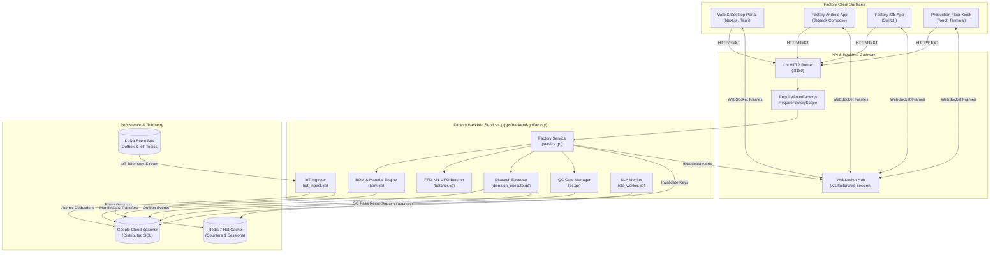
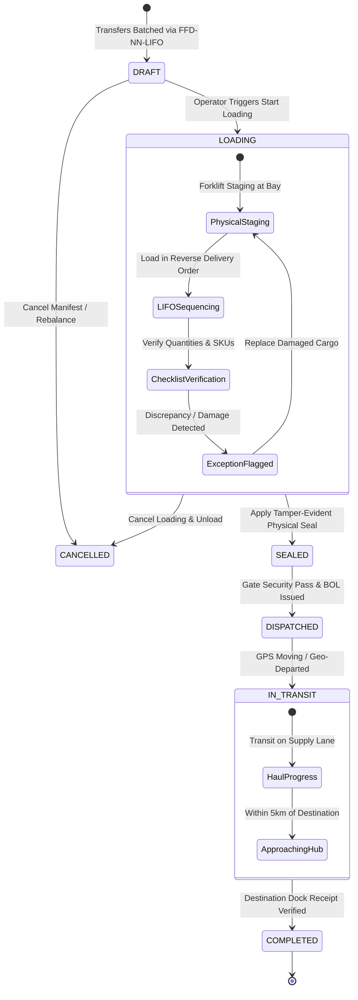

# Role 3 Specification: Factory Operations & Inter-Tier Production

> **Role Number**: Role 3 of 9  
> **Persona ID**: `ROLE_FACTORY` / `ROLE_FACTORY_ADMIN`  
> **Operational Overview**: [`docs/roles/DETAILED_ROLE_OPERATIONS_AND_FEATURES.md`](file:///Users/shakhzod/Desktop/pegasusx/docs/roles/DETAILED_ROLE_OPERATIONS_AND_FEATURES.md)  
> **PegasusX Enterprise Architecture — Tier 1 Production & Supply Transfer Backbone**  
> *Document Version: 3.0.0 — Canonical Implementation Ledger*  

---

## 1. Executive Role Summary

The **Factory Role (`RoleFactory` / `RoleFactoryAdmin`)** represents the Tier-1 production nodes within the PegasusX logistics ecosystem. Factories serve as the primary manufacturing, batching, and high-volume dispatch hubs that supply regional distribution warehouses.

The Factory surface encompasses:
1. **Production Scheduling & Batching**: High-throughput manufacturing run scheduling and SKU production coordination.
2. **BOM & Raw Material Consumption**: Automated Bill of Materials explosion, inventory verification, and atomic raw material deductions.
3. **Warehouse Supply Requests & Quality Control (QC)**: Ingestion of regional warehouse inventory replenishments, fulfillment options calculation, mandatory physical inspection gates, and quality sign-off.
4. **Inter-Tier Transfer Manifest Generation**: Multi-warehouse dispatch optimization utilizing First-Fit Decreasing bin packing, Nearest-Neighbor routing from origin, and Last-In-First-Out (LIFO) loading sequences.
5. **IoT Machine Ingestion & Fleet Telemetry**: Real-time Kafka telemetry streams for production machine statuses (running, idle, jammed) and live GPS fleet tracking of transfer trucks.
6. **Multi-Platform Consistency**: Synchronous operational capability across Desktop/Web Portal (`apps/factory-portal`), Native Android (`apps/factory-app-android`), and Native iOS (`apps/factory-app-ios`).

---

## 2. Multi-Platform Screen & View Catalog

### Summary Metrics
| Platform | Environment | Framework / Runtime | Total Screens / Views |
| :--- | :--- | :--- | :--- |
| **Web & Desktop** | `apps/factory-portal` | Next.js 15 (App Router) + Tauri 2.0 | **22** |
| **Native Android** | `apps/factory-app-android` | Kotlin + Jetpack Compose + Hilt | **22** |
| **Native iOS** | `apps/factory-app-ios` | Swift 6 + SwiftUI + Combine | **24** |
| **Total Surfaces** | **3 Platforms** | **Unified Cross-Platform Core** | **68 Views** |

---

### Detailed Surface Inventory

#### A. Web & Desktop Portal (`apps/factory-portal`)
All routes run under Next.js App Router with responsive layouts and Tauri desktop integration:

| # | Route / Path | File Location | Operational Purpose |
| :--- | :--- | :--- | :--- |
| 1 | `/` | `apps/factory-portal/app/page.tsx` | Main Factory Dashboard, executive KPIs, active runs, quick dispatch actions |
| 2 | `/analytics` | `apps/factory-portal/app/analytics/page.tsx` | Production throughput, transfer lead-times, and demand forecast charts |
| 3 | `/auth/login` | `apps/factory-portal/app/auth/login/page.tsx` | Phone/password and OTP authentication with tenant node resolution |
| 4 | `/auth/register` | `apps/factory-portal/app/auth/register/page.tsx` | Factory entity onboarding and initial administrative credentials |
| 5 | `/fleet` | `apps/factory-portal/app/fleet/page.tsx` | Inter-tier transport fleet status, driver assignments, and live map view |
| 6 | `/insights` | `apps/factory-portal/app/insights/page.tsx` | Replenishment demand predictions, inventory depletion warnings |
| 7 | `/loading-bay` | `apps/factory-portal/app/loading-bay/page.tsx` | Active transfer staging, vehicle loading bay control, and dispatch triggers |
| 8 | `/manifests` | `apps/factory-portal/app/manifests/page.tsx` | Transfer manifests list, filtering by state (`DRAFT`, `LOADING`, `SEALED`, `DISPATCHED`) |
| 9 | `/manifests/[id]` | `apps/factory-portal/app/manifests/[id]/page.tsx` | Manifest details, itemized transfer roster, seal verification, and dispatch execution |
| 10 | `/manifest-exceptions` | `apps/factory-portal/app/manifest-exceptions/page.tsx` | Transfer discrepancies, damaged cargo reporting, and exception resolutions |
| 11 | `/notifications` | `apps/factory-portal/app/notifications/page.tsx` | Factory notification center, SLA breach alerts, and machine telemetry warnings |
| 12 | `/payload` | `apps/factory-portal/app/payload/page.tsx` | Loading bay overview, payload assignment, and dock staging |
| 13 | `/payload-override` | `apps/factory-portal/app/payload-override/page.tsx` | Live load rebalancing between trucks and manual capacity override form |
| 14 | `/settings/location` | `apps/factory-portal/app/settings/location/page.tsx` | Factory GPS geocoding, dock location coordinates, and geofence configuration |
| 15 | `/setup/factory` | `apps/factory-portal/app/setup/factory/page.tsx` | New factory setup wizard, operational hours, and staging capacity definitions |
| 16 | `/staff` | `apps/factory-portal/app/staff/page.tsx` | Factory operators, dock workers, and QC inspectors roster |
| 17 | `/staff/[id]` | `apps/factory-portal/app/staff/[id]/page.tsx` | Staff member profile, role assignments, and password reset panel |
| 18 | `/supply-requests` | `apps/factory-portal/app/supply-requests/page.tsx` | Warehouse supply requests Kanban board, fulfillment planner, and QC inspections |
| 19 | `/transfers` | `apps/factory-portal/app/transfers/page.tsx` | Inter-facility transfer directory, state filters, and pagination |
| 20 | `/transfers/create` | `apps/factory-portal/app/transfers/create/page.tsx` | Manual inter-facility transfer creation, destination warehouse selection |
| 21 | `/transfers/[id]` | `apps/factory-portal/app/transfers/[id]/page.tsx` | Transfer order line details, driver assignment, and stage transitions |
| 22 | Kiosk View | `apps/factory-portal/src/components/production/ProductionKioskScreen.tsx` | Floor production kiosk for shop-floor operators and real-time machine tracking |

---

#### B. Native Android (`apps/factory-app-android`)
Engineered with 100% Jetpack Compose, Coroutines, StateFlow, Room local queue, and Hilt DI:

| # | Screen Component | File Location | Operational Purpose |
| :--- | :--- | :--- | :--- |
| 1 | `LoginScreen` | `ui/screens/auth/LoginScreen.kt` | Mobile authentication, credential validation, and device token registration |
| 2 | `DashboardScreen` | `ui/screens/dashboard/DashboardScreen.kt` | Mobile KPI dashboard, live throughput indicators, and quick action launchpads |
| 3 | `AnalyticsScreen` | `ui/screens/analytics/AnalyticsScreen.kt` | Mobile production analytics, batch cycle times, and dispatch volumes |
| 4 | `SupplyRequestsScreen` | `ui/screens/supply/SupplyRequestsScreen.kt` | Supply requests board, filter by state, QC pass/fail inspection modal |
| 5 | `TransferListScreen` | `ui/screens/transfer/TransferListScreen.kt` | Mobile transfers list, search by transfer ID, status indicators |
| 6 | `CreateTransferScreen` | `ui/screens/transfer/CreateTransferScreen.kt` | Transfer draft creation, destination warehouse picker, product quantity setup |
| 7 | `TransferDetailScreen` | `ui/screens/transfer/TransferDetailScreen.kt` | Line item breakdown, driver assignment selector, transfer state stepper |
| 8 | `LoadingBayScreen` | `ui/screens/loadingbay/LoadingBayScreen.kt` | Loading bay staging, bay allocation, and dispatch execution trigger |
| 9 | `ManifestListScreen` | `ui/screens/manifest/ManifestListScreen.kt` | Manifest list, truck plate indicators, capacity fill gauges |
| 10 | `ManifestDetailScreen` | `ui/screens/manifest/ManifestDetailScreen.kt` | Manifest inspection, start loading, seal confirmation, and dispatch |
| 11 | `ManifestExceptionsScreen` | `ui/screens/exceptions/ManifestExceptionsScreen.kt` | Exception reporting, damaged unit capture, and resolution workflows |
| 12 | `FleetScreen` | `ui/screens/fleet/FleetScreen.kt` | Fleet tracker, driver directory, vehicle volume specs, and GPS pins |
| 13 | `StaffScreen` | `ui/screens/staff/StaffScreen.kt` | Factory operator roster, active shift indicators |
| 14 | `StaffDetailScreen` | `ui/screens/staff/StaffDetailScreen.kt` | Staff details, role changes, and PIN/password reset |
| 15 | `InsightsScreen` | `ui/screens/insights/InsightsScreen.kt` | Mobile warehouse stockout predictions and replenishment recommendations |
| 16 | `PayloadOverrideScreen` | `ui/screens/override/PayloadOverrideScreen.kt` | Manual manifest load adjustment, transfer rebalancing across trucks |
| 17 | `PayloadLoadScreen` | `ui/screens/payload/PayloadLoadScreen.kt` | Staging verification, barcode scanning, and truck loading confirmation |
| 18 | `ProductionKioskScreen` | `ui/screens/production/ProductionKioskScreen.kt` | Touch-first production station kiosk with machine jam alerts and unit tickers |
| 19 | `LocationSetupScreen` | `ui/screens/setup/LocationSetupScreen.kt` | Factory geofence setup, Mapbox dock pin positioning |
| 20 | `NotificationInboxScreen` | `ui/screens/notifications/NotificationInboxScreen.kt` | Push notification inbox, mark-as-read, urgent SLA breach alerts |
| 21 | `FactoryMoreHubScreen` | `ui/screens/more/FactoryMoreHubScreen.kt` | Application settings, language selection (EN/RU/UZ), offline queue monitor |
| 22 | `MainActivity` | `MainActivity.kt` | Top-level Activity container, Jetpack Navigation host, biometric prompt |

---

#### C. Native iOS (`apps/factory-app-ios`)
Built with Swift 6, SwiftUI, Swift Concurrency (`async/await`), and NWPathMonitor:

| # | View Component | File Location | Operational Purpose |
| :--- | :--- | :--- | :--- |
| 1 | `LoginView` | `Views/LoginView.swift` | Secure iOS login, SMS OTP / password auth, Keychain token storage |
| 2 | `DashboardView` | `Views/Dashboard/DashboardView.swift` | iPad/iPhone adaptive dashboard, real-time KPI tiles, workflow cards |
| 3 | `AnalyticsView` | `Views/Analytics/AnalyticsView.swift` | Native Swift Charts production forecast and transfer fulfillment metrics |
| 4 | `SupplyRequestsHubView` | `Views/SupplyRequests/SupplyRequestsHubView.swift` | Supply requests board with swipe actions for accept/transition |
| 5 | `SupplyRequestDetailView` | `Views/SupplyRequests/SupplyRequestDetailView.swift` | Request itemization, fulfill options calculation, and mandatory QC inspection view |
| 6 | `TransferListView` | `Views/Transfers/TransferListView.swift` | Inter-facility transfers list with state filtering and search |
| 7 | `CreateTransferView` | `Views/Transfers/CreateTransferView.swift` | Transfer creation sheet, destination picker, volume estimation |
| 8 | `TransferDetailView` | `Views/Transfers/TransferDetailView.swift` | Transfer inspection, assigned driver badge, transition action buttons |
| 9 | `LoadingBayView` | `Views/LoadingBay/LoadingBayView.swift` | Loading bay dock manager, vehicle staging, and bulk dispatch trigger |
| 10 | `ManifestsView` | `Views/Manifests/ManifestsView.swift` | Truck manifest directory, capacity utilization bars, driver tags |
| 11 | `ManifestDetailView` | `Views/Manifests/ManifestDetailView.swift` | Manifest load inspection, start-loading trigger, seal verification, dispatch |
| 12 | `ManifestExceptionsView` | `Views/Exceptions/ManifestExceptionsView.swift` | Exception resolution hub, damaged cargo flags, and audit notes |
| 13 | `FleetView` | `Views/Fleet/FleetView.swift` | Fleet roster, vehicle volume capacities, live driver map pins |
| 14 | `StaffView` | `Views/Staff/StaffView.swift` | Factory personnel directory, operator status |
| 15 | `StaffDetailView` | `Views/Staff/StaffDetailView.swift` | Operator profile, permission grants, password change sheet |
| 16 | `InsightsView` | `Views/Insights/InsightsView.swift` | Stockout risk radar, inventory rebalance suggestions |
| 17 | `PayloadOverrideView` | `Views/PayloadOverride/PayloadOverrideView.swift` | Rebalance transfer sheet, truck capacity redistribution |
| 18 | `ProductionKioskScreen` | `Views/Production/ProductionKioskScreen.swift` | Dedicated iPad production floor view, batch count incrementer, IoT alerts |
| 19 | `LocationSettingsView` | `Views/Location/LocationSettingsView.swift` | Factory location settings, lat/lng coordinates editor |
| 20 | `LocationSetupView` | `Views/Setup/LocationSetupView.swift` | Factory initial setup geocode picker with forward/reverse autocomplete |
| 21 | `NotificationInboxView` | `Views/Notifications/NotificationInboxView.swift` | In-app notification center with real-time WebSocket badging |
| 22 | `FactoryMoreHubView` | `Views/FactoryMoreHubView.swift` | More options, client policy banner, cache controls, language switcher |
| 23 | `MainTabView` | `Views/MainTabView.swift` | Adaptive bottom tab bar (iPhone) / NavigationSplitView sidebar (iPad) |
| 24 | `RootView` | `RootView.swift` | Top-level auth gate, session reconciler, offline status banner |

---

## 3. Exhaustive Backend API Specification

The Factory backend is implemented in Go (`apps/backend-go/factory` and `apps/backend-go/factoryroutes`). All operational routes enforce strict tenant scoping via `auth.RequireFactoryScope` and role authorization via `auth.RequireRole`.

### Summary Count: **51 Endpoints**

| # | HTTP Method | URL Path | Handler Function | Required Auth Roles | Tenant / Scope Parameter |
| :--- | :--- | :--- | :--- | :--- | :--- |
| 1 | `POST` | `/v1/auth/factory/login` | `HandleFactoryLogin` | Public | Phone / Password in body |
| 2 | `POST` | `/v1/auth/factory/register` | `HandleFactoryRegister` | Public | Organization / Factory body |
| 3 | `POST` | `/v1/auth/factory/refresh` | `HandleFactoryRefresh` | Public (Refresh JWT) | Refresh token payload |
| 4 | `POST` | `/v1/factory/setup` | `HandleFactorySetup` | `RoleFactory`, `RoleAdmin` | Header / Claim Factory Node |
| 5 | `GET` | `/v1/factory/ws-session` | `WSSessionHandler` | `RoleFactory`, `RoleFactoryAdmin`, `RoleAdmin` | JWT claims `home_node_id` |
| 6 | `GET` | `/v1/factory/manifests` | `HandleManifests` | `RoleFactory`, `RoleFactoryAdmin`, `RoleAdmin`, `RolePayload` | `X-Factory-Id` / Token Scope |
| 7 | `GET` | `/v1/factory/manifests/{manifestID}` | `HandleManifestDetail` | `RoleFactory`, `RoleFactoryAdmin`, `RoleAdmin`, `RolePayload` | `manifestID` + Token Scope |
| 8 | `POST` | `/v1/factory/manifests/{manifestID}/start-loading` | `HandleManifestStartLoading` | `RoleFactory`, `RoleFactoryAdmin`, `RoleAdmin`, `RolePayload` | `manifestID` + Token Scope |
| 9 | `POST` | `/v1/factory/manifests/{manifestID}/seal` | `HandleManifestSeal` | `RoleFactory`, `RoleFactoryAdmin`, `RoleAdmin`, `RolePayload` | `manifestID` + Token Scope |
| 10 | `GET` | `/v1/factory/manifest-exceptions` | `HandleManifestExceptions` | `RoleFactory`, `RoleFactoryAdmin`, `RoleAdmin`, `RolePayload` | Token Scope (`factory_id`) |
| 11 | `POST` | `/v1/factories` | `HandleCreateFactory` | `RoleFactory`, `RoleFactoryAdmin`, `RoleAdmin` | Token Scope (`factory_id`) |
| 12 | `GET` | `/v1/factories/{factoryId}` | `HandleGetFactory` | `RoleFactory`, `RoleFactoryAdmin`, `RoleAdmin` | `factoryId` path parameter |
| 13 | `PUT` | `/v1/factories/{factoryId}` | `HandleUpdateFactory` | `RoleFactory`, `RoleFactoryAdmin`, `RoleAdmin` | `factoryId` path parameter |
| 14 | `GET` | `/v1/factories` | `HandleListFactories` | `RoleFactory`, `RoleFactoryAdmin`, `RoleAdmin` | Token Scope (`factory_id`) |
| 15 | `GET` | `/v1/factory/analytics/overview` | `HandleAnalyticsOverview` | `RoleFactory`, `RoleFactoryAdmin`, `RoleAdmin` | Token Scope (`factory_id`) |
| 16 | `GET` | `/v1/factory/dashboard` | `HandleDashboard` | `RoleFactory`, `RoleFactoryAdmin`, `RoleAdmin` | Token Scope (`factory_id`) |
| 17 | `GET` | `/v1/factory/profile` | `HandleProfile` | `RoleFactory`, `RoleFactoryAdmin`, `RoleAdmin` | Token Scope (`factory_id`) |
| 18 | `GET` | `/v1/factory/ops/location` | `HandleOpsLocation` | `RoleFactory`, `RoleFactoryAdmin`, `RoleAdmin` | Token Scope (`factory_id`) |
| 19 | `PATCH` | `/v1/factory/ops/location` | `HandleOpsLocation` | `RoleFactory`, `RoleFactoryAdmin`, `RoleAdmin` | Token Scope (`factory_id`) |
| 20 | `GET` | `/v1/factory/transfers` | `HandleTransfers` | `RoleFactory`, `RoleFactoryAdmin`, `RoleAdmin` | Query (`states`, `limit`) |
| 21 | `POST` | `/v1/factory/transfers/create` | `HandleTransfers` | `RoleFactory`, `RoleFactoryAdmin`, `RoleAdmin` | Body (`destination_warehouse`) |
| 22 | `GET` | `/v1/factory/transfers/{transferID}` | `HandleTransferByID` | `RoleFactory`, `RoleFactoryAdmin`, `RoleAdmin` | `transferID` path parameter |
| 23 | `POST` | `/v1/factory/transfers/{transferID}/transition` | `HandleTransferTransition` | `RoleFactory`, `RoleFactoryAdmin`, `RoleAdmin` | `transferID` + target state |
| 24 | `POST` | `/v1/factory/transfers/{transferID}/driver` | `HandleTransferDriverUpdate` | `RoleFactory`, `RoleFactoryAdmin`, `RoleAdmin` | `transferID` + driver body |
| 25 | `GET` | `/v1/factory/fleet` | `HandleFleet` | `RoleFactory`, `RoleFactoryAdmin`, `RoleAdmin` | Token Scope (`factory_id`) |
| 26 | `GET` | `/v1/factory/fleet/live-map` | `HandleFactoryFleetLiveMap` | `RoleFactory`, `RoleFactoryAdmin`, `RoleAdmin` | Token Scope (`factory_id`) |
| 27 | `GET` | `/v1/factory/fleet/drivers` | `HandleFleetDrivers` | `RoleFactory`, `RoleFactoryAdmin`, `RoleAdmin` | Token Scope (`factory_id`) |
| 28 | `GET` | `/v1/factory/fleet/vehicles` | `HandleFleetVehicles` | `RoleFactory`, `RoleFactoryAdmin`, `RoleAdmin` | Token Scope (`factory_id`) |
| 29 | `POST` | `/v1/factory/manifests/{manifestID}/dispatch` | `HandleManifestDispatch` | `RoleFactory`, `RoleFactoryAdmin`, `RoleAdmin` | `manifestID` path parameter |
| 30 | `POST` | `/v1/factory/manifests/{manifestID}/complete` | `HandleManifestComplete` | `RoleFactory`, `RoleFactoryAdmin`, `RoleAdmin` | `manifestID` path parameter |
| 31 | `POST` | `/v1/factory/manifests/rebalance` | `HandleManifestRebalance` | `RoleFactory`, `RoleFactoryAdmin`, `RoleAdmin` | Body (`source`, `target`, `tr`) |
| 32 | `POST` | `/v1/factory/manifests/cancel-transfer` | `HandleManifestCancelTransfer` | `RoleFactory`, `RoleFactoryAdmin`, `RoleAdmin` | Body (`manifest_id`, `tr_id`) |
| 33 | `POST` | `/v1/factory/manifests/cancel` | `HandleManifestCancel` | `RoleFactory`, `RoleFactoryAdmin`, `RoleAdmin` | Body (`manifest_id`, `reason`) |
| 34 | `POST` | `/v1/factory/manifest-exceptions/{exceptionID}/resolve` | `HandleResolveManifestException` | `RoleFactory`, `RoleFactoryAdmin`, `RoleAdmin` | `exceptionID` path parameter |
| 35 | `GET` | `/v1/factory/staff` | `HandleStaff` | `RoleFactory`, `RoleFactoryAdmin`, `RoleAdmin` | Token Scope (`factory_id`) |
| 36 | `POST` | `/v1/factory/staff` | `HandleStaff` | `RoleFactory`, `RoleFactoryAdmin`, `RoleAdmin` | Body (new operator specs) |
| 37 | `GET` | `/v1/factory/staff/{staffID}` | `HandleStaffDetail` | `RoleFactory`, `RoleFactoryAdmin`, `RoleAdmin` | `staffID` path parameter |
| 38 | `POST` | `/v1/factory/staff/{staffID}/set-password` | `HandleStaffSetPassword` | `RoleFactory`, `RoleFactoryAdmin`, `RoleAdmin` | `staffID` + password body |
| 39 | `POST` | `/v1/factory/dispatch` | `HandleDispatch` | `RoleFactory`, `RoleFactoryAdmin`, `RoleAdmin` | Solved route / transfer IDs |
| 40 | `GET` | `/v1/factory/supply-requests` | `HandleSupplyRequests` | `RoleFactory`, `RoleFactoryAdmin`, `RoleAdmin` | Query (`state`) + Token Scope |
| 41 | `GET` | `/v1/factory/sla-board` | `HandleSLABoard` | `RoleFactory`, `RoleFactoryAdmin`, `RoleAdmin` | Token Scope (`factory_id`) |
| 42 | `GET` | `/v1/factory/supply-requests/{id}/fulfill-options` | `HandleSupplyRequestFulfillOptions` | `RoleFactory`, `RoleFactoryAdmin`, `RoleAdmin` | `id` (Supply Request ID) |
| 43 | `GET` | `/v1/factory/supply-requests/{id}/qc` | `HandleSupplyRequestQC` | `RoleFactory`, `RoleFactoryAdmin`, `RoleAdmin` | `id` (Supply Request ID) |
| 44 | `POST` | `/v1/factory/supply-requests/{id}/qc` | `HandleSupplyRequestQC` | `RoleFactory`, `RoleFactoryAdmin`, `RoleAdmin` | `id` + QC Result (`PASS`/`FAIL`) |
| 45 | `POST` | `/v1/factory/supply-requests/{requestID}/accept` | `HandleAcceptSupplyRequest` | `RoleFactory`, `RoleFactoryAdmin`, `RoleAdmin` | `requestID` path parameter |
| 46 | `PATCH` | `/v1/factory/supply-requests/{id}` | `HandleSupplyRequestTransition` | `RoleFactory`, `RoleFactoryAdmin`, `RoleAdmin` | `id` + target stage |
| 47 | `GET` | `/v1/warehouse/replenishment/insights` | `HandleReplenishmentInsights` | `RoleFactory`, `RoleFactoryAdmin`, `RoleAdmin` | Token Scope (`factory_id`) |
| 48 | `POST` | `/v1/supplier/planning/network-mode` | `HandleNetworkMode` | `RoleFactoryAdmin`, `RoleSupplierAdmin` | Scope `supplier_id` |
| 49 | `POST` | `/v1/supplier/planning/pull-matrix` | `HandlePullMatrix` | `RoleFactoryAdmin`, `RoleSupplierAdmin` | Scope `supplier_id` |
| 50 | `POST` | `/v1/supplier/planning/predictive-push` | `HandlePredictivePush` | `RoleFactoryAdmin`, `RoleSupplierAdmin` | Scope `supplier_id` |
| 51 | `POST` | `/v1/supplier/planning/kill-switch` | `HandleKillSwitch` | `RoleFactoryAdmin`, `RoleSupplierAdmin` | Scope `supplier_id` |

---

## 4. WebSocket & Real-Time Event System

Factory clients maintain continuous bidirectional or streaming connections through `/v1/factory/ws-session`.

### A. Subscribed Events (Received by Portal, Android, iOS)
1. `FACTORY_SUPPLY_REQUEST_UPDATE`: Emitted whenever a warehouse replenishment request changes state (`REQUESTED`, `ACCEPTED`, `IN_PRODUCTION`, `QC_PASSED`, `ALLOCATED`).
2. `FACTORY_TRANSFER_UPDATE`: Emitted when an internal transfer is created, approved, staged, or loaded.
3. `FACTORY_MANIFEST_UPDATE`: Broadcast when a transport manifest is created, locked, sealed, or dispatched.
4. `FACTORY_OUTBOX_FAILED`: Raised when transactional outbox relay encounters transient Spanner/Kafka serialization failures.
5. `MACHINE_JAM`: Urgent shop-floor alarm triggered by `IotIngestor` when machine status reports `JAMMED`.
6. `FACTORY_SLA_BREACH`: Broadcast by `sla_worker.go` when a high-priority replenishment request exceeds the agreed SLA fulfillment threshold.
7. `SUPPLY_TRANSFER_APPROACHING`: Emitted by driver telematics when a factory transfer truck is within 5 km of the destination warehouse.
8. `SUPPLY_TRANSFER_ARRIVED`: Driver dock arrival confirmation triggering automated inbound intake.

### B. Emitted Events (Broadcast to Hubs & Kafka Outbox)
1. `FACTORY_CREATED`: New manufacturing plant registered on the network.
2. `FACTORY_LOCATION_UPDATED`: Dock GPS coordinates or geofence boundary adjusted.
3. `FACTORY_STAFF_CREATED`: New factory worker or QC operator registered.
4. `FACTORY_STAFF_PASSWORD_SET`: Security credential rotation committed.
5. `TRANSFER_CREATED`: Inter-facility transfer batch initiated.
6. `SUPPLY_REQUEST_ACCEPTED`: Factory acknowledges regional demand commitment.
7. `SUPPLY_REQUEST_UPDATE`: Production state progression broadcast to suppliers and warehouses.
8. `FACTORY_SUPPLY_REQUEST_UPDATE`: QC inspection pass/fail recording and notes attachment.
9. `MANIFEST_DRAFT_CREATED`: Optimization solver commits a new multi-transfer truck manifest.
10. `MANIFEST_LOADING_STARTED`: Dock crew begins physical pallet staging.
11. `MANIFEST_SEALED`: High-security physical seal applied and verified against checklist.
12. `MANIFEST_DISPATCHED`: Transport truck departs gate; electronic bill of lading issued.
13. `MANIFEST_COMPLETED`: Cargo successfully received and unloaded at destination warehouse.
14. `MANIFEST_REBALANCED`: Load transferred between trucks due to weight/volume override.
15. `MANIFEST_CANCELLED`: Manifest annulled prior to departure; transfers returned to unassigned pool.
16. `MANIFEST_ORDER_EXCEPTION`: Damaged or missing cargo flagged during loading.
17. `MANIFEST_EXCEPTION_RESOLVED`: Exception resolved via supervisor approval or item write-off.
18. `MANIFEST_DLQ_ESCALATION`: Unresolved discrepancy escalated to executive logistics desk.
19. `EventMaterialShortage`: Published to Kafka outbox (`AggregateWarehouse`) when BOM validation detects insufficient raw material stock.

---

## 5. Spanner Database Entities & Persistence

The Factory service interacts directly with Google Cloud Spanner via read-write transactions and mutations.

### Touched Tables Catalog: **25 Entities**
| Table Name | Primary Key | Key Columns Utilized | Operational Purpose |
| :--- | :--- | :--- | :--- |
| `Factories` | `FactoryId` | `Name, Lat, Lng, ContactPhone, Address, Status, CreatedAt, UpdatedAt` | Factory master records, dock location, contact metadata |
| `FactoryInternalTransfers` | `TransferId` | `SupplierId, FactoryId, WarehouseId, SupplyRequestId, State, VolumeVU, DriverId, VehicleId, CreatedAt, UpdatedAt` | Internal inter-facility transfer requests and status tracking |
| `FactoryTruckManifests` | `ManifestId` | `FactoryId, DriverId, VehicleId, State, TransferCount, TotalVolumeVU, SealedAt, DispatchedAt, CreatedAt, UpdatedAt` | Inter-tier transport manifests and loading status |
| `ManifestExceptions` | `ExceptionId` | `ManifestId, TransferId, OrderId, Reason, Metadata, Status, AttemptCount, EscalatedAt, CreatedAt` | Shortage, damage, or discrepancy logging on manifests |
| `WarehouseSupplyRequests` | `RequestId, FactoryId` | `WarehouseId, SupplierId, State, SlaDueAt, Priority, Notes, CreatedAt, UpdatedAt` | Replenishment demand orders initiated by warehouses |
| `WarehouseSupplyRequestItems` | `RequestId, ProductId` | `RequestedQuantity, FulfilledQuantity, UnitPriceMinor` | SKU quantities requested per supply order |
| `FactorySupplyRequestQC` | `RequestId` | `Result, Notes, InspectedBy, InspectedAt` | Formal QC inspection certificate (`PASS`/`FAIL`) |
| `BillOfMaterials` | `FinishedProductId, RawMaterialId` | `QuantityRequired, ScrapFactor, UnitOfMeasure` | Production recipe for converting raw stock to finished SKUs |
| `FactoryRawInventory` | `FactoryId, RawMaterialId` | `QuantityOnHand, ReservedQuantity, ReorderPoint, UpdatedAt` | On-site raw material inventory with atomic deductions |
| `FactoryMachineTelemetry` | `MachineId, RecordedAt` | `UnitsProduced, Status, CreatedAt` | Aggregated shop-floor machine production counts |
| `FactorySLAEvents` | `EventId` | `RequestId, FactoryId, BreachType, DurationSeconds, CreatedAt` | Historical audit ledger of factory fulfillment SLA metrics |
| `NetworkOptimizationMode` | `SupplierId` | `Mode, DampeningFactor, UpdatedAt` | Inter-facility network mode (`BALANCED`, `COST_MIN`, `SPEED`) |
| `ReplenishmentLocks` | `LockKey` | `LockedBy, ExpiresAt, CreatedAt` | Distributed mutex preventing duplicate batch generation |
| `PullMatrixRuns` | `RunId` | `SupplierId, MatrixData, TotalVU, CreatedAt` | Algorithmic execution runs for pull replenishment |
| `SupplyLanes` | `LaneId` | `OriginFactoryId, DestWarehouseId, DistanceKm, TransitHours` | Calibrated logistics transit routes and baseline travel times |
| `DemandForecastBaseline` | `ProductId, RegionCode` | `ForecastedUnits, ConfidenceScore, HorizonDays` | Predictive push demand baselines from ML models |
| `SupplierInventoryV2` | `SupplierId, ProductId` | `QuantityOnHand, AllocatedQuantity, AvailableQuantity` | Finished goods inventory ready for transfer staging |
| `SupplierUsers` | `UserId` | `Phone, PasswordHash, Role, FactoryId, Status` | Factory personnel, manager, and operator accounts |
| `Drivers` | `DriverId` | `FullName, Phone, CurrentLat, CurrentLng, AvailabilityStatus` | Drivers qualified for inter-tier heavy transport |
| `Vehicles` | `VehicleId` | `PlateNumber, MaxVolumeVU, IsReefer, Status` | Long-haul transport trucks, volume capacity limits |
| `Warehouses` | `WarehouseId` | `Name, Lat, Lng, PrimaryFactoryId, CoLocateWithFactoryId` | Destination regional warehouse fulfillment nodes |
| `Orders` | `OrderId` | `SupplierId, RetailerId, Status, VolumeVU` | Retailer orders driving aggregated factory supply demands |
| `Products` | `ProductId` | `Name, UnitVolumeVU, HandlingClass, RequiresColdChain` | Product master attributes, dimensions, handling classes |
| `ReplenishmentInsights` | `InsightId` | `WarehouseId, ProductId, Urgency, RecommendedVU` | AI-generated recommendations for proactive replenishment |
| `OutboxEvents` | `EventId` | `AggregateType, AggregateId, Topic, Payload, CreatedAt` | Transactional outbox for guaranteed event delivery |

---

## 6. Comprehensive Feature-by-Feature Breakdown

### 1. Production Batching & First-Fit Decreasing Optimization
- **Bin Packing Algorithm (`PackFFDNNLIFO`)**: Factory transfers are consolidated using First-Fit Decreasing (FFD) volume optimization.
- **Route Sequencing**: Nearest-Neighbor (NN) sorting calculates the shortest road network sequence starting from the factory origin coordinates `(originLat, originLng)`.
- **Loading Sequences (LIFO)**: To prevent unloading deadlocks, the cargo is sequenced in reverse delivery order:
  - Sequence 1: "Load first — Back of Truck" (last warehouse on route).
  - Sequence `N`: "Load last — By the Doors" (first warehouse on route).
- **Oversized & Leftover Handling**: Any transfer exceeding single-truck capacity or remaining unassigned after fleet exhaustion is preserved in the unassigned pool with zero phantom transfer generation.

### 2. BOM Explosion & Atomic Raw Material Consumption
- **Recipe Explosion (`ValidateBOMAndStartProduction`)**: Upon approving a supply request, the system joins `WarehouseSupplyRequestItems` with `BillOfMaterials` to calculate exact raw material requirements:
  $$\text{Required}(R) = \sum \Big(\text{RequestedQuantity}(P) \times \text{QuantityRequired}(P, R)\Big)$$
- **Atomic Deduction & Concurrency**: Checks `FactoryRawInventory.QuantityOnHand`. If all components exist, deductions are buffered within the same Spanner Read-Write transaction, transitioning the request to `IN_PRODUCTION`.
- **Shortage Circuit-Breaker**: If any raw component is insufficient:
  - Material deductions are discarded.
  - State transitions to `EXCEPTION_MATERIAL`.
  - Transactional event `EventMaterialShortage` is emitted to the Kafka outbox to alert upstream suppliers.

### 3. Factory Quality Control (QC) Gates
- **Mandatory Physical QC Gate (`HandleSupplyRequestQC`)**: Prior to allocating transfers or allowing manifest creation, production batches must undergo inspection.
- **Enforced Pass Condition (`requireSupplyQCPass`)**: The system rejects any attempt to transition supply requests to `ALLOCATED` or `READY_FOR_DISPATCH` without a verified `PASS` record in `FactorySupplyRequestQC`.
- **Audit Trails**: Inspecting operator ID, RFC3339 timestamp, inspector notes, and pass/fail statuses are permanently recorded in Spanner.

### 4. Transfer Manifest Generation & Dispatch Execution
- **Multi-Route Generation (`HandleDispatch`)**: Supports both automated OR-Tools solver assignment (`dispatch.OptimizerSourceExternal`) and pure local deterministic fallback (`dispatch.OptimizerSourcePureLocal`).
- **Capacity Integrity Checks**: Verifies vehicle volume limit `EffectiveMaxVU`. If loaded volume exceeds capacity without explicit override, dispatch halts with `capacity_exceeded` status.
- **Plan Fingerprinting**: Every dispatch plan generates a SHA-256 fingerprint from sorted transfer IDs, vehicle IDs, and driver IDs to eliminate stale dispatch race conditions.

### 5. IoT Sensor Integration & Machine Telemetry
- **High-Throughput Ingestor (`IotIngestor`)**: Processes machine telemetry events (`pegasusx.iot.telemetry`) from production machines.
- **Dual-Tier Buffering**:
  1. *Hot Cache Tier*: Redis `IncrBy` aggregates units produced in memory for instant sub-second dashboard rendering.
  2. *Cold Persistence Tier*: Flushes batched mutations every 2 seconds or 1,000 events into `FactoryMachineTelemetry` in Spanner.
- **Emergency Jam Broadcasting**: If a machine reports status `JAMMED`, the ingestor instantly broadcasts a `MACHINE_JAM` WebSocket frame to all connected factory terminals and shop-floor kiosks.

---

## 7. Architecture & Workflow Diagrams

### High-Level Factory Architecture & Data Flow

---

### Factory Transfer Manifest State Machine

---

## 8. Foundry Surface Capabilities & Pre-Execution Edge-Case Guards

1. **1-Click Forward/Backward Lot Genealogy & Recall Blast Radius (`POST /v1/foundry/ontology/lot-recall`)**:
   - Every `RawMaterialLot`, `WorkOrder`, `FinishedLot`, and `SSCCPallet` is indexed in `OntologyObjects` and linked via `OntologyGraphEdges`.
   - If an in-line quality sensor or lab test flags a defect in a `RawMaterialLot`, `TriggerContaminatedLotRecall` executes a multi-hop breadth-first traversal across `WorkOrder -> FinishedLot -> SSCCPallet -> Tote -> Order -> SoliqFactura`, propagates `MARKING:LOT_RECALL_QUARANTINE` to every downstream node, quarantines warehouse pallets/totes, pushes in-transit driver drop blocks, and identifies delivered retailer orders for reverse pickup.
