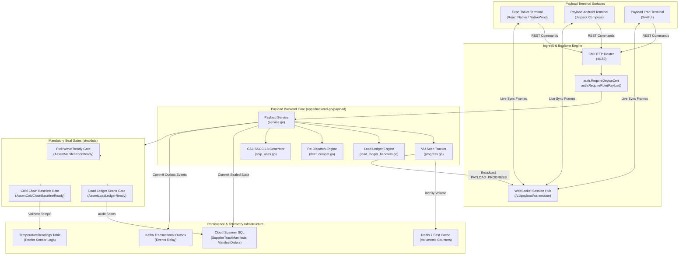

# Role 6: Payload & Loading Bay Operations Specification
**PegasusX Enterprise Architecture — Tier 2 Warehouse Loading, Staging & Seal Integrity**
*Document Version: 2.4.0 — Canonical Implementation Ledger*

---

## 1. Executive Role Summary

The **Payload Role (`RolePayload`)** governs physical loading dock verification, truck cargo compartment staging, volume/weight capacity enforcement, cold-chain temperature baseline validation, and tamper-evident seal tracking across regional distribution centers and factory loading bays.

The Payload surface encompasses:
1. **Physical Dock Staging & Loading Workflow**: Real-time assignment of outbound delivery orders into assigned vehicles, pallet positioning, and dock door operations.
2. **Itemized Load Ledger & Barcode Scanning**: Scan-by-scan reconciliation of picked stock against shipping orders with variance tracking and supervisor sign-offs.
3. **Capacity Compliance & Volume Packing**: Enforcement of vehicle volumetric capacity (`MaxVolumeVU`), over-capacity blocking (`target_manifest_capacity_exceeded`), and dynamic load rebalancing.
4. **Cold-Chain & Reefer Telemetry Enforcement**: Hardware sensor integration ensuring that refrigerated trucks maintain certified temperature baselines (`TemperatureReadings`) before seal locks can be engaged.
5. **Tamper-Evident Physical & Digital Seal Verification**: High-security locking mechanism transitioning manifests to `SEALED`, generating GS1-128 shipping container labels (SSCC-18), and initiating the Edge 33 post-seal double-check challenge countdown.
6. **Cross-Platform Dedicated Terminal**: Native performance across Expo Mobile/Web Terminal (`apps/payload-terminal`), Native Android (`apps/payload-app-android`), and Native iOS (`apps/payload-app-ios`).

---

## 2. Multi-Platform Screen & View Catalog

### Summary Metrics
| Platform | Environment | Framework / Runtime | Total Screens / Views |
| :--- | :--- | :--- | :--- |
| **Mobile / Web Terminal** | `apps/payload-terminal` | Expo SDK 52 + React Native + NativeWind | **16** |
| **Native Android** | `apps/payload-app-android` | Kotlin + Jetpack Compose + Room + Hilt | **13** |
| **Native iOS** | `apps/payload-app-ios` | Swift 6 + SwiftUI + SQLite + Combine | **12** |
| **Total Surfaces** | **3 Platforms** | **Touch-First Terminal System** | **41 Views** |

---

### Detailed Surface Inventory

#### A. Mobile / Web Terminal (`apps/payload-terminal`)
Designed for ruggedized warehouse tablets and dockside mobile terminals (locked to landscape orientation):

| # | Screen / View Component | File Location | Operational Purpose |
| :--- | :--- | :--- | :--- |
| 1 | `LoginScreen` | `components/LoginScreen.tsx` | Payloader PIN/phone authentication, SMS OTP verification, and client policy display |
| 2 | `AuthLoadingScreen` | `components/AuthLoadingScreen.tsx` | Session hydration, offline queue restoration, and device certificate validation |
| 3 | `TruckSelectionScreen` | `components/TruckSelectionScreen.tsx` | Dock bay vehicle selector, truck status cards (`DRAFT`, `LOADING`, `SEALED`), and worker greeting |
| 4 | `ManifestWorkspaceScreen` | `components/ManifestWorkspaceScreen.tsx` | Master dock workspace coordinating sidebar, checklist, load ledger, and action bars |
| 5 | `PostSealCountdownScreen` | `components/PostSealCountdownScreen.tsx` | **Edge 33 Double-Check**: 5-second countdown allowing dock crews to report missing items before final dispatch |
| 6 | `AllSealedScreen` | `components/AllSealedScreen.tsx` | Shift completion screen displaying all sealed trucks with dispatch verification codes |
| 7 | `InboundReturnsPanel` | `inboundReturns.tsx` | Inbound intake gate, RMA return parcel scanning, and disposition triage |
| 8 | `ManifestDetailPane` | `components/ManifestDetailPane.tsx` | Active manifest metrics, volumetric fill gauge, start-loading and seal manifest action controls |
| 9 | `OrderChecklist` | `components/OrderChecklist.tsx` | Order picking checklist, item verification, and carton count audits |
| 10 | `ExceptionsSheet` | `components/ExceptionsSheet.tsx` | Modal sliding sheet for logging damaged cartons, missing items, or loading exceptions |
| 11 | `NotificationsSheet` | `components/NotificationsSheet.tsx` | Real-time push alerts, re-dispatch requests, and manifest updates |
| 12 | `TruckSidebar` | `components/TruckSidebar.tsx` | Collapsible staging rail displaying vehicle list, capacity % meters, and sealed indicators |
| 13 | `RecommendationCard` | `components/RecommendationCard.tsx` | Algorithmic re-dispatch card suggesting order moves to prevent truck volume overflow |
| 14 | `ManifestKpiGrid` | `components/ManifestKpiGrid.tsx` | Volumetric utilization (VU), carton counts, stop counts, and estimated route duration |
| 15 | `PayloadStatePanel` | `components/PayloadStatePanel.tsx` | Dock state banner reflecting `DRAFT`, `LOADING`, or `SEALED` manifest progression |
| 16 | `ConnectionStrip` | `components/ConnectionStrip.tsx` | Network health indicator, offline queue backlog depth, and pending sync actions |

---

#### B. Native Android (`apps/payload-app-android`)
Constructed with Jetpack Compose, OkHttp WebSocket client, and SQLite-backed offline action queue:

| # | Screen / Component | File Location | Operational Purpose |
| :--- | :--- | :--- | :--- |
| 1 | `LoginScreen` | `ui/auth/LoginScreen.kt` | Mobile login with PIN pad and device credential authentication |
| 2 | `HomeScreen` | `ui/home/HomeScreen.kt` | Primary loading bay cockpit displaying vehicle selection and staging panels |
| 3 | `InboundReturnsScreen` | `ui/inbound/InboundReturnsScreen.kt` | Reverse logistics intake, returns barcode scanning, and quarantine allocation |
| 4 | `PayloadRoot` | `ui/PayloadRoot.kt` | Root layout hosting scaffold, connection banners, and navigation routes |
| 5 | `ExceptionsSheet` | `ui/home/ExceptionsSheet.kt` | Bottom sheet for reporting damaged packages, short shipments, and discrepancies |
| 6 | `NotificationsSheet` | `ui/home/NotificationsSheet.kt` | Real-time notification drawer with unread counters and sync events |
| 7 | `ManifestBoard` | `ui/home/ManifestBoard.kt` | Visual Kanban board grouping trucks into Draft, Loading, and Sealed columns |
| 8 | `ManifestDetailPane` | `ui/home/ManifestDetailPane.kt` | Manifest loading controls, cold-chain status check, and seal trigger |
| 9 | `OrderChecklist` | `ui/home/OrderChecklist.kt` | Itemized order lines checklist with touch verification and scan tallying |
| 10 | `TruckSidebar` | `ui/home/TruckSidebar.kt` | Mobile vehicle roster with quick switching between loading bays |
| 11 | `RecommendationCard` | `ui/home/RecommendationCard.kt` | Automated overflow recommendation banner for load reassignment |
| 12 | `InboundReturnsList` | `ui/inbound/InboundReturnsList.kt` | Parcel return roster with condition badges (salvage, restock, destroy) |
| 13 | `MainActivity` | `MainActivity.kt` | Android Activity lifecycle host, intent dispatching, NFC/scanner integration |

---

#### C. Native iOS (`apps/payload-app-ios`)
Built with SwiftUI, Swift Concurrency, and native URLSession WebSocket:

| # | View Component | File Location | Operational Purpose |
| :--- | :--- | :--- | :--- |
| 1 | `LoginView` | `Views/LoginView.swift` | iPad touch-optimized PIN login with Keychain token caching |
| 2 | `HomeView` | `Views/HomeView.swift` | iPad split-view dock bay console with truck selector and load staging |
| 3 | `InboundReturnsView` | `Views/InboundReturnsView.swift` | Inbound returns gate with barcode camera scanning and disposition actions |
| 4 | `RootView` | `Views/RootView.swift` | Root flow coordinator handling auth, offline mode, and error banners |
| 5 | `ExceptionsSheet` | `Views/ExceptionsSheet.swift` | Slide-over drawer for logging loading damage and cargo exceptions |
| 6 | `NotificationsSheet` | `Views/NotificationsSheet.swift` | Native push notification sheet with live WebSocket synchronization |
| 7 | `ManifestDetailPane` | `Views/ManifestDetailPane.swift` | Load ledger verification pane with sliding seal gesture |
| 8 | `OrderChecklistSection` | `Views/OrderChecklistSection.swift` | Order verification checklist with haptic feedback on completion |
| 9 | `TruckSidebar` | `Views/TruckSidebar.swift` | Left-hand navigation rail displaying staged vehicles and volume percentages |
| 10 | `RecommendationRow` | `Views/RecommendationRow.swift` | Optimization card showing re-dispatch suggestions for unbalanced trucks |
| 11 | `InboundReturnsList` | `Views/InboundReturnsList.swift` | Detailed return shipment list with SKU condition triage |
| 12 | `PayloadStateView` | `Views/PayloadStateView.swift` | Visual status badge for cold-chain readiness and manifest lifecycle |

---

## 3. Exhaustive Backend API Specification

The Payload backend is implemented in Go (`apps/backend-go/payload` and `apps/backend-go/payloaderoutes`). All operational endpoints require `auth.RolePayload` or `auth.RoleAdmin` and enforce tenant scoping.

### Summary Count: **42 Endpoints**

| # | HTTP Method | URL Path | Handler Function | Required Auth Roles | Tenant / Scope Parameter |
| :--- | :--- | :--- | :--- | :--- | :--- |
| 1 | `POST` | `/v1/auth/payloader/login` | `HandlePayloaderLogin` | Public (`RequireDeviceCert`) | Phone / PIN / Device Cert in body |
| 2 | `POST` | `/v1/auth/payloader/refresh` | `HandlePayloaderRefresh` | Public (Refresh JWT) | Refresh token payload |
| 3 | `GET` | `/v1/payload/ws-session` | `WSSessionHandler` | `RolePayload`, `RoleAdmin` | Scoped Supplier / Warehouse claim |
| 4 | `GET` | `/v1/payloader/trucks` | `HandleTrucks` | `RolePayload`, `RoleAdmin` | Tenant Scope (`supplier_id`) |
| 5 | `GET` | `/v1/payloader/orders` | `HandleOrders` | `RolePayload`, `RoleAdmin` | Query (`vehicle_id`, `state`) |
| 6 | `GET` | `/v1/payloader/manifests` | `HandleManifestsList` | `RolePayload`, `RoleAdmin` | Query (`state`, `truck_id`) |
| 7 | `POST` | `/v1/payloader/manifests/seal-all` | `HandleSealAll` | `RolePayload`, `RoleAdmin` | Tenant Scope (`supplier_id`) |
| 8 | `POST` | `/v1/payloader/manifests/seal-completed` | `HandleSealCompletedManifests` | `RolePayload`, `RoleAdmin` | Body (`manifest_ids`) |
| 9 | `GET` | `/v1/payloader/manifests/{manifestID}` | `HandleManifestDetail` | `RolePayload`, `RoleAdmin` | `manifestID` path parameter |
| 10 | `POST` | `/v1/payloader/manifests/{manifestID}/start-loading` | `HandleStartLoading` | `RolePayload`, `RoleAdmin` | `manifestID` path parameter |
| 11 | `POST` | `/v1/payloader/manifests/{manifestID}/inject-order` | `HandleInjectOrder` | `RolePayload`, `RoleAdmin` | `manifestID` + `order_id` in body |
| 12 | `GET` | `/v1/payloader/manifests/{manifestID}/load-ledger` | `HandleLoadLedger` | `RolePayload`, `RoleAdmin` | `manifestID` path parameter |
| 13 | `POST` | `/v1/payloader/manifests/{manifestID}/load-ledger/scan` | `HandleLoadLedgerScan` | `RolePayload`, `RoleAdmin` | `manifestID` + item/quantity body |
| 14 | `POST` | `/v1/payloader/manifests/{manifestID}/load-ledger/variance/approve` | `HandleLoadLedgerVarianceApprove` | `RolePayload`, `RoleAdmin` | `manifestID` + supervisor sign-off |
| 15 | `POST` | `/v1/payloader/manifests/{manifestID}/seal` | `HandleSealManifest` | `RolePayload`, `RoleAdmin` | `manifestID` path parameter |
| 16 | `GET` | `/v1/payloader/manifests/{manifestID}/ship-units` | `HandleListShipUnits` | `RolePayload`, `RoleAdmin` | `manifestID` path parameter |
| 17 | `POST` | `/v1/payloader/manifests/{manifestID}/labels` | `HandleManifestLabels` | `RolePayload`, `RoleAdmin` | `manifestID` (SSCC-18 generation) |
| 18 | `POST` | `/v1/payload/manifest-exception` | `HandleManifestException` | `RolePayload`, `RoleAdmin` | `manifest_id`, `order_id`, `reason` |
| 19 | `POST` | `/v1/payload/exceptions/damaged` | `HandleManifestException` | `RolePayload`, `RoleAdmin` | Damaged carton exception payload |
| 20 | `GET` | `/v1/payloader/manifest-exceptions` | `HandleManifestExceptions` | `RolePayload`, `RoleAdmin` | Query (`limit`, `offset`) |
| 21 | `POST` | `/v1/payloader/recommend-reassign` | `HandleRecommendReassign` | `RolePayload`, `RoleAdmin` | Body (`order_id`) |
| 22 | `POST` | `/v1/payloader/reassign-order` | `HandleApplyReassign` | `RolePayload`, `RoleAdmin` | `order_id`, `to_driver_id`, `reason` |
| 23 | `POST` | `/v1/payload/seal` | `HandleSeal` | `RolePayload`, `RoleAdmin` | `order_id`, `terminal_id` in body |
| 24 | `GET` | `/v1/payload/capacity/{vehicleID}` | `HandleVehicleCapacity` | `RolePayload`, `RoleAdmin` | Returns 410 Gone (honest unwired) |
| 25 | `GET` | `/v1/payload/manifests/{manifestID}/ship-units` | `HandleListShipUnits` | `RolePayload`, `RoleAdmin` | `manifestID` path parameter |
| 26 | `POST` | `/v1/payload/manifests/{manifestID}/labels` | `HandleManifestLabels` | `RolePayload`, `RoleAdmin` | `manifestID` path parameter |
| 27 | `POST` | `/v1/fleet/reassign` | `HandleFleetReassign` | `RolePayload`, `RoleAdmin` | Body (`order_ids`, `new_route_id`) |
| 28 | `GET` | `/v1/supplier/manifests` | `HandleManifestsList` | `RolePayload`, `RoleAdmin` | Query (`state`) |
| 29 | `GET` | `/v1/supplier/manifests/{id}` | `HandleManifestDetail` | `RolePayload`, `RoleAdmin` | `id` path parameter |
| 30 | `POST` | `/v1/supplier/manifests/seal-all` | `HandleSealAll` | `RolePayload`, `RoleAdmin` | Tenant Scope (`supplier_id`) |
| 31 | `POST` | `/v1/supplier/manifests/{id}/start-loading` | `HandleStartLoading` | `RolePayload`, `RoleAdmin` | `id` path parameter |
| 32 | `POST` | `/v1/supplier/manifests/{id}/inject-order` | `HandleInjectOrder` | `RolePayload`, `RoleAdmin` | `id` + `order_id` in body |
| 33 | `POST` | `/v1/supplier/manifests/{id}/seal` | `HandleSealManifest` | `RolePayload`, `RoleAdmin` | `id` path parameter |
| 34 | `GET` | `/v1/supplier/manifests/{id}/ship-units` | `HandleListShipUnits` | `RolePayload`, `RoleAdmin` | `id` path parameter |
| 35 | `POST` | `/v1/supplier/manifests/{id}/labels` | `HandleManifestLabels` | `RolePayload`, `RoleAdmin` | `id` path parameter |
| 36 | `POST` | `/v1/delivery/exception-report` | `OrderService.HandleExceptionReport` | `RolePayload`, `RoleAdmin` | Discrepancy report payload |
| 37 | `POST` | `/v1/delivery/missing-items` | `OrderService.HandleMissingItems` | `RolePayload`, `RoleAdmin` | **Edge 33 Countdown** missing report |
| 38 | `POST` | `/v1/payload/scan` | `HandleScanProgress` | `RolePayload`, `RoleAdmin` | `manifest_id`, `item_id`, `item_vu` |
| 39 | `GET` | `/v1/catalog/barcode/{ean}` | `CatalogService.HandleBarcodeLookup` | `RolePayload`, `RoleAdmin` | Barcode EAN path parameter |
| 40 | `GET` | `/v1/returns/inbound` | `ReturnsService.HandleGetInboundReturns` | `RolePayload`, `RoleAdmin` | Query (`physical_status`, `limit`) |
| 41 | `POST` | `/v1/returns/inbound/scan` | `ReturnsService.HandleScanInboundReturn` | `RolePayload`, `RoleAdmin` | Barcode scan verification payload |
| 42 | `POST` | `/v1/returns/inbound/confirm` | `ReturnsService.HandleConfirmInboundReturn` | `RolePayload`, `RoleAdmin` | Inbound intake confirmation body |

---

## 4. WebSocket & Real-Time Event System

The Payload Terminal operates with live bidirectional state synchronization over `/v1/payload/ws-session`.

### A. Subscribed Events (Received by Terminal & Mobile Apps)
1. `PAYLOAD_SYNC`: Real-time signal that triggers background slice invalidation and refetches the active manifest data.
2. `PAYLOAD_PROGRESS`: Hot volume unit progress updates broadcast on every barcode scan.
3. `PAYLOAD_READY_TO_SEAL`: Alert triggered when all orders on a manifest have been verified and loaded.
4. `PAYLOAD_SEALED`: Broadcast when the tamper-evident physical seal has been recorded in Spanner.
5. `MANIFEST_DRAFT_CREATED`: Notice that a new delivery wave has been dispatched to the loading bay.
6. `MANIFEST_LOADING_STARTED`: Notifies terminal of active dock bay operations.
7. `MANIFEST_ORDER_INJECTED`: Fired when a dispatcher injects an urgent order into the current truck.
8. `MANIFEST_ORDER_EXCEPTION`: Alert raised when a package is flagged damaged or missing.
9. `MANIFEST_EXCEPTION_RESOLVED`: Notifies dock crew that a variance was approved.
10. `MANIFEST_REBALANCED`: Real-time notification when orders are moved across vehicles.
11. `MANIFEST_SEALED`: Master seal confirmation locking truck cargo.
12. `MANIFEST_DISPATCHED`: Notification that vehicle has exited the facility gate.
13. `ORDER_REASSIGNED`: Indicates dynamic reassignment of an individual order to another truck.

### B. Emitted Events (Broadcast to Hubs & Kafka Outbox)
1. `PAYLOAD_SYNC`: Emitted to `payload:{supplier_id}` channel on manifest mutations.
2. `PAYLOAD_PROGRESS`: Emitted to `warehouse:{warehouse_id}` room to drive dock monitoring screens.
3. `MANIFEST_LOADING_STARTED`: Initiates the physical loading cycle.
4. `MANIFEST_ORDER_INJECTED`: Outbox event committed upon order insertion.
5. `MANIFEST_ORDER_EXCEPTION`: Logged upon loading discrepancies or damage.
6. `MANIFEST_DLQ_ESCALATION`: Triggered after repeated failed attempts to resolve an exception.
7. `MANIFEST_REBALANCED`: Emitted when orders are shifted to prevent capacity breach.
8. `MANIFEST_SEALED`: High-priority outbox event emitted to Kafka topic `pegasusx.main` (`AggregateManifest`).
9. `ORDER_REASSIGNED`: Broadcast to drivers and warehouses indicating route adjustment.

---

## 5. Spanner Database Entities & Persistence

The Payload service executes all mutations through transactional read-write transactions in Cloud Spanner.

### Touched Tables Catalog: **14 Entities**
| Table Name | Primary Key | Key Columns Utilized | Operational Purpose |
| :--- | :--- | :--- | :--- |
| `SupplierTruckManifests` | `ManifestId` | `SupplierId, DriverId, TruckId, State, LoadingStartedAt, SealedAt, WarehouseId, CreatedAt, UpdatedAt` | Central manifest records, vehicle links, and seal timestamps |
| `ManifestOrders` | `ManifestId, OrderId` | `State, Sequence, UpdatedAt` | Orders assigned to manifest with physical loading state |
| `ManifestExceptions` | `ExceptionId` | `SupplierId, ManifestId, OrderId, Reason, Metadata, AttemptCount, EscalatedAt, CreatedAt` | Exceptions logged during dock loading and verification |
| `Orders` | `OrderId` | `SupplierId, RetailerId, Status, ManifestId, RouteId, VehicleId, LineItemsJson, TotalVU` | Order entities with live manifest linkages |
| `ManifestShipUnits` | `ShipUnitId` | `ManifestId, OrderId, Sequence, Sscc18, PackagingType, CreatedAt` | Pallets, cartons, and totes with GS1 SSCC-18 serials |
| `ManifestLoadLines` | `ManifestId, OrderId, LineItemId` | `SkuId, RequiredQty, ScannedQty, Status, UpdatedAt` | Itemized load ledger tracking required vs scanned units |
| `TemperatureReadings` | `ReadingId` | `ManifestId, SensorId, RecordedAt, TempC, Lat, Lng, CreatedAt` | Cold-chain reefer sensor readings before sealing |
| `SupplierProfiles` | `SupplierId` | `Gs1CompanyPrefix, Gln` | Barcode encoding prefixes for SSCC-18 and GLN tags |
| `Retailers` | `RetailerId` | `Name, Gln, Lat, Lng` | Destination retailer addresses for shipping unit labels |
| `Vehicles` | `VehicleId` | `PlateNumber, MaxVolumeVU, IsReefer, Status` | Truck registry, volume capacity boundaries |
| `Drivers` | `DriverId` | `FullName, Phone, AvailabilityStatus` | Drivers assigned to manifests |
| `SupplierUsers` | `UserId` | `Phone, PinHash, Role, Status` | Payloader dock worker authentication and permissions |
| `Products` | `ProductId` | `HandlingClass, RequiresColdChain, StorageTempMinC, StorageTempMaxC` | Cold-chain product criteria for seal gating |
| `OutboxEvents` | `EventId` | `AggregateType, AggregateId, Topic, Payload, CreatedAt` | Transactional outbox for guaranteed event publishing |

---

## 6. Comprehensive Feature-by-Feature Breakdown

### 1. Real-Time Cold-Chain & Reefer Telemetry Monitoring
- **Physical Seal Gate (`AssertColdChainBaselineReady`)**: Prior to sealing any manifest, the backend queries the feature flag `WMS_COLD_CHAIN_ENABLED`. If active and the manifest contains products where `RequiresColdChain = true` or storage temperature bounds are defined:
  - The system queries `TemperatureReadings WHERE ManifestId = @mid`.
  - At least one live reading must exist in the database.
  - If missing, the seal operation aborts with error `cold_chain_baseline_required`.
- **Excursion Auto-Raise (`order/condition_system.go`)**: If sensor readings exceed the certified temperature band (e.g., outside $2.00^\circ\text{C} - 8.00^\circ\text{C}$), a `wms-cold-chain` condition is automatically attached to affected orders, preventing dispatch until inspected.

### 2. Cargo Compartment Temperature Sensors
- **Sensor Integration**: Compartment IoT sensors report periodically via `TemperatureReadings` (`ReadingId`, `ManifestId`, `SensorId`, `TempC`, `RecordedAt`).
- **Telemetry Indexing**: Indexed via `Idx_TemperatureReadings_ByManifest` (`ManifestId`, `RecordedAt DESC`) allowing sub-millisecond retrieval of the most recent compartment temperature reading.

### 3. Weight & Volume Capacity Compliance
- **Volume Metering (`UsedVolumeVU` vs `MaxVolumeVU`)**: Every manifest calculates total volume units ($\text{VU}$) in real-time.
- **Strict Capacity Blocking**:
  - When injecting an order (`HandleInjectOrder`) or reassigning an order (`HandleApplyReassign`):
    $$\text{ProjectedVU} = \text{CurrentVU} + \text{OrderVU}$$
  - If $\text{ProjectedVU} > \text{MaxVolumeVU}$, the transaction rejects the addition with HTTP 409 Conflict:
    `target_manifest_capacity_exceeded`
- **Volumetric Scanning (`HandleScanProgress`)**: As cartons are scanned onto the truck, atomic counters in Redis (`{manifest:%s}:loaded_vu`) track real-time compartment fill percentage.

### 4. Tamper-Evident Physical & Digital Seal Tracking
- **Physical Seal Execution (`HandleSealManifest`)**: Once all items are verified, the operator slides the seal control. This performs atomic updates:
  1. Sets `SupplierTruckManifests.State = 'SEALED'`.
  2. Sets `SupplierTruckManifests.SealedAt = spanner.CommitTimestamp`.
  3. Transitions all constituent `ManifestOrders` to `SEALED` and updates parent `Orders.Status = 'DISPATCHED'`.
  4. Generates GS1-128 shipping labels with serialized SSCC-18 barcodes (`HandleManifestLabels`).
  5. Commits `MANIFEST_SEALED` event to the transactional outbox.
- **Edge 33 Post-Seal Double-Check Countdown**:
  - After sealing, `PostSealCountdownScreen` engages a mandatory 5-second challenge countdown.
  - If the dock crew spots forgotten items, they can tap **"Report Missing Items"**, invoking `POST /v1/delivery/missing-items` with idempotent tracking to flag the manifest for inspection before the truck departs.

### 5. Load Override & Dynamic Re-Dispatch Workflows
- **Manual Load Reassignment (`HandleApplyReassign`)**: If an order cannot physically fit or must be diverted:
  - Payloaders can reassign an order to an adjacent truck at the bay (`to_driver_id` / `to_manifest_id`).
  - Strict validation ensures the source manifest is unsealed and the destination manifest has sufficient capacity.
- **Automated Recommendations (`HandleRecommendReassign`)**: Algorithmic evaluation analyzes available bay trucks and recommends the ideal target vehicle based on route alignment and remaining volume capacity.

---

## 7. Architecture & Workflow Diagrams

### High-Level Payload Architecture & Data Flow

---

### Payload Seal Verification & Dispatch State Machine

```mermaid
stateDiagram-v2
    [*] --> DRAFT : Route Dispatched to Bay
    DRAFT --> LOADING : Start Loading Triggered

    state LOADING {
        [*] --> StagingOrders : Pull Picked Cartons to Dock
        StagingOrders --> LoadLedgerScan : Scan Barcodes per Item
        LoadLedgerScan --> CheckVolumetricVU : Verify VU Under MaxVolumeVU
        CheckVolumetricVU --> VarianceReview : Quantity Shortfall Detected
        VarianceReview --> LoadLedgerScan : Supervisor Approves Variance
    }

    state SEAL_GATING {
        [*] --> CheckPickCompletion : Verify All Pick Waves Done
        CheckPickCompletion --> CheckLoadLedgerComplete : Verify All Required Units Scanned
        CheckLoadLedgerComplete --> CheckColdChain : Verify Chilled SKUs Present?
        
        state CheckColdChain {
            [*] --> InspectSensorReadings
            InspectSensorReadings --> SensorPass : Reading in [StorageTempMinC, StorageTempMaxC]
            InspectSensorReadings --> SensorMissing : No Readings in TemperatureReadings
            SensorMissing --> ExcursionAlert : Abort Seal (cold_chain_baseline_required)
        }
    }

    LOADING --> SEAL_GATING : Operator Slides to Seal
    SEAL_GATING --> SEALED : All Physical Gates Satisfied
    
    state SEALED {
        [*] --> LockCargoCompartment : Apply High-Security Bolt Seal
        LockCargoCompartment --> GenerateSSCC18 : Print GS1 Shipping Container Labels
        GenerateSSCC18 --> Edge33Countdown : Start 5-Second Double-Check Timer
        
        state Edge33Countdown {
            [*] --> Ticking : 5s, 4s, 3s, 2s, 1s
            Ticking --> MissingItemsFlagged : Operator Reports Missing Items
            MissingItemsFlagged --> ReopenInspection : Abort Seal & Recheck
            Ticking --> TimerExpired : No Missing Items Reported
        }
    }

    SEALED --> DISPATCHED : Timer Expired & Gate Pass Issued
    DISPATCHED --> [*]
```

---

## 8. Foundry Surface Capabilities & Pre-Execution Edge-Case Guards

1. **3D Volumetric Crushability & Returnable Transport Item (`RTI`) Space Guard (`POST /v1/foundry/guards/load-3d-rti`)**:
   - Enforces vertical stack crushability limits (`MaxStackCrushKg`) so heavy beverage cases are never stacked on top of fragile cartons (`ErrCrushabilityViolation`).
   - Accounts for reverse-logistics volumetric space of picked-up empty crates, kegs, and pallets alongside outbound cargo volume, and updates `ReturnableContainerLedger` deposit balances.
2. **Pre-Loading Vehicle DVIR & Predictive Reefer Clearance (`GET /v1/foundry/fleet/vehicles/{vehicleID}/dispatch-check`)**:
   - Blocks Payloader bay loading and manifest sealing if the vehicle is in `RED_TAG_QUARANTINE` (`OUT_OF_SERVICE`) or on `PRE_FAILURE_MAINTENANCE_HOLD`.
