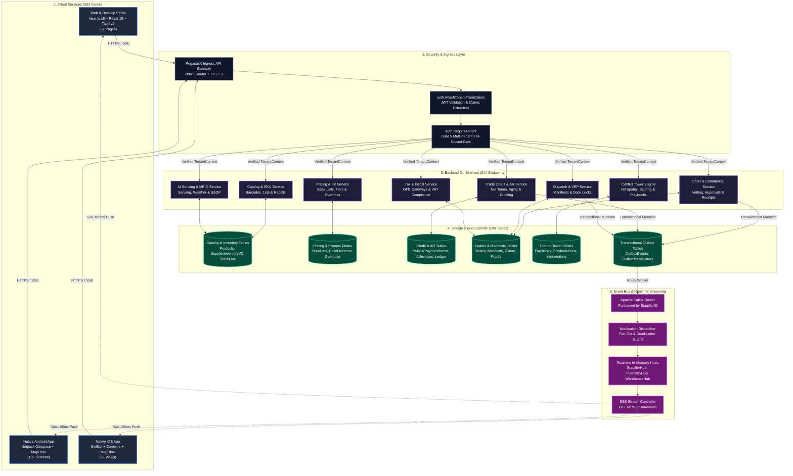

# Role 2 Specification: Supplier & Brand Executive Operations

> **Role Number**: Role 2 of 9  
> **Persona ID**: `ROLE_SUPPLIER`  
> **Document ID:** `ROLE-SPEC-SUPPLIER-001`  
> **Standard:** Enterprise Architectural Audit Standard (Gate 5 / GS-I Compliant)  
> **Classification:** Confidential / System Architecture Specification  
> **Version:** 2.0.0 (Uncapped Policy & Dynamic Waterfall Master)  
> **Target Path:** [`docs/roles/ROLE_SUPPLIER.md`](file:///Users/shakhzod/Desktop/pegasusx/docs/roles/ROLE_SUPPLIER.md)  
> **Operational Overview**: [`docs/roles/DETAILED_ROLE_OPERATIONS_AND_FEATURES.md`](file:///Users/shakhzod/Desktop/pegasusx/docs/roles/DETAILED_ROLE_OPERATIONS_AND_FEATURES.md)  
**Last Synchronized:** 2026-10-26  

---

## Table of Contents
1. [Executive Summary & Role Definition](#1-executive-summary--role-definition)
2. [Client Surface Matrix & Exhaustive Screen Census](#2-client-surface-matrix--exhaustive-screen-census)
   - [2.1 Web & Desktop Portal (`apps/supplier-portal`)](#21-web--desktop-portal-appssupplier-portal)
   - [2.2 Native Android Surface (`apps/supplier-app-android`)](#22-native-android-surface-appssupplier-app-android)
   - [2.3 Native iOS Surface (`apps/supplier-app-ios`)](#23-native-ios-surface-appssupplier-app-ios)
   - [2.4 Cross-Surface Metric Synthesis](#24-cross-surface-metric-synthesis)
3. [Backend Go API Surface & Endpoint Census](#3-backend-go-api-surface--endpoint-census)
   - [3.1 API Endpoint Taxonomy & Inventory (244 Endpoints)](#31-api-endpoint-taxonomy--inventory-244-endpoints)
   - [3.2 Domain-Specific Endpoint Breakdown](#32-domain-specific-endpoint-breakdown)
4. [Real-Time Event Hub & Streaming Architecture](#4-real-time-event-hub--streaming-architecture)
   - [4.1 Channel Topology & Connection Lifecycle](#41-channel-topology--connection-lifecycle)
   - [4.2 Comprehensive Event Catalog (`@pegasusx/ws-refresh-contract`)](#42-comprehensive-event-catalog-pegasusxws-refresh-contract)
   - [4.3 Selective Dirty Slice Invalidation Model](#43-selective-dirty-slice-invalidation-model)
5. [Database Schema & Spanner Entities Catalog](#5-database-schema--spanner-entities-catalog)
   - [5.1 Entity Inventory (109 Touched Tables)](#51-entity-inventory-109-touched-tables)
   - [5.2 Key Entity Schemas & Relational Integrity](#52-key-entity-schemas--relational-integrity)
6. [Comprehensive Feature-by-Feature Deep Dive](#6-comprehensive-feature-by-feature-deep-dive)
   - [6.1 Executive Control Tower & Rollup KPIs](#61-executive-control-tower--rollup-kpis)
   - [6.2 Product Catalog & Batch/SKU Management](#62-product-catalog--batchsku-management)
   - [6.3 Wholesale Pricing & Tier Overrides](#63-wholesale-pricing--tier-overrides)
   - [6.4 Customer (Retailer) Credit & AR Aging / Dunning](#64-customer-retailer-credit--ar-aging--dunning)
   - [6.5 Promotional Campaigns & Discounts](#65-promotional-campaigns--discounts)
   - [6.6 Fleet Real-Time Map & Driver Tracking (MapLibre GL)](#66-fleet-real-time-map--driver-tracking-maplibre-gl)
   - [6.7 AI Demand Forecasting & Recommendations Acceptance](#67-ai-demand-forecasting--recommendations-acceptance)
   - [6.8 Smart Dispatch Planning & Route Review](#68-smart-dispatch-planning--route-review)
   - [6.9 Order Approvals, Cancellations & Exceptions Handling](#69-order-approvals-cancellations--exceptions-handling)
   - [6.10 Tax Regimes & Fiscal Config](#610-tax-regimes--fiscal-config)
   - [6.11 Multi-Tenant Supplier Scoping (GS-I / Gate 5 TenantContext Isolation)](#611-multi-tenant-supplier-scoping-gs-i--gate-5-tenantcontext-isolation)
7. [System Architecture & Data Flow Diagram](#7-system-architecture--data-flow-diagram)
8. [Supplier Commercial & Order Approval Lifecycle State Machine](#8-supplier-commercial--order-approval-lifecycle-state-machine)
9. [Enterprise Reliability, Offline Recovery & Failure Modes](#9-enterprise-reliability-offline-recovery--failure-modes)

---

## 1. Executive Summary & Role Definition

In the PegasusX multi-tier supply chain and distribution operating system, the **Supplier** is the primary commercial anchor, wholesale distributor, and inventory authority. The Supplier manages upstream procurement from factories, regional distribution centers (warehouses), proprietary and contract fleets, commercial trade terms, wholesale credit lines for retail store networks, and real-time order execution.

### Architectural Positioning
```
+-----------------------------------------------------------------------------+
|                           PegasusX Ecosystem                                |
|                                                                             |
|  [Factory / Producer] <---> [ SUPPLIER (Distributor) ] <---> [Retailer Stores]|
|           ^                         |                                ^      |
|           |                         v                                |      |
|           +-----------------> [ Warehouse / WMS ] --------------------+      |
|                                     |                                        |
|                                     v                                        |
|                             [ Driver / Fleet ]                               |
+-----------------------------------------------------------------------------+
```

### Core Responsibilities of the Supplier Role
1. **Catalog & Inventory Ownership:** Authoritative ownership of commercial SKU definitions, barcode registries (EAN-13, UPC), bulk catalog onboarding, warehouse-level batch/lot reservations, quarantine controls, and national recall campaigns.
2. **Wholesale Pricing & Discount Governance:** Base price lists with scheduled validity windows, volumetric minimum quantity tiers (MinQty), retailer-specific margin overrides, and cross-currency multi-scale conversion via FX rate oracles.
3. **Credit Underwriting & AR Lifecycle:** Managing B2B trade credit programs, establishing per-retailer payment terms (Net-7, Net-14, Net-30), monitoring real-time Accounts Receivable (AR) aging buckets, orchestrating automated multi-channel dunning, and enforcing programmatic delinquency locks.
4. **Logistics & Fleet Command:** Intelligent multi-stop dispatch planning (Vehicle Routing Problem - VRP), warehouse dispatch lock coordination, digital twin fleet tracking via MapLibre GL with dead-reckoning marker interpolation, and cross-docking visibility.
5. **Exception Adjudication & Commercial Approvals:** First-party vetting of retail orders, processing closed-shop waivers (Payment Bypass), approving early driver route completion, and adjudicating post-delivery OS&D (Over, Short, Damaged) claims into credit notes and chargebacks.
6. **AI Demand Sensing & MEIO Planning:** Ingesting external POS flywheel telemetry, calendar payday cycles, and localized weather signals to generate multi-echelon inventory optimization (MEIO) proposals and scenario sandboxes.
7. **Fiscal Compliance:** Integration with national tax regimes (e.g., State Tax Committee of Uzbekistan 12% VAT), issuing cryptographically signed electronic fiscal receipts, and real-time reconciliation.

---

## 2. Client Surface Matrix & Exhaustive Screen Census

The Supplier experience is provided natively across three production client runtimes: **Web & Desktop (Next.js 15 + React 19 + Tauri v2)**, **Native Android (Kotlin + Jetpack Compose)**, and **Native iOS (Swift + SwiftUI)**. Every platform implements a zero-trust multi-tenant state model with offline cache reconciliation.

### 2.1 Web & Desktop Portal (`apps/supplier-portal`)
Built on Next.js 15 App Router, React 19, HeroUI, Tailwind CSS, Recharts, and MapLibre GL. Encapsulated as cross-platform native binaries for macOS and Windows via Tauri v2 (`src-tauri`).
- **Total Web Pages Count:** `82`

| # | Route Relative Path | Function & Primary Subsystems |
|---|---------------------|-------------------------------|
| 1 | `app/page.tsx` | Root portal redirect & landing router |
| 2 | `app/auth/login/page.tsx` | Password & OTP authentication, session cookie establishment |
| 3 | `app/auth/register/page.tsx` | Supplier company registration & credential onboarding |
| 4 | `app/auth/oidc/callback/page.tsx` | Single Sign-On (SSO) OAuth2/OIDC token exchange callback |
| 5 | `app/setup/business/page.tsx` | Initial business entity legal identity & tax setup wizard |
| 6 | `app/setup/billing/page.tsx` | Stripe / GlobalPay merchant billing configuration |
| 7 | `app/(portal)/page.tsx` | Portal workspace home dispatcher |
| 8 | `app/(portal)/dashboard/page.tsx` | Executive Dashboard: Rollup KPIs, revenue velocity, order pulse |
| 9 | `app/(portal)/control-tower/page.tsx` | Executive Control Tower: Hexagonal H3 live map, EKG telemetry |
| 10 | `app/(portal)/catalog/page.tsx` | Product Catalog: SKU list, category filter, active statuses |
| 11 | `app/(portal)/catalog/[productId]/page.tsx` | Product Editor: Barcodes, dimensions, packaging units, images |
| 12 | `app/(portal)/inventory/page.tsx` | Real-time Inventory: Warehouse balances, reserved, safety stock |
| 13 | `app/(portal)/inventory/import/page.tsx` | Inventory Import Wizard: CSV upload, column mapping, dry-run |
| 14 | `app/(portal)/pricing/page.tsx` | Wholesale Pricing Engine: Base price lists, volume tiers |
| 15 | `app/(portal)/pricing/[productId]/page.tsx` | SKU Pricing Detail: Margin calculators, scale arithmetic |
| 16 | `app/(portal)/pricing/retailer-overrides/page.tsx` | Retailer Pricing Matrix: Customer-specific tier adjustments |
| 17 | `app/(portal)/promotions/page.tsx` | Promotional Campaigns: BOGO, volume discounts, spend thresholds |
| 18 | `app/(portal)/orders/page.tsx` | Order Management: Real-time queues, status filtering, batch actions |
| 19 | `app/(portal)/orders/[id]/page.tsx` | Order Command Center: Timeline, lines, fiscal QR, vetting controls |
| 20 | `app/(portal)/dispatch/page.tsx` | Smart Dispatch Board: VRP optimization, manifest grouping |
| 21 | `app/(portal)/manifests/page.tsx` | Truck Manifests List: Active runs, driver allocations, loading |
| 22 | `app/(portal)/manifests/[id]/page.tsx` | Manifest Inspector: Stop sequences, parcel units, seal actions |
| 23 | `app/(portal)/manifest-exceptions/page.tsx` | Manifest Exceptions Board: Route dropouts, unassigned orders |
| 24 | `app/(portal)/fleet/page.tsx` | Fleet Telemetry: Active driver roster, vehicle inspection statuses |
| 25 | `app/(portal)/fleet/orders/page.tsx` | Fleet Order Allocation: Drag-and-drop vehicle loading matrix |
| 26 | `app/(portal)/ops/map/page.tsx` | Fullscreen Ops Map: MapLibre GL driver tracking, live trails |
| 27 | `app/(portal)/delivery-zones/page.tsx` | Delivery Zone Configurator: Geographic polygon definitions |
| 28 | `app/(portal)/supply-lanes/page.tsx` | Supply Lanes Matrix: Factory-to-warehouse transit SLA monitoring |
| 29 | `app/(portal)/topology/page.tsx` | Supply Network Topology: Node graph (Factories, DCs, Stores) |
| 30 | `app/(portal)/warehouses/page.tsx` | Warehouse Network: Multi-DC listing, capacities, throughput |
| 31 | `app/(portal)/warehouses/[warehouseId]/coverage/page.tsx` | Warehouse Service Coverage: Hexagonal H3 coverage cells |
| 32 | `app/(portal)/factories/page.tsx` | Upstream Factories: Producer node directory, inbound PO lead times |
| 33 | `app/(portal)/credit/policy/page.tsx` | Credit Program Policies: Net terms, default limits, grace periods |
| 34 | `app/(portal)/credit/collections/page.tsx` | AR Collections & Dunning: Aging buckets, overdue escalations |
| 35 | `app/(portal)/credit/admin-disable/page.tsx` | Emergency Credit Disablement: Circuit-breaker relationship lock |
| 36 | `app/(portal)/finance/credit-notes/page.tsx` | Credit Notes Ledger: Issued credit adjustments, tax invoices |
| 37 | `app/(portal)/finance/payouts/page.tsx` | Payout Batches: Bank rail transfers, settlement disbursements |
| 38 | `app/(portal)/reconciliation/page.tsx` | Delivery & Settlement Reconciliation: Discrepancy matching |
| 39 | `app/(portal)/treasury/page.tsx` | Treasury Hub: Cash collections, bank deposits, float balances |
| 40 | `app/(portal)/treasury/cash-reconciliations/page.tsx` | Driver Cash Reconciliation: Physical cash handover verification |
| 41 | `app/(portal)/chargebacks/claims/page.tsx` | Financial Chargebacks: Disputed transaction chargeback claims |
| 42 | `app/(portal)/returns/page.tsx` | Reverse Logistics: Customer return requests, RMA inspections |
| 43 | `app/(portal)/exceptions/page.tsx` | Operational Exceptions Center: Global triage for stalled orders |
| 44 | `app/(portal)/exceptions/claims/page.tsx` | OS&D Claims Adjudication: Retailer short/damaged claims queue |
| 45 | `app/(portal)/exceptions/shop-closed/page.tsx` | Shop-Closed Resolution: Closed retail store handling, bypasses |
| 46 | `app/(portal)/exceptions/early-complete/page.tsx` | Early Completion Requests: Driver early route cutoff approvals |
| 47 | `app/(portal)/exceptions/negotiations/page.tsx` | Commercial Negotiations: Quantity & price compromise center |
| 48 | `app/(portal)/crm/page.tsx` | Retailer CRM: Customer 360, ordering history, creditworthiness |
| 49 | `app/(portal)/loyalty/page.tsx` | Retailer Loyalty Program: Tier rewards, point ledgers, rebates |
| 50 | `app/(portal)/entity-resolution/page.tsx` | Master Data Entity Resolution: Deduplication of store addresses |
| 51 | `app/(portal)/analytics/page.tsx` | Commercial Analytics: GMV, margin velocity, customer cohort retention |
| 52 | `app/(portal)/analytics/demand/page.tsx` | Demand Forecasting: Baseline forecasts vs actual order trends |
| 53 | `app/(portal)/analytics/demand/signals/page.tsx` | External Demand Signals: Payday peaks, weather, macro-events |
| 54 | `app/(portal)/analytics/demand/flywheel/page.tsx` | POS Sell-Through Flywheel: Store register telemetry feedback |
| 55 | `app/(portal)/analytics/knowledge-graph/page.tsx` | Supply Chain Knowledge Graph: Graph visualization of dependencies |
| 56 | `app/(portal)/analytics/route-performance/page.tsx` | Route Performance Analytics: Cost per drop, on-time delivery |
| 57 | `app/(portal)/planning/page.tsx` | Multi-Echelon Planning (MEIO): Safety stock, S&OP matrix |
| 58 | `app/(portal)/operations/page.tsx` | Real-time Operations Hub: Live emergency broadcast, bypasses |
| 59 | `app/(portal)/operations/replenishment-policies/page.tsx` | Replenishment Policy Editor: Min/Max thresholds, reorder points |
| 60 | `app/(portal)/replenishment/suggestions/page.tsx` | AI Reorder Suggestions: One-click draft PO creation |
| 61 | `app/(portal)/labor-capacity/page.tsx` | Warehouse Labor Planning: Shift labor capacity, pick throughput |
| 62 | `app/(portal)/geo-report/page.tsx` | Geographic Delivery Density: Regional heatmaps, drop density |
| 63 | `app/(portal)/profile/page.tsx` | Supplier Organization Profile: Master contacts, logo, fiscal IDs |
| 64 | `app/(portal)/settings/planning/page.tsx` | Planning Engine Settings: Seasonality multipliers, lead buffers |
| 65 | `app/(portal)/settings/playbooks/page.tsx` | Control Tower Playbooks: Automated rule-based intervention configs |
| 66 | `app/(portal)/settings/segmentation/page.tsx` | Retailer & SKU Segmentation: ABC/XYZ classification thresholds |
| 67 | `app/(portal)/settings/return-policy/page.tsx` | Returns Policy Settings: Restocking fees, acceptance windows |
| 68 | `app/(portal)/settings/integrations/page.tsx` | Enterprise EDI & ERP Integrations: SAP, 1C:Enterprise, SFTP |
| 69 | `app/(portal)/settings/notification-preferences/page.tsx` | Notification Subscriptions: SMS, Email, Push alert matrix |
| 70 | `app/(dashboard)/activity/page.tsx` | System Audit Trail: Tamper-evident operator activity logging |
| 71 | `app/(dashboard)/chargebacks/page.tsx` | Chargeback Analytics: Settlement deductions, dispute win-rates |
| 72 | `app/(dashboard)/compliance/page.tsx` | Regulatory & Tax Compliance: Unfiscalized transactions audit |
| 73 | `app/(dashboard)/ledger/page.tsx` | Financial General Ledger: Real-time double-entry debit/credit |
| 74 | `app/(dashboard)/settings/fx-rates/page.tsx` | Foreign Exchange (FX) Rates: Spot rates, quotation currencies |
| 75 | `app/(dashboard)/settings/tax-regimes/page.tsx` | Tax Regime Configurations: VAT brackets, fiscal authority URLs |
| 76 | `app/ai/recommendations/page.tsx` | AI Decision Hub: Autonomous recommendations acceptance matrix |
| 77 | `app/demand/signals/page.tsx` | Regional Demand Signal Ingestion: Custom multiplier inputs |
| 78 | `app/demand/payday-calendar/page.tsx` | Payday Calendar: Civil service & enterprise payday calendar |
| 79 | `app/earnings/page.tsx` | Commercial Earnings & Margin Analysis: Net revenue payouts |
| 80 | `app/org-fleet/page.tsx` | Integrated Org & Fleet Management: Staff roles, vehicles, drivers |
| 81 | `app/payments/page.tsx` | B2B Payment Rails: Virtual terminals, manual payment collection |
| 82 | `app/tracking/page.tsx` | Autonomous Vehicle Tracking: Real-time driver GPS tracking |

---

### 2.2 Native Android Surface (`apps/supplier-app-android`)
Engineered with Kotlin 2.0, Jetpack Compose (Material3), Coroutines, StateFlow, Retrofit, OkHttp, and MapLibre Mobile Native. Implements responsive layouts supporting both mobile hand-held terminals and Android rugged tablets.
- **Total Kotlin Screen & Dialog Files Count:** `105`
- **Registered Navigation Destinations in `SupplierRoutes`:** `63`

#### Navigation Route Registry (`SupplierRoutes.kt`)
`LOGIN`, `REGISTER`, `BUSINESS_SETUP`, `BILLING`, `DASHBOARD`, `ORDERS`, `ORDERS_ROUTE`, `ORDER_DETAIL`, `FLEET`, `MORE`, `INVENTORY`, `CATALOG`, `CATALOG_DETAIL`, `PROMOTIONS`, `PRICING`, `RETURNS`, `RECONCILIATION`, `CHARGEBACKS`, `CLAIMS`, `CLAIM_CHARGEBACKS`, `RETAILER_OVERRIDES`, `INVENTORY_IMPORT`, `TREASURY_HUB`, `DEMAND_HISTORY`, `PLANNING_BRAIN`, `PLANNING_SETTINGS`, `RETURN_POLICY`, `KNOWLEDGE_GRAPH`, `REPLENISHMENT_POLICIES`, `FACTORIES`, `WAREHOUSES`, `CRM`, `LOYALTY`, `ENTITY_RESOLUTION`, `PAYOUTS`, `CONTROL_TOWER`, `PLAYBOOKS`, `SEGMENTATION`, `TAX_REGIMES`, `CREDIT_POLICY`, `CREDIT_ADMIN_DISABLE`, `FLYWHEEL`, `PAYDAY_CALENDAR`, `EARLY_COMPLETE`, `ORG_FLEET`, `EARNINGS`, `PROFILE`, `EXCEPTIONS`, `SHOP_CLOSED`, `NEGOTIATIONS`, `MANIFESTS`, `MANIFEST_DETAIL`, `MANIFEST_EXCEPTIONS`, `DISPATCH_PREVIEW`, `ACTIVITY`, `FLEET_ORDERS`, `FLEET_LIVE_MAP`, `LEDGER`, `OPERATIONS`, `ANALYTICS`, `AI_RECOMMENDATIONS`, `GEO_REPORT`, `TOPOLOGY`, `DELIVERY_ZONES`, `SUPPLY_LANES`, `PAYMENTS`, `COMPLIANCE`, `CASH_RECONCILIATIONS`, `CREDIT_NOTES`, `CREDIT_PROFILES`, `ROUTE_PERFORMANCE`, `NOTIFICATION_PREFS`, `NOTIFICATIONS`.

#### Comprehensive File Directory (`ui/screens`)
1. `ui/screens/activity/ActivityScreen.kt` - Operational audit events stream
2. `ui/screens/ai/AIRecommendationsScreen.kt` - Autonomous AI recommendations triage
3. `ui/screens/analytics/AnalyticsScreen.kt` - High-level revenue and volume charts
4. `ui/screens/analytics/DemandHistoryScreen.kt` - Historical demand curve analysis
5. `ui/screens/analytics/PlanningBrainSection.kt` - Predictive planning analytics section
6. `ui/screens/analytics/RoutePerformanceScreen.kt` - Vehicle route SLA & fuel efficiency
7. `ui/screens/auth/LoginScreen.kt` - Multi-tenant login screen
8. `ui/screens/auth/RegisterScreen.kt` - Supplier self-service registration
9. `ui/screens/billing/BillingScreen.kt` - Platform subscription and billing status
10. `ui/screens/catalog/CatalogBarcodeField.kt` - EAN/UPC camera barcode scanner input
11. `ui/screens/catalog/CatalogDetailScreen.kt` - Product detail & parameter modification
12. `ui/screens/catalog/CatalogList.kt` - Scrollable product catalog list component
13. `ui/screens/catalog/CatalogScreen.kt` - Main catalog hub with search and filter
14. `ui/screens/catalog/CreateProductDialog.kt` - New SKU authoring modal dialog
15. `ui/screens/crm/EntityResolutionScreen.kt` - Store address deduplication triage
16. `ui/screens/crm/LoyaltyProgramScreen.kt` - Retailer reward tier configuration
17. `ui/screens/crm/SupplierCRMScreen.kt` - Retailer relationship overview
18. `ui/screens/dashboard/DashboardScreen.kt` - Executive mobile dashboard with pulse strip
19. `ui/screens/dispatch/DispatchPreviewScreen.kt` - Pre-dispatch manifest review & lock
20. `ui/screens/earnings/EarningsScreen.kt` - Net settlement earnings and balances
21. `ui/screens/exceptions/ClaimsScreen.kt` - Retailer OS&D claims review
22. `ui/screens/exceptions/EarlyCompleteScreen.kt` - Route early termination approvals
23. `ui/screens/exceptions/ExceptionsList.kt` - Reusable exception items list
24. `ui/screens/exceptions/ExceptionsScreen.kt` - Main exceptions command center
25. `ui/screens/exceptions/NegotiationsScreen.kt` - Stalled commercial price proposals
26. `ui/screens/exceptions/ShopClosedScreen.kt` - Closed retailer bypass management
27. `ui/screens/fleet/FleetLiveMapScreen.kt` - MapLibre Mobile live driver telemetry map
28. `ui/screens/fleet/FleetOrdersScreen.kt` - Vehicle-to-order manifest assignment
29. `ui/screens/fleet/FleetScreen.kt` - Fleet roster, driver shifts, vehicles
30. `ui/screens/inventory/AdjustQuantityDialog.kt` - Cycle-count manual inventory adjustment
31. `ui/screens/inventory/InventoryImportScreen.kt` - File picker & CSV import status
32. `ui/screens/inventory/InventoryList.kt` - Warehouse SKU inventory component
33. `ui/screens/inventory/InventoryScreen.kt` - Inventory balance management
34. `ui/screens/manifests/ManifestDetailScreen.kt` - Truck manifest stops, parcels, verification
35. `ui/screens/manifests/ManifestExceptionsScreen.kt` - Undelivered manifest exceptions
36. `ui/screens/manifests/ManifestsList.kt` - Manifest cards list
37. `ui/screens/manifests/ManifestsScreen.kt` - Manifest operations hub
38. `ui/screens/more/MoreScreen.kt` - Secondary drawer and hub navigation
39. `ui/screens/network/AddFactoryDialog.kt` - Producer node creation dialog
40. `ui/screens/network/AddWarehouseDialog.kt` - Regional warehouse creation dialog
41. `ui/screens/network/DeliveryZonesList.kt` - Delivery zones list
42. `ui/screens/network/DeliveryZonesScreen.kt` - Delivery boundary polygon management
43. `ui/screens/network/FactoriesScreen.kt` - Inbound factory nodes
44. `ui/screens/network/FactoryList.kt` - Factory nodes list component
45. `ui/screens/network/GeoReportLanesList.kt` - Cross-zone delivery metrics list
46. `ui/screens/network/GeoReportScreen.kt` - Geographic distribution report
47. `ui/screens/network/SupplyLanesList.kt` - Transit lanes list component
48. `ui/screens/network/SupplyLanesScreen.kt` - Intersite transit lanes monitoring
49. `ui/screens/network/TopologyMutations.kt` - Network topology node mutations
50. `ui/screens/network/TopologyNodeForms.kt` - Network node editing forms
51. `ui/screens/network/TopologyScreen.kt` - Full network topology map and graph
52. `ui/screens/network/WarehouseList.kt` - Warehouse cards list
53. `ui/screens/network/WarehousesScreen.kt` - Warehouse network management
54. `ui/screens/notifications/NotificationInboxScreen.kt` - Real-time push notification center
55. `ui/screens/onboarding/BusinessSetupScreen.kt` - Mobile business legal onboarding
56. `ui/screens/operations/OperationsScreen.kt` - Live operational commands
57. `ui/screens/operations/OperatorBroadcast.kt` - Emergency network message broadcast
58. `ui/screens/operations/PaymentBypass.kt` - On-the-fly payment bypass authoring
59. `ui/screens/operations/ReplenishmentAction.kt` - Manual replenishment trigger
60. `ui/screens/ops/PlaybooksScreen.kt` - Automated intervention playbook rules
61. `ui/screens/ops/ScoredExceptionsScreen.kt` - Algorithmic exception severity scoring
62. `ui/screens/ops/SupplierPortalFeedScreen.kt` - Live streaming event feed
63. `ui/screens/orders/OrderDetailScreen.kt` - Full order detail, lines, tracking
64. `ui/screens/orders/OrdersHubScreen.kt` - Multi-tab order lifecycle hub
65. `ui/screens/orders/OrdersList.kt` - Order cards list component
66. `ui/screens/orders/OrdersScreen.kt` - Orders search and execution
67. `ui/screens/orders/ReassignOrderDialog.kt` - Driver reassignment modal
68. `ui/screens/orgfleet/CreateDriverDialog.kt` - Driver personnel onboarding
69. `ui/screens/orgfleet/CreateOrgMemberDialog.kt` - Supplier staff member invitation
70. `ui/screens/orgfleet/CreateVehicleDialog.kt` - Fleet vehicle registration
71. `ui/screens/orgfleet/DriverRoster.kt` - Drivers list and status
72. `ui/screens/orgfleet/EditOrgMemberDialog.kt` - Staff role modification
73. `ui/screens/orgfleet/FormPickers.kt` - Reusable picker inputs
74. `ui/screens/orgfleet/MetricsOverview.kt` - Fleet utilization KPI cards
75. `ui/screens/orgfleet/OrgFleetScreen.kt` - Organization and fleet command hub
76. `ui/screens/orgfleet/OrgFleetUtils.kt` - Fleet formatting and badge helpers
77. `ui/screens/orgfleet/OrgRoster.kt` - Staff directory list
78. `ui/screens/orgfleet/VehicleRoster.kt` - Vehicles inventory list
79. `ui/screens/planning/CreateOverrideForm.kt` - Seasonal demand override input
80. `ui/screens/planning/ForecastConfidenceView.kt` - Confidence interval visualizer
81. `ui/screens/planning/KnowledgeGraphScreen.kt` - Network knowledge graph viewer
82. `ui/screens/planning/PlanningBrainScreen.kt` - Planning simulation sandbox
83. `ui/screens/planning/PlanningSettingsScreen.kt` - Forecasting parameters configuration
84. `ui/screens/planning/ReplenishmentPoliciesScreen.kt` - Reorder policies matrix
85. `ui/screens/planning/SeasonalOverridesList.kt` - Seasonal demand overrides list
86. `ui/screens/portal/PortalHandoffScreen.kt` - Deep-link handoff screen
87. `ui/screens/pricing/PricingScreen.kt` - Wholesale price tier management
88. `ui/screens/pricing/RetailerOverridesScreen.kt` - Customer-specific pricing overrides
89. `ui/screens/profile/ProfileScreen.kt` - Supplier organization settings
90. `ui/screens/profile/SupplierIdentityCard.kt` - Organization verification card
91. `ui/screens/promotions/PromotionsScreen.kt` - Promotional discount campaigns
92. `ui/screens/returns/ReturnsScreen.kt` - Customer RMA returns triage
93. `ui/screens/settings/NotificationPreferencesScreen.kt` - User push notification settings
94. `ui/screens/settings/ReturnPolicySettingsScreen.kt` - Return acceptance rules
95. `ui/screens/treasury/CashReconciliationsScreen.kt` - Driver cash handover audit
96. `ui/screens/treasury/ChargebacksScreen.kt` - Payment dispute chargebacks
97. `ui/screens/treasury/ClaimChargebacksScreen.kt` - Claim-induced chargebacks
98. `ui/screens/treasury/ComplianceScreen.kt` - Unfiscalized orders compliance
99. `ui/screens/treasury/CreditNotesScreen.kt` - Credit notes list and issuance
100. `ui/screens/treasury/CreditProfilesScreen.kt` - Retailer credit limits and balances
101. `ui/screens/treasury/LedgerScreen.kt` - Financial ledger entries
102. `ui/screens/treasury/PaymentsScreen.kt` - Payment collections and settlements
103. `ui/screens/treasury/PayoutsScreen.kt` - Bank transfer payout batches
104. `ui/screens/treasury/ReconciliationScreen.kt` - Financial reconciliation mismatches
105. `ui/screens/treasury/TreasuryHubScreen.kt` - Main treasury and banking hub

---

### 2.3 Native iOS Surface (`apps/supplier-app-ios`)
Engineered with Swift 6, SwiftUI, Combine, Observation framework, and MapLibre Native iOS. Supports adaptive split-view navigation across iPhone and iPad (`SupplierAdaptiveShell.swift`).
- **Total SwiftUI View Files Count:** `96`
- **Supported `SupplierSection` Enum Categories:** `59`

#### Architecture & Section Mapping (`SupplierSection.swift`)
The iOS app dynamically adapts between a compact 5-tab iPhone layout (`Dashboard`, `Orders`, `Dispatch`, `Plan`, `More`) and an iPad multi-column sidebar split into 5 hierarchical groups:
1. **Primary:** Dashboard, Orders, Dispatch Preview, Planning Brain
2. **Operations:** Fleet, Manifests, Activity, Fleet Orders, Org & Fleet, Treasury, Payouts, Ledger, Payments, Chargebacks, Claims, Claim Chargebacks, Reconciliation, Compliance, Operations, Replenishment Policies, Exceptions, Credit Policy, Credit Admin Disable, Tax Regimes
3. **Intelligence:** Analytics, AI Recommendations, Geo Report, Demand Forecast, Knowledge Graph, Planning Settings, Return Policy, Control Tower, Playbooks, POS Flywheel, Payday Calendar
4. **Network:** Topology, Factories, Warehouses, CRM, Loyalty, Entity Resolution, Segmentation, Delivery Zones, Supply Lanes
5. **Account:** Catalog, Inventory, Import Inventory, Promotions, Pricing, Retailer Overrides, Returns, Notifications, Earnings, Business Setup, Profile

#### Comprehensive File Directory (`SupplierApp/Views`)
1. `Views/AI/AIRecommendationsView.swift` - Autonomous AI recommendations screen
2. `Views/Activity/ActivityView.swift` - Tamper-evident operator activity stream
3. `Views/Analytics/AnalyticsView.swift` - Commercial revenue and volume charts
4. `Views/Analytics/DemandHistoryView.swift` - Historical demand curve view
5. `Views/Auth/BusinessSetupView.swift` - Legal entity onboarding wizard
6. `Views/Auth/RegisterView.swift` - Supplier registration screen
7. `Views/BillingGateView.swift` - Platform subscription enforcement gate
8. `Views/Catalog/CatalogBarcodeField.kt` (iOS Barcode scanner representation)
9. `Views/Catalog/CatalogCreateSheet.swift` - New SKU authoring modal sheet
10. `Views/Catalog/CatalogDetailView.swift` - Product detail & parameter modification
11. `Views/Catalog/CatalogList.swift` - Scrollable product catalog list
12. `Views/Catalog/CatalogView.swift` - Main catalog hub
13. `Views/Components/AddressLocationField.swift` - Location geocoding picker
14. `Views/Components/ClientPolicyBanner.swift` - OTA app version enforcement banner
15. `Views/Components/KpiTile.swift` - Reusable executive KPI metric card
16. `Views/Components/SupplierStateViews.swift` - Loading, error, and empty state views
17. `Views/Dashboard/DashboardView.swift` - Executive dashboard with rollup KPIs
18. `Views/Dashboard/NetworkPulseStrip.swift` - Live WebSocket connection pulse
19. `Views/Dispatch/DispatchPreviewMapView.swift` - Pre-dispatch map preview
20. `Views/Dispatch/DispatchPreviewView.swift` - Pre-dispatch manifest review & lock
21. `Views/Earnings/EarningsView.swift` - Net settlement earnings and balances
22. `Views/Exceptions/ClaimsView.swift` - Retailer OS&D claims review
23. `Views/Exceptions/EarlyCompleteView.swift` - Route early termination approvals
24. `Views/Exceptions/ExceptionsList.swift` - Reusable exception items list
25. `Views/Exceptions/ExceptionsView.swift` - Main exceptions command center
26. `Views/Exceptions/NegotiationsView.swift` - Stalled commercial price proposals
27. `Views/Exceptions/ShopClosedView.swift` - Closed retailer bypass management
28. `Views/Fleet/FleetLiveMapView.swift` - MapLibre live driver telemetry map
29. `Views/Fleet/FleetOrdersView.swift` - Vehicle-to-order manifest assignment
30. `Views/Fleet/FleetView.swift` - Fleet roster, driver shifts, vehicles
31. `Views/Inventory/InventoryImportView.swift` - Document picker & CSV import status
32. `Views/Inventory/InventoryList.swift` - Warehouse SKU inventory component
33. `Views/Inventory/InventoryView.swift` - Inventory balance management
34. `Views/LoginView.swift` - Multi-tenant login view
35. `Views/Manifests/ManifestDetailView.swift` - Manifest stops, parcels, verification
36. `Views/Manifests/ManifestExceptionsView.swift` - Undelivered manifest exceptions
37. `Views/Manifests/ManifestsList.swift` - Manifest cards list
38. `Views/Manifests/ManifestsView.swift` - Manifest operations hub
39. `Views/More/MoreHubView.swift` - Secondary navigation hub for compact screens
40. `Views/Network/DeliveryZonesList.swift` - Delivery zones list component
41. `Views/Network/DeliveryZonesView.swift` - Delivery boundary polygon management
42. `Views/Network/FactoriesView.swift` - Inbound factory nodes
43. `Views/Network/FactoryList.swift` - Factory nodes list component
44. `Views/Network/GeoReportLanesList.swift` - Cross-zone delivery metrics list
45. `Views/Network/GeoReportView.swift` - Geographic distribution report
46. `Views/Network/SupplyLanesList.swift` - Transit lanes list component
47. `Views/Network/SupplyLanesView.swift` - Intersite transit lanes monitoring
48. `Views/Network/TopologyNodeForms.swift` - Network node editing forms
49. `Views/Network/TopologyView.swift` - Full network topology map and graph
50. `Views/Network/WarehouseList.swift` - Warehouse cards list component
51. `Views/Network/WarehousesView.swift` - Warehouse network management
52. `Views/Notifications/NotificationInboxView.swift` - Real-time push notification center
53. `Views/Operations/OperationsView.swift` - Live operational commands
54. `Views/Operations/OperatorBroadcastView.swift` - Emergency network message broadcast
55. `Views/Operations/PaymentBypassView.swift` - On-the-fly payment bypass authoring
56. `Views/Operations/ReplenishmentActionView.swift` - Manual replenishment trigger
57. `Views/Orders/OrderDetailPanel.swift` - Order detail sidebar panel for iPad
58. `Views/Orders/OrderRow.swift` - Order list item row
59. `Views/Orders/OrdersHubView.swift` - Multi-tab order lifecycle hub
60. `Views/Orders/OrdersList.swift` - Orders list component
61. `Views/Orders/OrdersView.swift` - Orders search and execution
62. `Views/OrgFleet/CreateDriverSheet.swift` - Driver personnel onboarding sheet
63. `Views/OrgFleet/CreateOrgMemberSheet.swift` - Supplier staff invitation sheet
64. `Views/OrgFleet/CreateVehicleSheet.swift` - Fleet vehicle registration sheet
65. `Views/OrgFleet/DriverListView.swift` - Drivers list and status
66. `Views/OrgFleet/EditOrgMemberSheet.swift` - Staff role modification sheet
67. `Views/OrgFleet/MetricsOverviewView.swift` - Fleet utilization KPI cards
68. `Views/OrgFleet/OrgFleetUtils.swift` - Fleet formatting and badge helpers
69. `Views/OrgFleet/OrgFleetView.swift` - Organization and fleet command hub
70. `Views/OrgFleet/OrgMemberListView.swift` - Staff directory list
71. `Views/OrgFleet/VehicleListView.swift` - Vehicles inventory list
72. `Views/Planning/CreateOverrideForm.swift` - Seasonal demand override input
73. `Views/Planning/ForecastConfidenceView.swift` - Confidence interval visualizer
74. `Views/Planning/KnowledgeGraphView.swift` - Network knowledge graph viewer
75. `Views/Planning/PlanningBrainView.swift` - Planning simulation sandbox
76. `Views/Planning/PlanningSettingsView.swift` - Forecasting parameters configuration
77. `Views/Planning/ReplenishmentPoliciesView.swift` - Reorder policies matrix
78. `Views/Planning/SeasonalOverridesList.swift` - Seasonal demand overrides list
79. `Views/Portal/PortalHandoffView.swift` - Deep-link handoff view
80. `Views/Pricing/PricingView.swift` - Wholesale price tier management
81. `Views/Pricing/ProductPricingDetailView.swift` - SKU pricing calculation sheet
82. `Views/Pricing/RetailerOverridesView.swift` - Customer-specific pricing overrides
83. `Views/Profile/ProfileView.swift` - Supplier organization settings
84. `Views/Profile/SupplierIdentityCard.swift` - Organization verification card
85. `Views/Promotions/PromotionsView.swift` - Promotional discount campaigns
86. `Views/Returns/ReturnsView.swift` - Customer RMA returns triage
87. `Views/Settings/NotificationPreferencesView.swift` - User push notification settings
88. `Views/Settings/ReturnPolicySettingsView.swift` - Return acceptance rules
89. `Views/Treasury/ChargebacksView.swift` - Payment dispute chargebacks
90. `Views/Treasury/ClaimChargebacksView.swift` - Claim-induced chargebacks
91. `Views/Treasury/ComplianceAuditView.swift` - Unfiscalized orders compliance
92. `Views/Treasury/FinanceGapViews.swift` - Fallback feed views (CreditPolicy, Flywheel, Payday)
93. `Views/Treasury/LedgerView.swift` - Financial ledger entries
94. `Views/Treasury/PaymentsView.swift` - Payment collections and settlements
95. `Views/Treasury/ReconciliationView.swift` - Financial reconciliation mismatches
96. `Views/Treasury/TreasuryHubView.swift` - Main treasury and banking hub

---

### 2.4 Cross-Surface Metric Synthesis

| Client Surface | Primary Technology Stack | Concrete Screen/View Count | Registered Navigation Endpoints |
|----------------|--------------------------|----------------------------|---------------------------------|
| **Web & Desktop Portal** | Next.js 15, React 19, HeroUI, Tauri v2 | **82** Next.js Pages | 82 URL Paths |
| **Native Android** | Kotlin 2.0, Jetpack Compose, Retrofit | **105** Compose Screen/Dialog Files | 63 Route Destinations |
| **Native iOS** | Swift 6, SwiftUI, Combine | **96** SwiftUI View Files | 59 `SupplierSection` Items |
| **TOTAL CLIENT VIEWS** | Tri-Platform Synchronized | **283 Concrete Views** | **204 Route Mappings** |

---

## 3. Backend Go API Surface & Endpoint Census

The backend architecture is implemented in Go 1.22+ on the high-performance `chi/v5` router, strictly enforcing multi-tenant isolation via the `auth.RequireTenant` and `auth.RequireRole` middleware gates.

### 3.1 API Endpoint Taxonomy & Inventory (244 Endpoints)
The supplier surface consists of **244 distinct HTTP endpoints**. Every mutation is protected by double-spend idempotency keys (`Idempotency-Key` or `X-Idempotency-Key`) and strictly scoped to the caller's verified `SupplierID`.

| HTTP Method | URL Path | Handler Function | Required Auth Role | Tenant Scoping Parameter |
|:---|:---|:---|:---|:---|
| `POST` | `/v1/auth/supplier/register` | `d.Service.HandleRegister` | Public | None (Generates `SupplierID`) |
| `POST` | `/v1/auth/supplier/login` | `d.Service.HandleLogin` | Public | None (Generates JWT) |
| `POST` | `/v1/auth/supplier/refresh` | `d.Service.HandleSupplierRefresh` | Public/Cookie | JWT Refresh Token |
| `GET` | `/v1/auth/oidc/discovery` | `d.OrgOIDC.HandleDiscovery` | Public | `domain` Query Parameter |
| `POST` | `/v1/auth/oidc/exchange` | `d.OrgOIDC.HandleExchange` | Public | `code` / `state` Body |
| `POST` | `/v1/supplier/configure` | `d.Service.HandleConfigure` | `ADMIN` | `TenantContext.SupplierID` |
| `POST` | `/v1/supplier/business/setup` | `d.Service.HandleSupplierBusinessSetup` | `ADMIN` | `TenantContext.SupplierID` |
| `POST` | `/v1/supplier/billing/setup` | `d.Service.HandleConfigureBilling` | `ADMIN` | `TenantContext.SupplierID` |
| `GET` | `/v1/supplier/profile` | `d.Service.HandleProfile` | `ADMIN` | `TenantContext.SupplierID` |
| `PUT` | `/v1/supplier/profile` | `d.Service.HandleProfile` | `ADMIN` | `TenantContext.SupplierID` |
| `GET` | `/v1/supplier/settings` | `d.Service.HandleProfile` | `ADMIN` | `TenantContext.SupplierID` |
| `GET` | `/v1/supplier/topology` | `d.Service.HandleTopology` | `ADMIN` | `TenantContext.SupplierID` |
| `PUT` | `/v1/supplier/topology` | `d.Service.HandleTopology` | `ADMIN` | `TenantContext.SupplierID` |
| `GET` | `/v1/supplier/payment-catalog` | `d.Service.HandlePaymentCatalog` | `ADMIN` | `TenantContext.SupplierID` |
| `GET` | `/v1/supplier/regions` | `d.Service.HandleSupplierRegions` | `ADMIN` | `TenantContext.SupplierID` |
| `PUT` | `/v1/supplier/regions` | `d.Service.HandleSupplierRegions` | `ADMIN` | `TenantContext.SupplierID` |
| `GET` | `/v1/supplier/warehouses/{warehouseID}/pins` | `d.Service.HandleWarehousePins` | `ADMIN` | `TenantContext.SupplierID` & `{warehouseID}` |
| `PUT` | `/v1/supplier/warehouses/{warehouseID}/pins` | `d.Service.HandleWarehousePins` | `ADMIN` | `TenantContext.SupplierID` & `{warehouseID}` |
| `GET` | `/v1/supplier/warehouses/{warehouseID}/coverage` | `d.Service.HandleWarehouseCoverage` | `ADMIN` | `TenantContext.SupplierID` & `{warehouseID}` |
| `PUT` | `/v1/supplier/warehouses/{warehouseID}/coverage` | `d.Service.HandleWarehouseCoverage` | `ADMIN` | `TenantContext.SupplierID` & `{warehouseID}` |
| `GET` | `/v1/supplier/return-policy` | `d.OrderService.HandleSupplierReturnPolicy` | `ADMIN` | `TenantContext.SupplierID` |
| `PUT` | `/v1/supplier/return-policy` | `d.OrderService.HandleSupplierReturnPolicy` | `ADMIN` | `TenantContext.SupplierID` |
| `GET` | `/v1/supplier/country-overrides/{code}` | `h.HandleCountryOverride` | `ADMIN` | `TenantContext.SupplierID` & `{code}` |
| `PATCH` | `/v1/supplier/country-overrides/{code}` | `h.HandleCountryOverride` | `ADMIN` | `TenantContext.SupplierID` & `{code}` |
| `GET` | `/v1/supplier/org/members` | `d.Service.HandleOrgMembers` | `ADMIN` | `TenantContext.SupplierID` |
| `POST` | `/v1/supplier/org/members` | `d.Service.HandleOrgMembers` | `ADMIN` | `TenantContext.SupplierID` |
| `PATCH` | `/v1/supplier/org/members/{userID}` | `d.Service.HandleOrgMemberByID` | `ADMIN` | `TenantContext.SupplierID` & `{userID}` |
| `PUT` | `/v1/supplier/org/members/{userID}` | `d.Service.HandleOrgMemberByID` | `ADMIN` | `TenantContext.SupplierID` & `{userID}` |
| `DELETE` | `/v1/supplier/org/members/{userID}` | `d.Service.HandleOrgMemberByID` | `ADMIN` | `TenantContext.SupplierID` & `{userID}` |
| `POST` | `/v1/supplier/retailer-invites` | `d.RetailerService.HandleCreateTradingPartnerInvite` | `ADMIN` | `TenantContext.SupplierID` |
| `POST` | `/v1/supplier/staff-invites` | `d.StaffInvite.HandleCreate` | `ADMIN` | `TenantContext.SupplierID` |
| `GET` | `/v1/supplier/oidc` | `d.OrgOIDC.HandleGet` | `ADMIN` | `TenantContext.SupplierID` |
| `PUT` | `/v1/supplier/oidc` | `d.OrgOIDC.HandlePut` | `ADMIN` | `TenantContext.SupplierID` |
| `DELETE` | `/v1/supplier/oidc` | `d.OrgOIDC.HandleDelete` | `ADMIN` | `TenantContext.SupplierID` |
| `GET` | `/v1/supplier/fleet/drivers` | `d.Service.HandleFleetDrivers` | `ADMIN` | `TenantContext.SupplierID` |
| `POST` | `/v1/supplier/fleet/drivers` | `d.Service.HandleFleetDrivers` | `ADMIN` | `TenantContext.SupplierID` |
| `GET` | `/v1/supplier/fleet/vehicles` | `d.Service.HandleFleetVehicles` | `ADMIN` | `TenantContext.SupplierID` |
| `POST` | `/v1/supplier/fleet/vehicles` | `d.Service.HandleFleetVehicles` | `ADMIN` | `TenantContext.SupplierID` |
| `GET` | `/v1/supplier/fleet/orders` | `d.Service.HandleSupplierFleetOrders` | `ADMIN` | `TenantContext.SupplierID` |
| `GET` | `/v1/supplier/fleet/live-map` | `d.Service.HandleSupplierFleetLiveMap` | `ADMIN` | `TenantContext.SupplierID` |
| `GET` | `/v1/supplier/events` | `ws.HandleSupplierEvents` | `ADMIN, WAREHOUSE_ADMIN` | SSE Stream (`SupplierID` claim) |
| `GET` | `/v1/supplier/ws-session` | `d.Service.HandleWebSocketSession` | `ADMIN` | `TenantContext.SupplierID` |
| `GET` | `/v1/supplier/dashboard` | `d.Service.HandleDashboard` | `ADMIN` | `TenantContext.SupplierID` |
| `GET` | `/v1/supplier/activity` | `d.Service.HandleActivity` | `ADMIN` | `TenantContext.SupplierID` |
| `GET` | `/v1/supplier/supply-lanes` | `d.Service.HandleSupplyLanes` | `ADMIN` | `TenantContext.SupplierID` |
| `GET` | `/v1/supplier/earnings` | `d.Service.HandleEarnings` | `ADMIN` | `TenantContext.SupplierID` |
| `GET` | `/v1/supplier/inventory` | `d.Service.HandleInventory` | `ADMIN` | `TenantContext.SupplierID` |
| `PATCH` | `/v1/supplier/inventory` | `d.Service.HandleInventory` | `ADMIN` | `TenantContext.SupplierID` |
| `PATCH` | `/v1/supplier/inventory/policy` | `d.Service.HandleInventoryPolicy` | `ADMIN` | `TenantContext.SupplierID` |
| `GET` | `/v1/supplier/inventory/audit` | `d.Service.HandleInventoryAudit` | `ADMIN` | `TenantContext.SupplierID` (410 wire) |
| `POST` | `/v1/supplier/inventory/import` | `d.Service.HandleInventoryImport` | `ADMIN` | `TenantContext.SupplierID` |
| `POST` | `/v1/supplier/inventory/imports` | `handleCreateImportSession` | `ADMIN` | `TenantContext.SupplierID` |
| `GET` | `/v1/supplier/inventory/imports/{id}` | `handleGetImportSession` | `ADMIN` | `TenantContext.SupplierID` & `{id}` |
| `POST` | `/v1/supplier/inventory/imports/{id}/uploaded` | `handlePostImportUploaded` | `ADMIN` | `TenantContext.SupplierID` & `{id}` |
| `POST` | `/v1/supplier/inventory/imports/{id}/ingest` | `handlePostImportIngest` | `ADMIN` | `TenantContext.SupplierID` & `{id}` |
| `GET` | `/v1/supplier/inventory/imports/{id}/rows` | `handleGetImportRows` | `ADMIN` | `TenantContext.SupplierID` & `{id}` |
| `GET` | `/v1/supplier/inventory/imports/{id}/mapping` | `handleGetImportMapping` | `ADMIN` | `TenantContext.SupplierID` & `{id}` |
| `POST` | `/v1/supplier/inventory/imports/{id}/mapping` | `handlePostImportMapping` | `ADMIN` | `TenantContext.SupplierID` & `{id}` |
| `POST` | `/v1/supplier/inventory/imports/{id}/approve` | `handlePostImportApprove` | `ADMIN` | `TenantContext.SupplierID` & `{id}` |
| `POST` | `/v1/supplier/inventory/imports/{id}/apply` | `handlePostImportApply` | `ADMIN` | `TenantContext.SupplierID` & `{id}` |
| `GET` | `/v1/supplier/recalls` | `stocklots.HandleRecalls` | `ADMIN` | `TenantContext.SupplierID` |
| `POST` | `/v1/supplier/recalls` | `stocklots.HandleRecalls` | `ADMIN` | `TenantContext.SupplierID` |
| `GET` | `/v1/supplier/recalls/{campaignID}` | `stocklots.HandleRecallByID` | `ADMIN` | `TenantContext.SupplierID` & `{campaignID}` |
| `GET` | `/v1/supplier/pricing/rules` | `d.Service.HandlePricingRules` | `ADMIN` | `TenantContext.SupplierID` |
| `PATCH` | `/v1/supplier/pricing/rules` | `d.Service.HandlePricingRules` | `ADMIN` | `TenantContext.SupplierID` |
| `GET` | `/v1/supplier/pricing/retailer-overrides` | `d.Service.HandleRetailerPricingOverrides` | `ADMIN` | `TenantContext.SupplierID` |
| `POST` | `/v1/supplier/pricing/retailer-overrides` | `d.Service.HandleRetailerPricingOverrides` | `ADMIN` | `TenantContext.SupplierID` |
| `POST` | `/v1/supplier/pricing/retailer-overrides/preview` | `d.Service.HandleRetailerPricingOverridePreview` | `ADMIN` | `TenantContext.SupplierID` |
| `DELETE` | `/v1/supplier/pricing/retailer-overrides/{overrideID}` | `d.Service.HandleRetailerPricingOverrideDelete` | `ADMIN` | `TenantContext.SupplierID` & `{overrideID}` |
| `GET` | `/v1/supplier/fx-rates` | `fxrates.HandleList` | `ADMIN` | `TenantContext.SupplierID` |
| `GET` | `/v1/catalog/products` | `d.Service.HandleListProducts` | Public / `ADMIN` | `TenantContext.SupplierID` |
| `GET` | `/v1/catalog/products/{productID}` | `d.Service.HandleGetProduct` | Public / `ADMIN` | `{productID}` |
| `GET` | `/v1/catalog/products/upload-ticket` | `d.Service.HandleGetUploadTicket` | `ADMIN` | `TenantContext.SupplierID` |
| `POST` | `/v1/catalog/products` | `d.Service.HandleCreateProduct` | `ADMIN` | `TenantContext.SupplierID` |
| `PUT` | `/v1/catalog/products/{productID}` | `d.Service.HandleUpdateProduct` | `ADMIN` | `TenantContext.SupplierID` & `{productID}` |
| `POST` | `/v1/catalog/categories` | `d.Service.HandleCreateCategory` | `ADMIN` | `TenantContext.SupplierID` |
| `GET` | `/v1/supplier/promotions` | `d.Service.HandleListSupplierPromotions` | `ADMIN` | `TenantContext.SupplierID` |
| `POST` | `/v1/supplier/promotions` | `d.Service.HandleCreateSupplierPromotion` | `ADMIN` | `TenantContext.SupplierID` |
| `PATCH` | `/v1/supplier/promotions/{promotionID}` | `d.Service.HandleUpdateSupplierPromotion` | `ADMIN` | `TenantContext.SupplierID` & `{promotionID}` |
| `DELETE` | `/v1/supplier/promotions/{promotionID}` | `d.Service.HandleDeactivateSupplierPromotion` | `ADMIN` | `TenantContext.SupplierID` & `{promotionID}` |
| `POST` | `/v1/supplier/campaigns` | `d.Service.HandleCreateCampaign` | `ADMIN` | `TenantContext.SupplierID` |
| `POST` | `/v1/supplier/planning/promotions/simulate` | `d.Service.HandlePlanningPromoSimulate` | `ADMIN` | `TenantContext.SupplierID` |
| `GET` | `/v1/supplier/planning/promotions/{promotionID}/performance` | `d.Service.HandlePlanningPromoPerformance` | `ADMIN` | `TenantContext.SupplierID` & `{promotionID}` |
| `GET` | `/v1/supplier/manifests` | `d.Service.HandleManifests` | `ADMIN` | `TenantContext.SupplierID` |
| `GET` | `/v1/supplier/dispatch/preview` | `d.Service.HandleDispatchPreview` | `ADMIN, WAREHOUSE_SCOPE` | `TenantContext.SupplierID` |
| `POST` | `/v1/supplier/dispatch/preview` | `d.Service.HandleDispatchPreview` | `ADMIN, WAREHOUSE_SCOPE` | `TenantContext.SupplierID` |
| `POST` | `/v1/supplier/dispatch/execute` | `d.Service.HandleDispatchExecute` | `ADMIN, WAREHOUSE_SCOPE` | `TenantContext.SupplierID` |
| `GET` | `/v1/supplier/dispatch/tracking` | `d.Service.HandleDispatchTracking` | `ADMIN` | `TenantContext.SupplierID` |
| `GET` | `/v1/supplier/manifest-exceptions` | `d.Service.HandleManifestExceptions` | `ADMIN` | `TenantContext.SupplierID` |
| `GET` | `/v1/supplier/orders` | `d.Service.HandleOrders` | `ADMIN` | `TenantContext.SupplierID` |
| `POST` | `/v1/supplier/orders/vet` | `d.Service.HandleVetOrder` | `ADMIN` | `TenantContext.SupplierID` |
| `GET` | `/v1/supplier/orders/{orderID}/receipt` | `d.Service.HandleGetSupplierOrderReceipt` | `ADMIN` | `TenantContext.SupplierID` & `{orderID}` |
| `PATCH` | `/v1/order/{orderID}/status` | `d.Service.HandleUpdateStatus` | `ADMIN, RETAILER` | `TenantContext.SupplierID` & `{orderID}` |
| `POST` | `/v1/finance/drafts` | `d.Service.HandleCreateFinancialDraft` | `ADMIN, RETAILER` | `TenantContext.SupplierID` |
| `POST` | `/v1/finance/drafts/review` | `d.Service.HandleReviewFinancialDraft` | `ADMIN` | `TenantContext.SupplierID` |
| `POST` | `/v1/orders/{orderID}/assign` | `d.Service.HandleAssignOrder` | `ADMIN, WAREHOUSE_ADMIN` | `TenantContext.SupplierID` & `{orderID}` |
| `POST` | `/v1/order/{orderID}/force-complete` | `d.Service.HandleForceComplete` | `ADMIN, WAREHOUSE_ADMIN` | `TenantContext.SupplierID` & `{orderID}` |
| `POST` | `/v1/order/{orderID}/refunds` | `d.Service.HandleInitiateRefund` | `ADMIN, WAREHOUSE_ADMIN` | `TenantContext.SupplierID` & `{orderID}` |
| `POST` | `/v1/order/{orderID}/fiscal/retry` | `d.Service.HandleFiscalRetry` | `DRIVER, ADMIN, WAREHOUSE_ADMIN` | `TenantContext.SupplierID` & `{orderID}` |
| `GET` | `/v1/order/{orderID}/timeline` | `d.Service.HandleGetOrderTimeline` | `ADMIN, RETAILER, WAREHOUSE` | `TenantContext.SupplierID` & `{orderID}` |
| `GET` | `/v1/order/{orderID}/status-context` | `d.Service.HandleGetOrderStatusContext` | `ADMIN, RETAILER, WAREHOUSE` | `TenantContext.SupplierID` & `{orderID}` |
| `GET` | `/v1/order/{orderID}/condition-reports` | `d.Service.ListConditionReports` | `ADMIN, RETAILER, DRIVER` | `TenantContext.SupplierID` & `{orderID}` |
| `GET` | `/v1/supplier/shop-closed/active` | `d.OrderService.HandleListActiveShopClosedAttempts` | `ADMIN` | `TenantContext.SupplierID` |
| `POST` | `/v1/supplier/shop-closed/resolve` | `d.OrderService.HandleResolveShopClosed` | `ADMIN` | `TenantContext.SupplierID` |
| `POST` | `/v1/supplier/orders/payment-bypass` | `d.OrderService.HandleIssuePaymentBypass` | `ADMIN` | `TenantContext.SupplierID` |
| `GET` | `/v1/supplier/negotiations/pending` | `d.OrderService.HandleListPendingNegotiations` | `ADMIN` | `TenantContext.SupplierID` (410 wire) |
| `POST` | `/v1/supplier/negotiate/resolve` | `d.OrderService.HandleResolveNegotiation` | `ADMIN` | `TenantContext.SupplierID` (410 wire) |
| `POST` | `/v1/supplier/route/approve-early-complete` | `d.OrderService.HandleApproveEarlyComplete` | `ADMIN` | `TenantContext.SupplierID` |
| `GET` | `/v1/supplier/exceptions` | `d.Service.HandleExceptions` | `ADMIN` | `TenantContext.SupplierID` |
| `POST` | `/v1/supplier/exceptions/{kind}/{id}/resolve` | `supplier.HandleResolveException` | `ADMIN` | `TenantContext.SupplierID` & `{kind}/{id}` |
| `GET` | `/v1/supplier/ops/exception-map` | `d.Service.HandleExceptionMap` | `ADMIN` | `TenantContext.SupplierID` |
| `POST` | `/v1/supplier/reassign-order` | `d.PayloadService.HandleApplyReassign` | `ADMIN` | `TenantContext.SupplierID` |
| `POST` | `/v1/supplier/recommend-reassign` | `d.PayloadService.HandleRecommendReassign` | `ADMIN` | `TenantContext.SupplierID` |
| `GET` | `/v1/supplier/reconciliation` | `d.Service.HandleListReconciliationOrders` | `ADMIN` | `TenantContext.SupplierID` |
| `POST` | `/v1/supplier/reconciliation/resolve` | `d.Service.HandleResolveReconciliation` | `ADMIN` | `TenantContext.SupplierID` |
| `GET` | `/v1/supplier/claims` | `d.ClaimsService.HandleListSupplierClaims` | `ADMIN, WAREHOUSE_ADMIN` | `TenantContext.SupplierID` |
| `POST` | `/v1/claims/{claimID}/approve` | `d.ClaimsService.HandleApproveClaim` | `ADMIN, WAREHOUSE_ADMIN` | `TenantContext.SupplierID` & `{claimID}` |
| `POST` | `/v1/claims/{claimID}/reject` | `d.ClaimsService.HandleRejectClaim` | `ADMIN, WAREHOUSE_ADMIN` | `TenantContext.SupplierID` & `{claimID}` |
| `GET` | `/v1/supplier/claim-chargebacks` | `d.Service.HandleClaimChargebacks` | `ADMIN` | `TenantContext.SupplierID` |
| `POST` | `/v1/payment/chargeback` | `d.PaymentService.HandleChargeback` | `ADMIN` | `TenantContext.SupplierID` |
| `POST` | `/v1/payment/chargeback/reversal` | `d.PaymentService.HandleChargebackReversal` | `ADMIN` | `TenantContext.SupplierID` |
| `GET` | `/v1/supplier/returns` | `d.Service.HandleReturns` | `ADMIN` | `TenantContext.SupplierID` |
| `POST` | `/v1/supplier/returns/resolve` | `d.Service.HandleResolveReturn` | `ADMIN` | `TenantContext.SupplierID` |
| `GET` | `/v1/supplier/returns/history` | `d.Service.HandleReturnsHistory` | `ADMIN` | `TenantContext.SupplierID` |
| `GET` | `/v1/supplier/credit-profiles` | `d.Service.HandleListSupplierProfiles` | `ADMIN` | `TenantContext.SupplierID` |
| `GET` | `/v1/supplier/credit-scores` | `d.Service.HandleGetScores` | `ADMIN` | `TenantContext.SupplierID` |
| `PATCH` | `/v1/supplier/retailer-credit-profile` | `d.Service.HandleUpsertSupplierProfile` | `ADMIN` | `TenantContext.SupplierID` |
| `GET` | `/v1/supplier/credit-program` | `ps.HandleGetCreditProgram` | `ADMIN, WAREHOUSE_ADMIN` | `TenantContext.SupplierID` |
| `POST` | `/v1/supplier/credit-program` | `ps.HandleEnableCreditProgram` | `ADMIN, WAREHOUSE_ADMIN` | `TenantContext.SupplierID` |
| `GET` | `/v1/supplier/credit-program/defaults` | `ps.HandleCreditProgramDefaults` | `ADMIN, WAREHOUSE_ADMIN` | `TenantContext.SupplierID` |
| `PATCH` | `/v1/supplier/credit-program/defaults` | `ps.HandleCreditProgramDefaults` | `ADMIN, WAREHOUSE_ADMIN` | `TenantContext.SupplierID` |
| `GET` | `/v1/supplier/credit-relationships` | `ps.HandleListCreditRelationships` | `ADMIN, WAREHOUSE_ADMIN` | `TenantContext.SupplierID` |
| `POST` | `/v1/supplier/credit-relationships/{retailerId}/enable` | `ps.HandleEnableCreditRelationship` | `ADMIN, WAREHOUSE_ADMIN` | `TenantContext.SupplierID` & `{retailerId}` |
| `PATCH` | `/v1/supplier/credit-relationships/{retailerId}/terms` | `ps.HandlePatchCreditRelationshipTerms` | `ADMIN, WAREHOUSE_ADMIN` | `TenantContext.SupplierID` & `{retailerId}` |
| `POST` | `/v1/supplier/credit-relationships/{retailerId}/hold` | `ps.HandleHoldCreditRelationship` | `ADMIN, WAREHOUSE_ADMIN` | `TenantContext.SupplierID` & `{retailerId}` |
| `POST` | `/v1/supplier/credit-relationships/{retailerId}/unhold` | `ps.HandleUnholdCreditRelationship` | `ADMIN, WAREHOUSE_ADMIN` | `TenantContext.SupplierID` & `{retailerId}` |
| `POST` | `/v1/supplier/credit-relationships/{retailerId}/disable` | `ps.HandleSelfServeDisableCreditRelationship` | `ADMIN, WAREHOUSE_ADMIN` | `TenantContext.SupplierID` & `{retailerId}` |
| `POST` | `/v1/admin/credit-relationships/{supplierId}/{retailerId}/disable` | `ps.HandleAdminDisableRelationship` | `ADMIN` | `{supplierId}` & `{retailerId}` |
| `POST` | `/v1/admin/credit-program/{supplierId}/disable` | `ps.HandleAdminDisableProgram` | `ADMIN` | `{supplierId}` |
| `GET` | `/v1/supplier/ar/invoices` | `d.ARService.HandleListSupplierInvoices` | `ADMIN, WAREHOUSE_ADMIN` | `TenantContext.SupplierID` |
| `GET` | `/v1/supplier/ar/aging-summary` | `d.ARService.HandleSupplierAgingSummary` | `ADMIN, WAREHOUSE_ADMIN` | `TenantContext.SupplierID` |
| `POST` | `/v1/supplier/ar/invoices/{id}/write-off` | `d.ARService.HandleInvoiceWriteOff` | `ADMIN, WAREHOUSE_ADMIN` | `TenantContext.SupplierID` & `{id}` |
| `GET` | `/v1/supplier/ar/retailers/{retailerId}/delinquency-lock` | `d.ARService.HandleCheckDelinquencyLock` | `ADMIN, WAREHOUSE_ADMIN` | `TenantContext.SupplierID` & `{retailerId}` |
| `GET` | `/v1/supplier/credit-notes` | `h.HandleList` | `ADMIN` | `TenantContext.SupplierID` |
| `POST` | `/v1/supplier/credit-notes` | `h.HandleCreateManual` | `ADMIN` | `TenantContext.SupplierID` |
| `POST` | `/v1/supplier/credit-notes/{id}/issue` | `h.HandleIssue` | `ADMIN` | `TenantContext.SupplierID` & `{id}` |
| `GET` | `/v1/supplier/credit-notes/order-lines` | `h.HandleOrderLines` | `ADMIN` | `TenantContext.SupplierID` |
| `GET` | `/v1/supplier/cash-reconciliations` | `h.HandleSupplierList` | `ADMIN` | `TenantContext.SupplierID` |
| `POST` | `/v1/supplier/cash-reconciliations/{id}/accept` | `h.HandleSupplierAccept` | `ADMIN` | `TenantContext.SupplierID` & `{id}` |
| `POST` | `/v1/supplier/cash-reconciliations/{id}/write-off` | `h.HandleSupplierWriteOff` | `ADMIN` | `TenantContext.SupplierID` & `{id}` |
| `GET` | `/v1/supplier/payouts/rail` | `h.HandleRailInfo` | `ADMIN` | `TenantContext.SupplierID` |
| `GET` | `/v1/supplier/payout-policy` | `h.HandlePayoutPolicy` | `ADMIN` | `TenantContext.SupplierID` |
| `PATCH` | `/v1/supplier/payout-policy` | `h.HandlePayoutPolicy` | `ADMIN` | `TenantContext.SupplierID` |
| `GET` | `/v1/supplier/payouts/batches` | `h.HandleListBatches` | `ADMIN` | `TenantContext.SupplierID` |
| `GET` | `/v1/supplier/payouts/batches/{batchID}` | `h.HandleGetBatch` | `ADMIN` | `TenantContext.SupplierID` & `{batchID}` |
| `POST` | `/v1/supplier/payouts/batches` | `h.HandleGenerate` | `ADMIN` | `TenantContext.SupplierID` |
| `POST` | `/v1/supplier/payouts/batches/{batchID}/export` | `h.HandleExport` | `ADMIN` | `TenantContext.SupplierID` & `{batchID}` |
| `POST` | `/v1/supplier/payouts/batches/{batchID}/dispatch` | `h.HandleDispatch` | `ADMIN` | `TenantContext.SupplierID` & `{batchID}` |
| `POST` | `/v1/supplier/payouts/batches/{batchID}/mark-paid` | `h.HandleMarkPaid` | `ADMIN` | `TenantContext.SupplierID` & `{batchID}` |
| `GET` | `/v1/supplier/analytics/velocity` | `d.Service.HandleAnalyticsVelocity` | `ADMIN` | `TenantContext.SupplierID` |
| `GET` | `/v1/supplier/analytics/revenue` | `d.Service.HandleAnalyticsRevenue` | `ADMIN` | `TenantContext.SupplierID` |
| `GET` | `/v1/supplier/analytics/demand/today` | `d.Service.HandleAnalyticsDemandToday` | `ADMIN` | `TenantContext.SupplierID` |
| `GET` | `/v1/supplier/analytics/demand/history` | `d.Service.HandleAnalyticsDemandHistory` | `ADMIN` | `TenantContext.SupplierID` |
| `GET` | `/v1/supplier/analytics/demand/accuracy` | `d.Service.HandleAnalyticsDemandAccuracy` | `ADMIN` | `TenantContext.SupplierID` |
| `GET` | `/v1/supplier/analytics/demand/flywheel` | `d.Service.HandleAnalyticsDemandFlywheel` | `ADMIN` | `TenantContext.SupplierID` |
| `GET` | `/v1/supplier/route-performance` | `h.HandleListRoutePerformance` | `ADMIN` | `TenantContext.SupplierID` |
| `GET` | `/v1/supplier/ai/recommendations` | `d.Service.HandleAIRecommendations` | `ADMIN` | `TenantContext.SupplierID` |
| `POST` | `/v1/supplier/ai/recommendations` | `d.Service.HandleAIRecommendations` | `ADMIN` | `TenantContext.SupplierID` |
| `GET` | `/v1/supplier/empathy/adoption` | `d.Service.HandleEmpathyAdoption` | `ADMIN` | `TenantContext.SupplierID` |
| `POST` | `/v1/supplier/broadcast` | `d.Service.HandleBroadcast` | `ADMIN` | `TenantContext.SupplierID` |
| `GET` | `/v1/demand/signals` | `handleListSignals` | `ADMIN, PLATFORM_ADMIN` | `TenantContext.SupplierID` |
| `POST` | `/v1/demand/signals` | `handleCreateSignal` | `ADMIN, PLATFORM_ADMIN` | `TenantContext.SupplierID` |
| `GET` | `/v1/demand/adjustments` | `handleGetAdjustments` | `ADMIN, PLATFORM_ADMIN` | `retailerId` & Date Range |
| `GET` | `/v1/demand/signals/{id}` | `handleGetSignal` | `ADMIN, PLATFORM_ADMIN` | `{id}` |
| `PATCH` | `/v1/demand/signals/{id}` | `handleUpdateSignal` | `ADMIN, PLATFORM_ADMIN` | `{id}` |
| `POST` | `/v1/demand/signals/{id}/deactivate` | `handleDeactivateSignal` | `ADMIN, PLATFORM_ADMIN` | `{id}` |
| `GET` | `/v1/supplier/network-mode` | `d.Service.HandleNetworkMode` | `ADMIN` | `TenantContext.SupplierID` |
| `PUT` | `/v1/supplier/network-mode` | `d.Service.HandleNetworkMode` | `ADMIN` | `TenantContext.SupplierID` |
| `POST` | `/v1/supplier/planning/pull-matrix` | `d.Service.HandlePlanningPullMatrix` | `ADMIN` | `TenantContext.SupplierID` |
| `POST` | `/v1/supplier/planning/predictive-push` | `d.Service.HandlePlanningPredictivePush` | `ADMIN` | `TenantContext.SupplierID` |
| `POST` | `/v1/supplier/planning/kill-switch` | `d.Service.HandlePlanningKillSwitch` | `ADMIN` | `TenantContext.SupplierID` |
| `POST` | `/v1/supplier/replenishment/trigger` | `d.Service.HandleReplenishmentTrigger` | `ADMIN` | `TenantContext.SupplierID` |
| `GET` | `/v1/supplier/replenishment/policies` | `d.Service.HandleReplenishmentPolicies` | `ADMIN` | `TenantContext.SupplierID` |
| `PATCH` | `/v1/supplier/replenishment/policies` | `d.Service.HandleReplenishmentPolicies` | `ADMIN` | `TenantContext.SupplierID` |
| `GET` | `/v1/supplier/replenishment/traceability` | `d.Service.HandleReplenishmentTraceability` | `ADMIN` | `TenantContext.SupplierID` |
| `GET` | `/v1/replenishment/suggestions` | `suggestionsAPI.HandleList` | `ADMIN` | `TenantContext.SupplierID` |
| `POST` | `/v1/replenishment/suggestions/dismiss` | `suggestionsAPI.HandleDismiss` | `ADMIN` | `TenantContext.SupplierID` |
| `POST` | `/v1/replenishment/suggestions/create-draft` | `suggestionsAPI.HandleCreateDraft` | `ADMIN` | `TenantContext.SupplierID` |
| `POST` | `/v1/replenishment/suggestions/create-drafts` | `suggestionsAPI.HandleBulkCreateDrafts` | `ADMIN` | `TenantContext.SupplierID` |
| `GET` | `/v1/twin/routes/active` | `twinHandler.ListActiveRoutes` | `ADMIN` | `TenantContext.SupplierID` |
| `GET` | `/v1/twin/routes/{routeID}` | `twinHandler.GetRoute` | `ADMIN` | `TenantContext.SupplierID` & `{routeID}` |
| `GET` | `/v1/twin/routes/{routeID}/inventory` | `twinHandler.GetRouteInventory` | `ADMIN` | `TenantContext.SupplierID` & `{routeID}` |
| `GET` | `/v1/supplier/meio/network-summary` | `d.Service.HandleMEIONetworkSummary` | `ADMIN` | `TenantContext.SupplierID` |
| `GET` | `/v1/supplier/control-tower/zone-overrides` | `d.Service.HandleControlTowerZoneOverrides` | `ADMIN` | `TenantContext.SupplierID` |
| `POST` | `/v1/supplier/control-tower/zone-overrides` | `d.Service.HandleControlTowerZoneOverrides` | `ADMIN` | `TenantContext.SupplierID` |
| `POST` | `/v1/supplier/planning/scenarios/run` | `d.Service.HandlePlanningScenarioRun` | `ADMIN` | `TenantContext.SupplierID` |
| `GET` | `/v1/supplier/planning/scenarios` | `d.Service.HandlePlanningScenarioList` | `ADMIN` | `TenantContext.SupplierID` |
| `POST` | `/v1/supplier/planning/scenarios/compare` | `d.Service.HandlePlanningScenarioCompare` | `ADMIN` | `TenantContext.SupplierID` |
| `POST` | `/v1/supplier/planning/scenarios/{scenarioID}/clone` | `d.Service.HandlePlanningScenarioClone` | `ADMIN` | `TenantContext.SupplierID` & `{scenarioID}` |
| `POST` | `/v1/supplier/planning/scenarios/{scenarioID}/publish` | `d.Service.HandlePlanningScenarioPublish` | `ADMIN` | `TenantContext.SupplierID` & `{scenarioID}` |
| `GET` | `/v1/supplier/planning/s-and-op` | `d.Service.HandlePlanningSAndOP` | `ADMIN` | `TenantContext.SupplierID` |
| `GET` | `/v1/supplier/knowledge-graph` | `d.Service.HandleKnowledgeGraph` | `ADMIN` | `TenantContext.SupplierID` |
| `POST` | `/v1/supplier/planning/agent/invoke` | `d.Service.HandleGovernedAgentHook` | `ADMIN` | `TenantContext.SupplierID` |
| `GET` | `/v1/supplier/planning/seasonal-overrides` | `d.Service.HandlePlanningSeasonalOverrides` | `ADMIN` | `TenantContext.SupplierID` |
| `POST` | `/v1/supplier/planning/seasonal-overrides` | `d.Service.HandlePlanningSeasonalOverrides` | `ADMIN` | `TenantContext.SupplierID` |
| `POST` | `/v1/supplier/planning/seasonal-estimate` | `d.Service.HandlePlanningSeasonalEstimate` | `ADMIN` | `TenantContext.SupplierID` |
| `POST` | `/v1/supplier/planning/signals/ingest` | `d.Service.HandlePlanningSignalIngest` | `ADMIN` | `TenantContext.SupplierID` |
| `GET` | `/v1/supplier/planning/signals/status` | `d.Service.HandlePlanningSignalStatus` | `ADMIN` | `TenantContext.SupplierID` |
| `GET` | `/v1/supplier/planning/sparsity/{retailerID}` | `d.Service.HandlePlanningSparsityCheck` | `ADMIN` | `TenantContext.SupplierID` & `{retailerID}` |
| `GET` | `/v1/control-tower/exceptions/scored` | `d.Handlers.HandleScoredExceptions` | `ADMIN` | `TenantContext.SupplierID` |
| `GET` | `/v1/control-tower/playbooks` | `d.Handlers.HandlePlaybooks` | `ADMIN` | `TenantContext.SupplierID` |
| `POST` | `/v1/control-tower/playbooks` | `d.Handlers.HandlePlaybooks` | `ADMIN` | `TenantContext.SupplierID` |
| `PATCH` | `/v1/control-tower/playbooks/{id}` | `d.Handlers.HandlePlaybookByID` | `ADMIN` | `TenantContext.SupplierID` & `{id}` |
| `POST` | `/v1/control-tower/playbooks/{id}/deactivate` | `d.Handlers.HandleDeactivatePlaybook` | `ADMIN` | `TenantContext.SupplierID` & `{id}` |
| `GET` | `/v1/control-tower/runs` | `d.Handlers.HandleRuns` | `ADMIN` | `TenantContext.SupplierID` |
| `POST` | `/v1/control-tower/runs/{id}/{action}` | `d.Handlers.HandleRunAction` | `ADMIN` | `TenantContext.SupplierID` & `{id}` & `{action}` |
| `POST` | `/v1/control-tower/evaluate` | `d.Handlers.HandleEvaluate` | `ADMIN` | `TenantContext.SupplierID` |
| `POST` | `/v1/control-tower/manifests/{id}/abort` | `d.Handlers.HandleManifestAbort` | `ADMIN` | `TenantContext.SupplierID` & `{id}` |
| `GET` | `/v1/supplier/crm/retailers` | `d.Service.HandleCRMRetailers` | `ADMIN` | `TenantContext.SupplierID` |
| `GET` | `/v1/supplier/crm/retailers/{retailerId}` | `d.Service.HandleCRMRetailerDetail` | `ADMIN` | `TenantContext.SupplierID` & `{retailerId}` |
| `GET` | `/v1/supplier/loyalty/program` | `loyalty.HandleSupplierProgram` | `ADMIN` | `TenantContext.SupplierID` |
| `PATCH` | `/v1/supplier/loyalty/program` | `loyalty.HandleSupplierProgram` | `ADMIN` | `TenantContext.SupplierID` |
| `POST` | `/v1/supplier/segmentation/bootstrap` | `segmentHandlers.HandleBootstrap` | `ADMIN` | `TenantContext.SupplierID` |
| `GET` | `/v1/supplier/segmentation/retailers` | `segmentHandlers.HandleRetailerSegments` | `ADMIN` | `TenantContext.SupplierID` |
| `PATCH` | `/v1/supplier/segmentation/retailers/{retailerID}` | `segmentHandlers.HandleRetailerSegmentByID` | `ADMIN` | `TenantContext.SupplierID` & `{retailerID}` |
| `GET` | `/v1/supplier/segmentation/sku-classes` | `segmentHandlers.HandleSkuClasses` | `ADMIN` | `TenantContext.SupplierID` |
| `PATCH` | `/v1/supplier/segmentation/sku-classes/{sku}` | `segmentHandlers.HandleSkuClassBySKU` | `ADMIN` | `TenantContext.SupplierID` & `{sku}` |
| `POST` | `/v1/supplier/entity-resolution/resolve` | `entityresolution.HandleResolve` | `ADMIN` | `TenantContext.SupplierID` |
| `POST` | `/v1/supplier/entity-resolution/explain` | `entityresolution.HandleExplain` | `ADMIN` | `TenantContext.SupplierID` |
| `GET` | `/v1/supplier/service-policy` | `d.Service.HandleGetServicePolicy` | `ADMIN` | `TenantContext.SupplierID` |
| `PUT` | `/v1/supplier/service-policy` | `d.Service.HandleUpsertServicePolicy` | `ADMIN` | `TenantContext.SupplierID` |
| `POST` | `/v1/supplier/service-policy` | `d.Service.HandleUpsertServicePolicy` | `ADMIN` | `TenantContext.SupplierID` |
| `GET` | `/v1/supplier/service-promises/breaches` | `d.Service.HandleListBreachedPromises` | `ADMIN` | `TenantContext.SupplierID` |
| `GET` | `/v1/compliance/fiscal-open` | `d.OrderService.HandleComplianceFiscalOpen` | `ADMIN` | `TenantContext.SupplierID` |
| `GET` | `/v1/compliance/force-completes` | `d.OrderService.HandleComplianceForceCompletes` | `ADMIN` | `TenantContext.SupplierID` |
| `GET` | `/v1/compliance/claim-mismatches` | `d.OrderService.HandleComplianceClaimMismatches` | `ADMIN` | `TenantContext.SupplierID` |
| `GET` | `/v1/compliance/credit-freezes` | `d.OrderService.HandleComplianceCreditFreezes` | `ADMIN` | `TenantContext.SupplierID` |
| `GET` | `/v1/compliance/dashboard` | `d.ComplianceHandler.GetDashboard` | `ADMIN` | `TenantContext.SupplierID` |
| `GET` | `/v1/compliance/export` | `d.ComplianceHandler.ExportCSV` | `ADMIN` | `TenantContext.SupplierID` |
| `POST` | `/v1/admin/tax-regimes` | `d.TaxService.HandleCreateRegime` | `ADMIN, WAREHOUSE_ADMIN` | Country Code & Body |
| `GET` | `/v1/admin/tax-regimes` | `d.TaxService.HandleListRegimes` | `ADMIN, WAREHOUSE_ADMIN` | Country Code & Body |
| `GET` | `/v1/admin/tax-regimes/{regimeID}` | `d.TaxService.HandleGetRegime` | `ADMIN, WAREHOUSE_ADMIN` | `{regimeID}` |
| `GET` | `/v1/user/notifications` | `inbox.HandleList` | Authenticated | `claims.Subject` |
| `POST` | `/v1/user/notifications/read` | `inbox.HandleMarkRead` | Authenticated | `claims.Subject` |
| `GET` | `/v1/user/notification-preferences` | `prefs.HandleGetPreferences` | Authenticated | `claims.Subject` |
| `PATCH` | `/v1/user/notification-preferences` | `prefs.HandlePatchPreferences` | Authenticated | `claims.Subject` |

---

## 4. Real-Time Event Hub & Streaming Architecture

The real-time backbone delivers sub-100ms updates to all active client surfaces via **Server-Sent Events (SSE)** on `/v1/supplier/events` and bidirectional WebSocket fallback.

### 4.1 Channel Topology & Connection Lifecycle
```
+-----------------------------------------------------------------------------------------+
|                               Redis / In-Memory Hubs                                    |
|                                                                                         |
|   +--------------------------+  +--------------------------+  +----------------------+  |
|   | supplier:{SupplierID}    |  | telemetry:supplier:{id}  |  | warehouse:{NodeID}   |  |
|   | Order, Manifest, Money,  |  | GPS Coordinates, Speed,  |  | Loading, Dock, Gate, |  |
|   | Inventory, Exception Evt |  | Heading, ETAs            |  | WMS Movement Events  |  |
|   +--------------------------+  +--------------------------+  +----------------------+  |
|                 |                             |                           |             |
|                 +-----------------------------+---------------------------+             |
|                                               |                                         |
|                                               v                                         |
|                               +-------------------------------+                         |
|                               |  SSE Multiplexer & Dispatcher |                         |
|                               |    GET /v1/supplier/events    |                         |
|                               +-------------------------------+                         |
|                                               |                                         |
|                          +--------------------+--------------------+                    |
|                          v                                         v                    |
|             [ Web/Desktop EventSource ]               [ Native Android / iOS ]          |
+-----------------------------------------------------------------------------------------+
```

1. **Client Handshake:** The client connects to `GET /v1/supplier/events?token={jwt}` with HTTP headers `Accept: text/event-stream` and `Cache-Control: no-cache`.
2. **Channel Subscription:** The server extracts `SupplierID` and `HomeNodeID` from JWT claims and binds three independent hub subscriptions:
   - `supplier:{SupplierID}` on `SupplierHub`
   - `telemetry:supplier:{SupplierID}` on `TelemetryHub`
   - `warehouse:{HomeNodeID}` on `WarehouseHub` (if operator is associated with a warehouse node)
3. **Replay & Gap Recovery:** If the client passes `Last-Event-ID` or `?since_seq={seq}`, each hub replays missing messages from its ring buffer before streaming live events.
4. **Heartbeat Protocol:** Ticker emits `: connected

` initially, followed by `: ping

` comments every 15 seconds (`SSE_PING_INTERVAL_MS = 15000`) to keep middlebox NAT bindings open. Reconnection backoff defaults to 3,000ms (`retry: 3000`).

---

### 4.2 Comprehensive Event Catalog (`@pegasusx/ws-refresh-contract`)
The contract defines **79 standard event types** across commercial, operational, and financial domains:

#### Order Lifecycle Events
- `ORDER_CREATED`: New purchase order placed by retailer
- `ORDER_STATUS_CHANGED`: Commercial status mutated (e.g. `PENDING_SUPPLIER_APPROVAL` -> `APPROVED`)
- `ORDER_ASSIGNED`: Order allocated to warehouse or delivery run
- `ORDER_REASSIGNED`: Order swapped to a different warehouse or vehicle
- `ORDER_AMENDED`: Line item quantity or price adjusted prior to dispatch
- `ORDER_FINALIZED`: Commercial terms frozen for picking
- `ORDER_DISPATCHED`: Loaded on vehicle and departed facility
- `ORDER_DELAYED`: Route delay or traffic bottleneck identified
- `ORDER_REROUTED`: Multi-stop route sequence dynamically updated
- `ORDER_COMPLETED`: Delivery completed, physical handover confirmed
- `ORDER_CONDITION_REPORTED`: Driver or retailer filed damage or temperature condition report
- `CANCEL_REQUESTED`: Retailer initiated order cancellation
- `CANCEL_APPROVED`: Supplier approved cancellation and released stock/credit reservations
- `ROUTE_REORDERED`: Driver manual or algorithmic resequencing of stops

#### Pre-Order Lifecycle Events
- `PRE_ORDER_NOTIFIED`: Advance notice of scheduled future order
- `PRE_ORDER_NUDGE`: Automated reminder for upcoming delivery cycle
- `PRE_ORDER_CONFIRMATION`: Retailer submitted formal confirmation
- `PRE_ORDER_CONFIRMED`: System accepted pre-order into staging queue
- `PRE_ORDER_EDITED`: Future order lines amended
- `PRE_ORDER_CANCELLED`: Pre-order revoked
- `PRE_ORDER_AUTO_ACCEPTED`: System auto-approved pre-order based on supplier policy
- `PRE_ORDER_DATE_PROPOSED`: Alternative delivery date suggested
- `PRE_ORDER_DATE_ACCEPTED`: Counter-proposed delivery date accepted
- `PRE_ORDER_DATE_REJECTED`: Proposed date rejected, order canceled

#### Dispatch & Manifest Lifecycle Events
- `DISPATCH_COMMITTED`: Warehouse dispatch batch frozen for staging
- `DISPATCH_PLAN_UPDATED`: VRP solver updated stop sequences
- `DISPATCH_LOCK_CHANGE`: Lock state modified on staging dock
- `WAREHOUSE_DISPATCH_LOCK_CHANGED`: Warehouse operator acquired or relinquished manifest lock
- `FREEZE_LOCK_ACQUIRED`: Pre-dispatch cutoff lock placed on orders
- `FREEZE_LOCK_RELEASED`: Freeze lock released after run execution
- `MANIFEST_DRAFT_CREATED`: Staging manifest generated
- `MANIFEST_LOADING_STARTED`: Pallet/parcel scanning commenced at dock
- `MANIFEST_ORDER_INJECTED`: Hot order appended to an existing loading manifest
- `MANIFEST_ORDER_EXCEPTION`: Parcel damaged or missing during loading
- `MANIFEST_DLQ_ESCALATION`: Order failed routing criteria, escalated to dead-letter queue
- `MANIFEST_REBALANCED`: Load weight or volume redistributed across vehicles
- `MANIFEST_CANCELLED`: Manifest aborted prior to dispatch
- `MANIFEST_SEALED`: Physical tamper-evident seal placed and recorded
- `MANIFEST_DISPATCHED`: Vehicle departed departure gate
- `MANIFEST_COMPLETED`: All stops reconciled and driver returned to base

#### Failed Delivery & Exception Events
- `SHOP_CLOSED`: Driver arrived at store but retail premises closed
- `SHOP_CLOSED_RESPONSE`: Retailer responded to closed-store notification
- `SHOP_CLOSED_ESCALATED`: Closed store escalated to supplier command center
- `SHOP_CLOSED_RESOLVED`: Supplier issued resolution (retry tomorrow or return to depot)
- `SHOP_CLOSED_BYPASS_OFFLOAD`: Supplier granted Payment/Offload bypass code
- `CREDIT_DELIVERY_MARKED`: Store granted credit delivery under authorized overdraft
- `CREDIT_DELIVERY_RESOLVED`: Credit hold cleared or recorded in AR
- `DELIVERY_DISPUTED`: Retailer disputed goods quantity, price, or quality

#### Return & Reverse Logistics Events
- `SUPPLIER_RETURN_CREATED`: Inbound RMA return request created
- `SUPPLIER_RETURN_RESOLVED`: Return accepted (credit note) or rejected
- `RETURN_RECEIVED_AT_WAREHOUSE`: Physical product verified at receiving dock
- `DRIVER_RETURN_APPROACHING`: Vehicle carrying return parcels approaching warehouse

#### Financial, AR & Settlement Events
- `PAYMENT_REQUIRED`: Payment gate triggered for order
- `SPLIT_PAYMENT_CREATED`: Multi-tender payment (e.g., cash + credit) created
- `PAYMENT_CLEARED`: Digital payment captured via GlobalPay / Stripe
- `PAYMENT_SETTLED`: Funds deposited into supplier merchant escrow
- `PAYMENT_FAILED`: Electronic tender rejected
- `PAYMENT_EXPIRED`: Payment timeout elapsed
- `FISCAL_FAILED`: National tax fiscal memory registration failed
- `RECONCILIATION_REQUIRED`: Physical vs recorded cash mismatch identified
- `RETAILER_CREDIT_PROFILE_CHANGED`: Retailer credit line adjusted
- `RETAILER_CREDIT_LIMIT_BREACHED`: Retailer exceeded authorized credit exposure
- `AR_INVOICE_GENERATED`: Accounts receivable invoice issued
- `AR_INVOICE_PAID`: Retailer settled outstanding AR invoice
- `AR_INVOICE_OVERDUE`: Invoice passed Net-D term without settlement
- `PAYOUT_BATCH_GENERATED`: Supplier payout batch assembled
- `PAYOUT_BATCH_DISPATCHED`: Payout batch sent to banking clearing house
- `PAYOUT_BATCH_PAID`: Banking confirmation received

#### Telemetry & Map Events
- `DRIVER_LOCATION_UPDATED`: GPS coordinate pair (`lat`, `lng`), speed, heading, route ID
- `DRIVER_APPROACHING`: Vehicle within 500m geofence of retailer
- `DRIVER_ARRIVED`: Driver arrived inside delivery geofence

#### Planning & Intelligence Events
- `SCENARIO_PUBLISHED`: Planning sandbox scenario committed to live operations
- `PLANNING_SCENARIO_PUBLISHED`: Multi-echelon S&OP scenario activated

---

### 4.3 Selective Dirty Slice Invalidation Model
To prevent unnecessary re-rendering and high query load on backend databases, the client library implements deterministic **dirty slice invalidation** via `dashboardDirtySlice(eventType)`:

```typescript
export function dashboardDirtySlice(eventType: string): DashboardDirtySlice {
  // Returns: "orders" | "manifests" | "money" | "shop_closed" | "pulse" | "map" | "plan" | null
}
```
- **Map Telemetry (`DRIVER_LOCATION_UPDATED`):** In-place mutating patch (`parseDriverLocationPatch`) that updates vehicle coordinate state without triggering HTTP refetches.
- **Rollup KPIs:** Automatically refetched only when events belong to `orders`, `manifests`, `money`, or `shop_closed` slices.

---

## 5. Database Schema & Spanner Entities Catalog

The Supplier role touches **109 relational Spanner tables** across transactional, master-data, and analytical domains.

### 5.1 Entity Inventory (109 Touched Tables)
`AIPredictions`, `AllocationDecisions`, `ArInvoices`, `ArLedgerEntries`, `AuditLog`, `CartItems`, `CashReconciliations`, `Claims`, `ControlTowerInterventions`, `ControlTowerPlaybookRuns`, `ControlTowerPlaybooks`, `CreditNoteLines`, `CreditNotes`, `CreditPolicyAudit`, `DemandAdjustments`, `DemandForecastBaseline`, `DemandSignals`, `DraftAdjustments`, `DriverScores`, `Drivers`, `EchelonTargets`, `ExceptionTickets`, `Factories`, `FactoryInternalTransfers`, `FlywheelDemandFeed`, `ForecastAccuracyDaily`, `GlobalProducts`, `InventoryLevels`, `InvoiceSettlementSlices`, `LoyaltyAccounts`, `LoyaltyLedger`, `LoyaltyPrograms`, `ManifestExceptions`, `ManifestOrders`, `NegotiationProposals`, `Notifications`, `OpsBroadcasts`, `OrderConditionReports`, `OrderCreditReservations`, `OrderDeliveryProofs`, `OrderFiscalReceipts`, `OrderLineAllocations`, `OrderLineFiscalSnapshots`, `OrderLotReservations`, `OrderPaymentLegs`, `OrderServicePromiseSnapshots`, `OrderSettlementExceptions`, `OrderShopClosedLog`, `OrderStatusTransitions`, `OrderStockReservationMarkers`, `Orders`, `OutboxDeadLetters`, `OutboxEvents`, `ParentOrders`, `PaymentLedgerEntries`, `PaymentSessions`, `PayoutBatches`, `PriceListItems`, `PriceLists`, `ProductCategories`, `Products`, `Refunds`, `ReorderSuggestions`, `ReplenishmentInsights`, `ReplenishmentPolicies`, `RetailerCreditProfiles`, `RetailerLocations`, `RetailerPaymentTerms`, `RetailerPricingOverrides`, `RetailerPromotionEnrollments`, `RetailerSegments`, `RetailerSellThroughDaily`, `RetailerStockBalances`, `Retailers`, `ReturnReceiveSessions`, `ReverseLogisticsTasks`, `RouteTwins`, `ServicePins`, `ServicePolicies`, `ShopClosedAttempts`, `SkuClasses`, `StockLots`, `StopTwins`, `SupplierCountryOverrides`, `SupplierCreditPrograms`, `SupplierImportMapping`, `SupplierImportSessions`, `SupplierImportStagedRows`, `SupplierInventoryV2`, `SupplierPayoutPolicies`, `SupplierPricingRules`, `SupplierProfiles`, `SupplierPromotionCampaigns`, `SupplierPromotions`, `SupplierRegions`, `SupplierReturnPolicies`, `SupplierReturns`, `SupplierServicePolicies`, `SupplierTruckManifests`, `SupplierUsers`, `Suppliers`, `SupplyLanes`, `VehicleInventory`, `Vehicles`, `WarehouseCoverageCells`, `WarehouseCoverageCities`, `WarehouseReturnPolicies`, `WarehouseSupplyRequests`, `Warehouses`.

---

### 5.2 Key Entity Schemas & Relational Integrity

#### 1. `Suppliers` & `SupplierProfiles`
- **Primary Key:** `SupplierId STRING(36)`
- **Schema:**
  - `Suppliers`: `SupplierId`, `Name`, `Status`, `CreatedAt`, `UpdatedAt`
  - `SupplierProfiles`: `SupplierId`, `LegalName`, `TaxId`, `RegistrationNumber`, `VatRegistered`, `BankName`, `BankAccountNumber`, `BankRoutingCode`, `SupportEmail`, `SupportPhone`, `Currency`, `FiscalConfig JSON`, `UpdatedAt`
- **Integrity Rule:** `SupplierProfiles` is an extension table linked 1:1 with `Suppliers` via foreign key `SupplierId`.

#### 2. `Products` & `SupplierInventoryV2`
- **Primary Key:** `Products(SupplierId, ProductId)`, `SupplierInventoryV2(SupplierId, WarehouseId, Sku)`
- **Schema:**
  - `Products`: `SupplierId`, `ProductId`, `Sku`, `Name`, `CategoryId`, `Brand`, `Barcode`, `UnitOfMeasure`, `PackagingQty`, `NetWeightGrams`, `VolumeCm3`, `IsActive`, `CreatedAt`, `UpdatedAt`
  - `SupplierInventoryV2`: `SupplierId`, `WarehouseId`, `Sku`, `OnHandQty`, `ReservedQty`, `AllocatedQty`, `DamagedQty`, `SafetyStockQty`, `ReorderPointQty`, `UpdatedAt`
- **Integrity Rule:** Enforces strict physical separation between total physical stock (`OnHandQty`), reserved orders awaiting picking (`ReservedQty`), and actual available-to-promise inventory (`OnHandQty - ReservedQty - DamagedQty`).

#### 3. `PriceLists` & `PriceListItems`
- **Primary Key:** `PriceLists(PriceListId)`, `PriceListItems(PriceListId, Sku, MinQty)`
- **Schema:**
  - `PriceLists`: `PriceListId`, `SupplierId`, `Name`, `Currency`, `EffectiveFrom`, `EffectiveTo`, `IsActive`, `CreatedAt`
  - `PriceListItems`: `PriceListId`, `Sku`, `MinQty`, `UnitPriceMinor`, `CreatedAt`
- **Integrity Rule:** Supports tiered pricing by `MinQty`. Effective price resolution queries the newest price list where `EffectiveFrom <= NOW()` and `EffectiveTo IS NULL OR EffectiveTo > NOW()`.

#### 4. `RetailerPricingOverrides`
- **Primary Key:** `(SupplierId, RetailerId, Sku)`
- **Schema:** `SupplierId`, `RetailerId`, `Sku`, `DiscountPercent`, `FixedPriceMinor`, `StartDate`, `EndDate`, `CreatedAt`, `UpdatedAt`
- **Integrity Rule:** Evaluated with higher precedence than base `PriceListItems` during commercial cart quote calculation.

#### 5. `SupplierPromotions` & `SupplierPromotionCampaigns`
- **Primary Key:** `(PromotionId)`
- **Schema:**
  - `SupplierPromotions`: `PromotionId`, `SupplierId`, `CampaignId`, `Type` (`PERCENTAGE`, `FIXED`, `BOGO`, `TIERED`), `ValueMinor`, `MinOrderValueMinor`, `MaxDiscountMinor`, `StartAt`, `EndAt`, `AudienceType` (`ALL`, `SEGMENT`, `OPT_IN`), `IsActive`
  - `SupplierPromotionCampaigns`: `CampaignId`, `SupplierId`, `Name`, `BudgetMinor`, `SpendMinor`, `Status`

#### 6. `RetailerPaymentTerms` & `SupplierCreditPrograms`
- **Primary Key:** `SupplierCreditPrograms(SupplierId)`, `RetailerPaymentTerms(SupplierId, RetailerId)`
- **Schema:**
  - `SupplierCreditPrograms`: `SupplierId`, `Enabled`, `DefaultNetDays`, `DefaultCreditLimitMinor`, `DefaultGraceDays`, `DefaultLateFeeBps`, `UpdatedAt`
  - `RetailerPaymentTerms`: `SupplierId`, `RetailerId`, `Status` (`ACTIVE`, `HOLD`, `DISABLED`), `CreditLimitMinor`, `UsedCreditMinor`, `NetDays`, `GraceDays`, `LateFeeBps`, `DelinquencyLockActive`, `UpdatedAt`
- **Integrity Rule:** Credit check fails closed if `UsedCreditMinor + OrderValueMinor > CreditLimitMinor` or if `DelinquencyLockActive = TRUE`.

#### 7. `ArInvoices` & `ArLedgerEntries`
- **Primary Key:** `ArInvoices(InvoiceId)`, `ArLedgerEntries(EntryId)`
- **Schema:**
  - `ArInvoices`: `InvoiceId`, `SupplierId`, `RetailerId`, `OrderId`, `TotalAmountMinor`, `PaidAmountMinor`, `OutstandingAmountMinor`, `DueDate`, `Status` (`OPEN`, `PARTIAL`, `PAID`, `OVERDUE`, `WRITTEN_OFF`), `CreatedAt`, `UpdatedAt`
  - `ArLedgerEntries`: `EntryId`, `InvoiceId`, `TransactionType` (`INVOICE`, `PAYMENT`, `CREDIT_NOTE`, `WRITE_OFF`), `AmountMinor`, `CreatedAt`

#### 8. `SupplierTruckManifests` & `ManifestOrders`
- **Primary Key:** `SupplierTruckManifests(ManifestId)`, `ManifestOrders(ManifestId, OrderId)`
- **Schema:**
  - `SupplierTruckManifests`: `ManifestId`, `SupplierId`, `WarehouseId`, `DriverId`, `VehicleId`, `Status` (`DRAFT`, `STAGED`, `SEALED`, `IN_TRANSIT`, `COMPLETED`, `CANCELLED`), `SealNumber`, `PlannedDepartAt`, `ActualDepartAt`, `CompletedAt`, `CreatedAt`
  - `ManifestOrders`: `ManifestId`, `OrderId`, `StopSequence`, `Status` (`LOADED`, `DELIVERED`, `FAILED`, `RETURNED`)

---

## 6. Comprehensive Feature-by-Feature Deep Dive

### 6.1 Executive Control Tower & Rollup KPIs
The Executive Control Tower (`app/(portal)/control-tower/page.tsx` and `DashboardScreen`) functions as the central neural core for distributor executives.
- **Hexagonal Spatial Aggregation:** Leverages Uber H3 spatial indexes to render regional delivery performance, order densities, and driver clusters onto high-contrast 3D hexagonal prisms.
- **Real-Time EKG Telemetry:** Displays order velocity (orders/minute), fulfillment latency, and delivery success rate in an animated pulse monitor.
- **Rollup Financial KPIs:** Aggregate calculation of Today's GMV, Gross Realized Revenue, Accounts Receivable exposure, Overdue AR, and Outstanding Claims.
- **Scored Exceptions Engine:** Continuously analyzes active exceptions (`ExceptionTickets`, `ManifestExceptions`) using multi-factor penalty scoring:
  $$	ext{Score} = (	ext{Order Value} 	imes W_v) + (	ext{Retailer Tier Weight} 	imes W_r) + (	ext{SLA Breach Urgency} 	imes W_u)$$
- **Automated Playbook Execution:** When an exception score breaches threshold criteria, rule-based playbooks (`ControlTowerPlaybooks`) trigger automatic intervention:
  - Auto-dispatching emergency replacement manifests.
  - Applying automatic invoice credit notes for minor quantity variances.
  - Re-assigning delayed stops to secondary standby drivers.

---

### 6.2 Product Catalog & Batch/SKU Management
The SKU master catalog enables high-volume FMCG operations with deep traceability.
- **Universal Product Codes:** Dual validation of standard EAN-13, EAN-8, UPC-A, and internal custom distributor SKUs. Barcode lookup service (`GET /v1/catalog/barcode/{ean}`) provides instant item resolution.
- **Packaging Hierarchy & Logistics Units:** Native tracking of item units, master cartons (cases), and pallet layer counts. Converts retail consumer units to logistics transport volumes ($m^3$) and weights ($kg$).
- **GCS Direct Asset Upload:** Generates pre-signed cryptographic Google Cloud Storage upload tickets (`/v1/catalog/products/upload-ticket`), preventing client binary uploads from exhausting backend HTTP threads.
- **Staged Bulk Import Wizard:** Five-stage ingestion pipeline (`SupplierImportSessions`, `SupplierImportStagedRows`, `SupplierImportMapping`):
  1. `CREATED`: Session initiated with target file metadata.
  2. `UPLOADED`: Raw CSV ingested into staging storage.
  3. `MAPPED`: Client maps arbitrary CSV column headers to canonical PegasusX fields.
  4. `VALIDATED`: Dry-run validation checks barcode uniqueness, category validity, and price integrity.
  5. `APPLIED`: Transactional Spanner batch mutation applies SKUs and publishes `INVENTORY_IMPORTED` events.
- **Lot Tracking & National Recalls:** Granular batch tracking via `StockLots`. During quality safety incidents, the Supplier triggers a recall campaign (`/v1/supplier/recalls`), which immediately locks matching stock in `LotQuarantineEvents`, identifies downstream delivered retailers via `LotRecallImpactedOrders`, and alerts affected store owners via high-priority push notifications.

---

### 6.3 Wholesale Pricing & Tier Overrides
Distributor pricing handles multi-currency scale arithmetic without floating-point drift.
- **Minor-Unit Scaled Arithmetic:** All currency calculations are represented as 64-bit integers in minor units (e.g. UZS tiyin, USD cents, EUR cents), paired with explicit integer scale factors.
- **Base Wholesale Price Lists:** Managed via `PriceLists` and `PriceListItems`. Prices support scheduled forward effective windows (`EffectiveFrom` to `EffectiveTo`), allowing suppliers to stage wholesale price updates weeks before public activation.
- **Minimum Quantity (MinQty) Volume Tiers:** Automatic stepped discounts triggered when ordering in case or pallet quantities.
- **Customer (Retailer) Margin Overrides:** Special trade terms established per retailer chain (`RetailerPricingOverrides`). The pricing engine evaluates rules hierarchically:
  $$	ext{Final Price} = \min(	ext{RetailerOverride}, 	ext{ActivePromoPrice}, 	ext{BaseTierPrice})$$
- **Simulation & Margin Preview:** The `/v1/supplier/pricing/retailer-overrides/preview` endpoint allows sales directors to simulate the net margin impact across historical order volumes before locking in retail agreements.
- **Real-Time FX Oracles:** Synchronizes with national central bank rates (`FxRates`), computing dynamic multi-currency quotations for cross-border FMCG imports.

---

### 6.4 Customer (Retailer) Credit & AR Aging / Dunning
The B2B Trade Credit subsystem underwrites retail store credit lines and automates collections.
- **Supplier Credit Program Governance:** Suppliers enable trade credit at an organizational level (`SupplierCreditPrograms`), defining global defaults for Net Days (e.g., Net-14), maximum exposure, grace periods (e.g., 3 days), and late fee penalties (in basis points).
- **Per-Store Credit Agreements:** Underwriting terms configured per retailer in `RetailerPaymentTerms`. Stores can be placed on `ACTIVE`, `HOLD` (preventing new orders while allowing delivery of active manifests), or `DISABLED`.
- **Two-Phase Credit Reservation:**
  1. **Phase 1 (Order Placement):** `OrderCreditReservations` checks available balance (`CreditLimitMinor - UsedCreditMinor`). If sufficient, funds are reserved, incrementing `UsedCreditMinor`.
  2. **Phase 2 (Settlement):** Upon physical delivery confirmation, the reservation converts into an active `ArInvoices` record. If the order is canceled, the reservation is released back to available credit immediately.
- **AR Aging Buckets & Risk Categorization:** Computes live aging distribution:
  - **Current:** Not yet due ($\le 	ext{DueDate}$)
  - **Bucket 1:** 1–30 days overdue
  - **Bucket 2:** 31–60 days overdue
  - **Bucket 3:** 61–90 days overdue
  - **Bucket 4:** 90+ days overdue (Default Risk / Write-Off Candidate)
- **Automated Multi-Channel Dunning Worker:** The background dunning engine (`ar.DunningWorker`) evaluates overdue accounts daily, dispatching graduated dunning notifications:
  - *Day +1 Overdue:* Courtesy reminder via mobile push and in-app inbox.
  - *Day +5 Overdue:* Formal overdue statement via email and SMS to store owner.
  - *Day +10 Overdue:* Final demand letter and automatic commercial hold placement.
- **Programmatic Delinquency Lock:** When an invoice exceeds the critical delinquency window, `DelinquencyLockActive` is flagged in Spanner. Any subsequent checkout attempt by that retailer across all suppliers fails immediately with HTTP `403 DELINQUENCY_LOCK_ACTIVE`.
- **Cash Reconciliation:** Reconciles physical cash collected by drivers against orders marked `CASH_ON_DELIVERY` (`CashReconciliations`). Supplier treasury operators inspect handover bags, confirm counts, and resolve variances or post write-offs.

---

### 6.5 Promotional Campaigns & Discounts
Allows suppliers to drive sell-through and seasonal volume clearance.
- **Promotion Archetypes:**
  - `PERCENTAGE`: Straight percentage discount (e.g. 5% off beverage category).
  - `FIXED_AMOUNT`: Fixed currency discount applied to order total or specific SKU.
  - `BOGO`: Buy $X$ units of SKU A, receive $Y$ units of SKU B free.
  - `TIERED_SPEND`: Spend \$5,000 across supplier catalog, receive \$300 invoice credit.
- **Audience Targeting:** Public campaigns accessible to all trading partners, segment-restricted campaigns (e.g. Tier-A Supermarkets only), or private opt-in incentive programs (`RetailerPromotionEnrollments`).
- **Predictive P&L Simulation:** Built-in econometric simulation endpoint (`POST /v1/supplier/planning/promotions/simulate`) models predicted volume lift vs gross margin erosion, preventing margin-negative promotions.
- **Outbox Real-Time Invalidation:** Creation or expiration of a promotion emits `PROMOTION_UPDATED`, immediately purging stale price caches in retailer cart sessions.

---

### 6.6 Fleet Real-Time Map & Driver Tracking (MapLibre GL)
Provides second-by-second telematics across all proprietary and contract vehicles.
- **MapLibre GL Integration:** Web and native apps render accelerated vector tile maps using open-standard MapLibre GL libraries (`@pegasusx/ui-maps`, `FleetLiveMapLibre.kt`, `FleetLiveMapView.swift`).
- **Telemetry Streaming:** The backend `TelemetryHub` subscribes to Redis pub/sub room `telemetry:supplier:{SupplierID}` and pipes throttled GPS packets (`DRIVER_LOCATION_UPDATED`) over SSE to portal operators.
- **Dead-Reckoning Marker Animation:** The `FleetDriverMarkerAnimator` computes smooth Hermite spline interpolations between incoming GPS pings, ensuring vehicle markers glide realistically along road networks without snapping or stuttering.
- **Stop Sequence Visualization:** Highlights current route polylines, completed stops, pending delivery addresses, and real-time Estimated Time of Arrival (ETA) predictions derived from traffic matrix models.
- **Driver Shift State Monitoring:** Real-time visibility into driver duty status (`ON_DUTY`, `EN_ROUTE`, `AT_STOP`, `OFF_DUTY`, `EMERGENCY`).

---

### 6.7 AI Demand Forecasting & Recommendations Acceptance
Leverages machine learning to optimize inventory replenishment and eliminate stock-outs.
- **Multi-Factor Demand Sensing:** The `DemandService` background sensing worker ingests external variables:
  - Local micro-climate and severe weather forecasts (`worker_weather.go`).
  - Regional civil service and enterprise payday schedules (`SignalPayday`).
  - Public holidays, festivals, and cultural events (`SignalEvent`).
  - Store-level register sell-through velocities (`FlywheelDemandFeed`).
- **Elasticity Multipliers:** Computes dynamic SKU demand multipliers constrained between $0.5	imes$ and $2.5	imes$.
- **AI Recommendation Engine:** Generates autonomous suggestions (`AIPredictions`):
  - *Inventory Rebalancing:* Transfer stock from DC North to DC South due to localized demand surge.
  - *Reorder Triggers:* Issue purchase orders to manufacturing plants ahead of projected stock-outs.
  - *Safety Stock Tuning:* Adjust buffer inventory based on supplier delivery variability.
- **Governed Human-in-the-Loop Workflow:** AI recommendations are queued in `/v1/supplier/ai/recommendations` where human operators can `ACCEPT`, `REJECT`, or `MODIFY` proposed parameters. Accepted recommendations automatically generate staging draft documents (`/v1/replenishment/suggestions/create-draft`).
- **Accuracy Auditing:** Computes Mean Absolute Percentage Error (MAPE) and Weighted Absolute Percentage Error (WAPE) daily (`ForecastAccuracyDaily`), penalizing drifting models.

---

### 6.8 Smart Dispatch Planning & Route Review
Solves complex Vehicle Routing Problems (VRP) to optimize transport logistics.
- **Multi-Stop Route Optimization:** Groups finalized orders by delivery zone, time window, vehicle payload weight limits, and cubic volume constraints.
- **Warehouse Dispatch Lock Coordination:** Prior to route execution, the system acquires a distributed lock (`WarehouseDispatchLocks`) on the fulfillment warehouse to prevent concurrent picking operations during manifest compilation.
- **Dispatch Preview & Run Execution:**
  1. `POST /v1/supplier/dispatch/preview`: Compiles draft manifests, calculates route mileage, and highlights potential delivery window breaches.
  2. `POST /v1/supplier/dispatch/execute`: Commits the staging plan, locks order allocations, generates legal `SupplierTruckManifests`, and stamps cryptographic tamper-evident seals.
- **Digital Twin Sync:** Instantly mirrors route and vehicle state into the PegasusX Digital Twin engine (`RouteTwins`, `StopTwins`, `VehicleInventory`), enabling real-time cross-system simulation.

---

### 6.9 Order Approvals, Cancellations & Exceptions Handling
The primary transactional triage workflow for commercial distribution.
- **Commercial Order Vetting:** Retail orders placed in `PENDING_SUPPLIER_APPROVAL` undergo automated and manual vetting (`/v1/supplier/orders/vet`). The supplier verifies customer credit headroom, inventory allocation, and minimum margin thresholds before approving.
- **Closed Store Exception Handling:** When a driver encounters a locked or inaccessible retail outlet:
  - Driver records GPS proof and photo evidence (`ShopClosedAttempts`).
  - System immediately raises `SHOP_CLOSED` event to the supplier portal.
  - Supplier operator evaluates options: authorize emergency **Payment/Offload Bypass** (`/v1/supplier/orders/payment-bypass`), schedule a second attempt for later in the day, or abort and return goods to warehouse.
- **Post-Delivery OS&D Claims Adjudication:** Retailers filing concealed damage or short shipments submit claims with high-resolution photographic evidence (`Claims`, `ClaimEvidences`). Supplier operators review claims in `/v1/supplier/claims` and execute one of two outcomes:
  - `APPROVE`: Generates an authorized `CreditNotes` document, issues a credit adjustment to the retailer's AR ledger, and schedules an optional physical reverse-logistics pick task (`ReverseLogisticsTasks`).
  - `REJECT`: Rejects the claim with formal dispute notes and releases hold states.
- **Early Route Cutoff:** If a driver experiences vehicle breakdown or reaches maximum legal hours, the supplier approves early route termination (`/v1/supplier/route/approve-early-complete`), automatically rescheduling remaining stops.

---

### 6.10 Tax Regimes & Fiscal Config
Ensures total regulatory compliance with national revenue services and tax authorities.
- **Country Tax Regimes:** Versioned tax matrices (`TaxRegimeVersions`) defining applicable VAT percentages (e.g. Uzbekistan 12%), excise duties, and mandatory fiscal classification codes (IKPU).
- **Electronic Fiscal Memory Receipts:** In jurisdictions requiring immediate point-of-delivery fiscalization, the backend communicates with authorized State Fiscal Gateways (OFD / Soliq), generating official fiscal receipts (`OrderFiscalReceipts`) bearing QR codes and fiscal sign hashes.
- **Fiscal Failure Recovery:** In case of remote tax server timeout or network failure, orders transition to `FISCAL_FAILED`. The system alerts operators on the Compliance Dashboard (`/v1/compliance/fiscal-open`) and exposes a manual retry endpoint (`POST /v1/order/{orderID}/fiscal/retry`).
- **Compliance Audit & CSV Export:** The `/v1/compliance/export` endpoint outputs regulatory-standard audit CSVs detailing all gross sales, applicable VAT taxes collected, payment tenders, and fiscal registration numbers.

---

### 6.11 Multi-Tenant Supplier Scoping (GS-I / Gate 5 TenantContext Isolation)
The PegasusX platform enforces a zero-trust, multi-tenant isolation boundary known as **GS-I Gate 5**.

```
                           Incoming HTTP Request
                                     |
                                     v
                       [ Cookie / Bearer JWT Parser ]
                                     |
                     +---------------+---------------+
                     |                               |
              No JWT / Invalid               Valid JWT Claims
                     |                               |
                     v                               v
            [ Public Route? ]               Extract SupplierID & Role
                     |                               |
             +-------+-------+                       v
             |               |             [ auth.AttachTenantFromClaims ]
            Yes              No                      |
             |               |                       v
        Pass Through      401 Error         Inject TenantContext into ctx
                                                     |
                                                     v
                                          [ auth.RequireTenant ]
                                                     |
                                   +-----------------+-----------------+
                                   |                                   |
                          TenantContext Present                TenantContext Missing
                                   |                                   |
                                   v                                   v
                        Pass to Route Handlers                 401 TENANT_REQUIRED
                                   |                                (Fail Closed)
                                   v
                    [ auth.PreferTenantSupplierID ]
                                   |
                 +-----------------+-----------------+
                 |                                   |
         TenantContext Enforced              Seed Fallback Break-Glass
         (Production & Sandbox)                   (Local Dev Only)
                 |                                   |
                 v                                   v
     Fail Closed if SupplierID=""          Return Seed Bootstrap ID
```

#### Strict Enforcement Rules
1. **Context Attachment (`AttachTenantFromClaims`):** Middleware extracts the authenticated supplier identifier from verified JWT claims (`SupplierID`, `sid`, `supplier_id`) and binds it as an immutable `auth.TenantContext` onto the Go request `context.Context`.
2. **Fail-Closed Gate (`RequireTenant`):** When running in production or sandbox (`PEGASUSX_ENV=production|sandbox`), missing `TenantContext` on any authenticated route triggers immediate fail-closed termination:
   ```json
   {
     "error": "tenant_required",
     "code": "TENANT_REQUIRED"
   }
   ```
   *Exemption:* Cross-tenant `PLATFORM_ADMIN` operators carry system governance privileges and are explicitly evaluated via step-up MFA.
3. **Seed Fallback Elimination (`SeedFallbackAllowed = false`):** In local development, legacy tests permitted falling back to a hardcoded bootstrap supplier ID. Under Gate 5, `SeedFallbackAllowed()` evaluates to `false` in production and sandbox. Calling `PreferTenantSupplierID(ctx, fallback)` returns empty string `""`, completely eliminating accidental cross-tenant data leakage.
4. **Spanner IDOR Prevention:** Handlers and repositories never accept a client-supplied `supplier_id` in request JSON bodies or URL query parameters as the authorization scope. Every Spanner SQL query strictly parameterizes:
   ```sql
   WHERE p.SupplierId = @supplierId
   ```
   where `@supplierId` is extracted solely from `TenantFromContext(ctx)`.
5. **Client Local Storage Isolation:** In Web and Desktop runtimes, local storage keys, IndexedDB databases, and Tauri SQLite local stores are partitioned using `supplierScopeId()`:
   ```typescript
   export function supplierScopeId(): string {
     return sessionSupplierId() ?? "supplier";
   }
   ```
   Ensures that logging into a different supplier account on a shared desktop workstation never exposes another tenant's cached manifests, orders, or credentials.

---

## 7. System Architecture & Data Flow Diagram



---

## 8. Supplier Commercial & Order Approval Lifecycle State Machine

```mermaid
stateDiagram-v2
    [*] --> DRAFT_CREATED: Retailer assembles cart

    DRAFT_CREATED --> PENDING_SUPPLIER_APPROVAL: Retailer places order (Checkout)
    
    state PENDING_SUPPLIER_APPROVAL {
        [*] --> CheckCreditLimit
        CheckCreditLimit --> ReserveCredit: Credit Sufficient & No Delinquency Lock
        CheckCreditLimit --> RejectOrder: Credit Exceeded or Store Locked
        ReserveCredit --> CheckAvailableStock: Credit Reserved in OrderCreditReservations
        CheckAvailableStock --> StockAvailable: OnHand - Reserved >= Required
        CheckAvailableStock --> StockShortage: Stock Insufficient
        StockShortage --> StalledProposal: Auto-Propose Backorder or Partial
        StockAvailable --> ReadyForVetting: Allocations Staged
    }

    RejectOrder --> CANCELED: Order Rejected with Audit Reason
    CANCELED --> [*]

    ReadyForVetting --> COMMERCIAL_APPROVED: Supplier clicks Approve (/v1/supplier/orders/vet)
    ReadyForVetting --> PRICE_NEGOTIATION: Supplier/Retailer Counter-Offer
    PRICE_NEGOTIATION --> COMMERCIAL_APPROVED: Terms Mutually Accepted
    PRICE_NEGOTIATION --> CANCELED: Terms Rejected

    COMMERCIAL_APPROVED --> WMS_ALLOCATED: Orders batch staged for picking
    
    WMS_ALLOCATED --> DISPATCH_FROZEN: Warehouse acquires dispatch lock
    DISPATCH_FROZEN --> MANIFEST_STAGED: Manifest assembled (VRP Optimizer)
    
    MANIFEST_STAGED --> MANIFEST_SEALED: Parcels verified, tamper seal affixed
    MANIFEST_SEALED --> IN_TRANSIT: Driver departs warehouse gate

    state IN_TRANSIT {
        [*] --> EnRouteToStore
        EnRouteToStore --> DriverArrived: Geofence Trigger (< 500m)
        DriverArrived --> NormalDelivery: Retailer Open & Verified
        DriverArrived --> StoreClosedException: Retail Premises Locked
        
        state StoreClosedException {
            [*] --> RecordGpsProof
            RecordGpsProof --> AwaitSupplierInstruction
            AwaitSupplierInstruction --> IssuePaymentBypass: Supplier grants Bypass Code
            AwaitSupplierInstruction --> RescheduleAttempt: Retry Next Cycle
            AwaitSupplierInstruction --> ReturnToDepot: Abort Delivery
        }
        
        IssuePaymentBypass --> NormalDelivery: Offload Authorized
    }

    RescheduleAttempt --> MANIFEST_STAGED: Re-injected into next dispatch run
    ReturnToDepot --> REVERSE_LOGISTICS: Return goods manifest created
    REVERSE_LOGISTICS --> RESTOCKED: Inspected at receiving dock & credit restored

    NormalDelivery --> PHYSICAL_HANDOVER: Goods scanned & signatures captured
    
    PHYSICAL_HANDOVER --> FISCALIZING: Electronic fiscal receipt generation (OFD)
    
    state FISCALIZING {
        [*] --> CallOfdGateway
        CallOfdGateway --> FiscalSuccess: QR Code & Hash stamped
        CallOfdGateway --> FiscalFailed: Gateway timeout or OFD rejection
        FiscalFailed --> FiscalRetryQueue: Retried via /v1/order/{id}/fiscal/retry
        FiscalRetryQueue --> FiscalSuccess: Successful Retry
    }

    FiscalSuccess --> DELIVERED_COMPLETE: Handover complete & Receipt issued

    DELIVERED_COMPLETE --> AR_INVOICE_OPEN: Converted to AR invoice (Net Terms)
    DELIVERED_COMPLETE --> CASH_SETTLED: Driver collected cash (COD)

    state AR_INVOICE_OPEN {
        [*] --> CurrentStatus
        CurrentStatus --> PaidOnTime: Retailer settles within Net-D
        CurrentStatus --> DunningEscalation: Past Due Date
        DunningEscalation --> DelinquencyLock: Exceeded Maximum Grace Period
        DelinquencyLock --> DebtCollection: Legal escalation
        PaidOnTime --> Settled
    }

    CASH_SETTLED --> CASH_RECONCILIATION: Cash handover at treasury desk
    CASH_RECONCILIATION --> Settled: Treasury accepts cash count

    DELIVERED_COMPLETE --> CLAIM_FILED: Retailer files Concealed Damage / Shortage
    
    state CLAIM_FILED {
        [*] --> ReviewClaimEvidence
        ReviewClaimEvidence --> RejectClaim: Evidence invalid
        ReviewClaimEvidence --> ApproveClaim: Shortage/Damage verified
        ApproveClaim --> IssueCreditNote: Credit Note created & AR deducted
    }
    
    RejectClaim --> Settled
    IssueCreditNote --> Settled

    Settled --> [*]
```



---

## 9. Enterprise Reliability, Offline Recovery & Failure Modes

### 9.1 Session Reconnection & State Recovery
Mobile and desktop clients operate in intermittent connectivity environments (e.g. warehouse concrete floors, rural transport corridors).
- **Client Heartbeat Reconnection:** Handled natively by SSE with automatic 3-second retry backoff.
- **Authoritative Reconcile on Reconnect:** Both Android (`SupplierSessionReconcile.kt`), iOS (`SupplierSessionReconcile.swift`), and Web (`session-reconcile.ts`) register network monitors (`NWPathMonitor`, `ConnectivityManager`). When transitioning from offline to online, the client executes an atomic background reconciliation:
  ```typescript
  export async function runSupplierSessionReconcile() {
    await Promise.allSettled([
      api.getDispatchPreview(),
      api.getManifests(),
      api.getDashboardRollup(),
      api.getExceptions()
    ]);
  }
  ```
  This immediately repopulates local caches, preventing operators from acting on stale manifest or credit states.

### 9.2 Cryptographic Idempotency Guarantees
All mutative actions (Order Vetting, Price Override Creation, Dispatch Execution, Cash Reconciliation, Claim Approval) require a unique client-generated UUIDv4 transmitted in the `Idempotency-Key` or `X-Idempotency-Key` header.
- The server stores completed request hashes in Spanner.
- If a duplicate key is presented within a 24-hour window, the server returns the cached response without re-executing business logic or financial mutations.

### 9.3 Dead-Letter Queue (DLQ) & Circuit Breaking
- If an asynchronous event fails to publish to Kafka or an external OFD tax gateway times out, the event is routed into `OutboxDeadLetters`.
- Background reconciliation sweepers inspect dead letters every 60 seconds, attempting exponential backoff retry up to 5 attempts before raising a high-priority ticket on the Executive Control Tower.

---

### Specification Sign-Off & Verification
- **Role Surface:** Supplier / FMCG Distributor Master Specification
- **Verified Platforms:** Web Portal (82 Pages), Android (105 Screens), iOS (96 Views) -> Total: 283 Views
- **Backend Endpoints:** 244 Endpoints (All Gate 5 Multi-Tenant Scoped)
- **Spanner Schema Footprint:** 109 Touched Tables
- **Contract Verification:** `@pegasusx/ws-refresh-contract` Compliant (79 Events)
- **Status:** APPROVED FOR PRODUCTION AUDIT


---

## 10. Foundry Surface Capabilities & Pre-Execution Edge-Case Guards

1. **Multi-Scenario S&OP War-Gaming Sandbox (`apps/backend-go/foundry/scenario_overlay.go`)**:
   - Suppliers fork live catalog, inventory, and pricing state into isolated `ScenarioId` Copy-on-Write overlays (`POST /v1/foundry/scenarios/{scenarioID}/patches`), simulate raw material cost shocks, seasonal surges, or promo budget adjustments, and commit atomically via `BaseVersion` watermark verification (`POST /v1/foundry/scenarios/{scenarioID}/commit`).
2. **Post-Settlement Clawback Slices & Rolling Reserve Escrow (`POST /v1/foundry/guards/clawback-slice`)**:
   - `InvoiceSettlementSlices` in `BATCHED` status are strictly immutable. When a concealed damage claim is approved after payout batch execution, `CreatePostSettlementClawbackSlice` appends a negative `UNSETTLED` slice (`CONCEALED_DAMAGE_CLAIM_APPROVED`) backed by the Supplier's rolling reserve holdback.
3. **FX Volatility Corridor & Wave Price Freeze (`POST /v1/foundry/guards/fx-corridor`)**:
   - Enforces `LOCK_AT_CHECKOUT` vs `FLOAT_WITH_CORRIDOR_CAP` prior to Warehouse Pick Wave release and hard-freezes UZS Tiyin minor prices once the wave is released.
