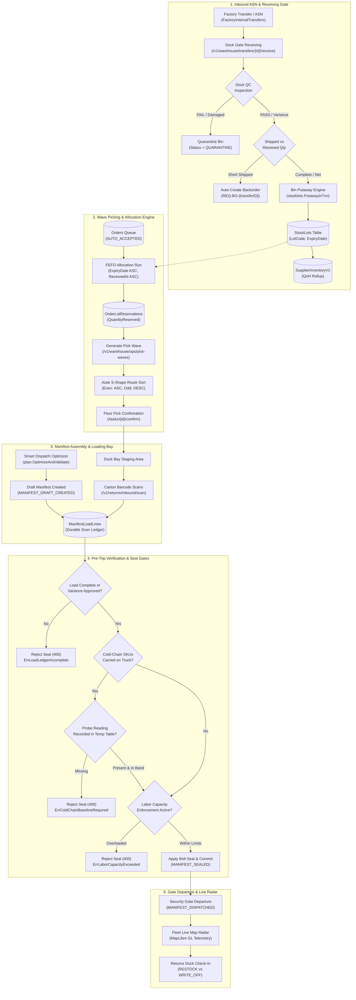
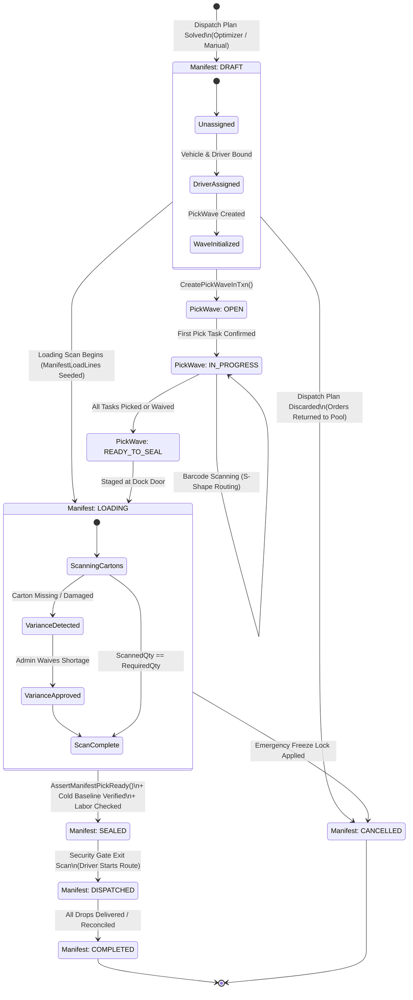

# Role 4 Specification: Warehouse Management System (WMS) & Operations Hub

> **Role Number**: Role 4 of 9  
> **Persona ID**: `ROLE_WAREHOUSE_MANAGER` / `ROLE_WAREHOUSE`  
> **Document Version:** 2.0.0  
> **Operational Overview**: [`docs/roles/DETAILED_ROLE_OPERATIONS_AND_FEATURES.md`](file:///Users/shakhzod/Desktop/pegasusx/docs/roles/DETAILED_ROLE_OPERATIONS_AND_FEATURES.md)  
> **Target Specification:** Enterprise WMS, Cross-Platform Floor & Command Board Architecture  
> **Scope:** Web Portal ([`apps/warehouse-portal`](file:///Users/shakhzod/Desktop/pegasusx/apps/warehouse-portal)), Android Native App ([`apps/warehouse-app-android`](file:///Users/shakhzod/Desktop/pegasusx/apps/warehouse-app-android)), iOS Native App ([`apps/warehouse-app-ios`](file:///Users/shakhzod/Desktop/pegasusx/apps/warehouse-app-ios)), Backend Microservices & Domain Packages ([`apps/backend-go/warehouseroutes`](file:///Users/shakhzod/Desktop/pegasusx/apps/backend-go/warehouseroutes), `warehouse`, `warehouseops`, `stocklots`, `laborcapacityroutes`, `laborcapacity`, `inventory`, `allocation`, `dispatch`, `returns`, `creditnoteroutes`, `syncroutes`).  

---

## Executive Summary & System Metrics

The **Warehouse Role** in PegasusX represents the operational core of the supply-chain network. Operating across three client form factors (Next.js 15 / Tauri desktop portal, Jetpack Compose Android native, and SwiftUI iOS native) backed by high-throughput Spanner-driven Go microservices, it bridges upstream supply manufacturing (depots and factories) with downstream distribution (fleet dispatch and retailer store delivery).

### Verified System Totals & Metrics Count

| Dimension | Exact Count | Description |
| :--- | :---: | :--- |
| **Total Client Screens & Pages** | **134** | 46 Web/Desktop pages, 44 Android native screens, 44 iOS native screens/views |
| **Total API Endpoints** | **138** | 121 Warehouse routes, 3 Labor Capacity, 6 Returns Gate, 2 Reverse Logistics, 2 Offline Sync, 1 Receipt, 2 Claims, 1 Control Tower |
| **WebSocket / SSE Event Types** | **78** | 50 incoming/subscribed real-time domain events, 28 outgoing/emitted state transition events across 3 rooms (`warehouse:{id}`, `supplier:{id}`, `telemetry:supplier:{id}`) |
| **Spanner Database Tables Touched** | **41** | Core entities spanning inventory, lots, bins, picking waves, manifests, freeze locks, temperature readings, and labor capacity |
| **Client Distribution Targets** | **3 Surface Types** | Responsive Web (Next.js 15), Desktop Native (Tauri Universal macOS/Windows), Mobile Native (Kotlin Jetpack Compose & Swift 6 SwiftUI) |

---

## 1. Complete Surface Directory & Screen Inventory

### 1.1 Web & Desktop Portal (`apps/warehouse-portal`) — 46 Pages

Every page in the Next.js 15 App Router (`apps/warehouse-portal/app`) is compiled for both responsive browser operations and packaged as a standalone cross-platform desktop binary via Tauri (`@tauri-apps/api` v2):

| # | Screen / Route Path | Relative Source File | Architectural Purpose & Core Capabilities |
| :-: | :--- | :--- | :--- |
| 1 | `/` | `app/page.tsx` | **Real-Time WMS Command Dashboard**: Live KPI cards (active orders, pending load, fleet utilization), operational funnel, urgent alerts. |
| 2 | `/analytics` | `app/analytics/page.tsx` | **Fulfillment & Turnaround Analytics**: Order throughput, pick-pack cycle times, dock-to-stock duration, driver turn times. |
| 3 | `/auth/login` | `app/auth/login/page.tsx` | **Operator Authentication**: Phone & 6-digit PIN login, Firebase custom token exchange, session hydration. |
| 4 | `/auth/register` | `app/auth/register/page.tsx` | **Warehouse Provisioning Wizard**: Self-registration flow for facility managers and operator onboarding. |
| 5 | `/bins` | `app/bins/page.tsx` | **Bin & Location Management**: Storage rack/aisle/shelf configuration, bin capacity VU, zone tagging (`STAGE`, `RACK`, `COLD`, `QUARANTINE`). |
| 6 | `/claims` | `app/claims/page.tsx` | **Delivery Claims & OS&D Review**: Inspection of missing, damaged, or expired stock reported during delivery or receiving. |
| 7 | `/cold-chain` | `app/cold-chain/page.tsx` | **Cold-Chain Temperature Monitor**: Real-time probe telemetry, excursion alarms, pre-trip sensor baseline verification. |
| 8 | `/control-tower` | `app/control-tower/page.tsx` | **Warehouse Control Tower**: ML-scored operational bottlenecks, stalled manifests, late driver alerts, exception triage. |
| 9 | `/coverage` | `app/coverage/page.tsx` | **Geographic Coverage & H3 Serviceability**: Serviced polygon boundaries, H3 resolution-7/8 hex grid assignments, delivery zone mapping. |
| 10 | `/credit/policy` | `app/credit/policy/page.tsx` | **Credit Program & AR Invoices**: Retailer open balances, delinquent credit holds, payment term monitoring. |
| 11 | `/crm` | `app/crm/page.tsx` | **Retailer Client Directory**: Serviced client roster, revenue stats, recurring order patterns, delivery preferences. |
| 12 | `/cycle-counts` | `app/cycle-counts/page.tsx` | **Cycle Counting & ABC Classification**: Enqueue ABC inventory audits, blind physical counts, variance reconciliation. |
| 13 | `/demand-forecast` | `app/demand-forecast/page.tsx` | **Demand Forecasting Ingestion**: 7-to-30 day SKU demand predictions, burn-rate analysis, stockout countdown indicators. |
| 14 | `/dispatch` | `app/dispatch/page.tsx` | **Dispatch Hub & Plan Optimizer**: Multi-vehicle routing, volume bin-packing, solve job triggers, manual route adjustments. |
| 15 | `/dispatch/rescues` | `app/dispatch/rescues/page.tsx` | **Breakdown & Rescue Operations**: Mid-route truck failure reassignment, partial load transfers, emergency driver re-routing. |
| 16 | `/dispatch-locks` | `app/dispatch-locks/page.tsx` | **Dispatch Freeze Lock Controls**: Emergency freeze switches by warehouse, truck, or order to prevent premature lock-in. |
| 17 | `/dispatch-settings` | `app/dispatch-settings/page.tsx` | **Fleet Optimizer Tuning**: Max stop thresholds, route distance limits, road-network routing engines (`Haversine` vs `OSRM`). |
| 18 | `/drivers` | `app/drivers/page.tsx` | **Driver Fleet Roster**: Shift management, truck-to-driver bindings, active duty status, performance metric summaries. |
| 19 | `/exceptions` | `app/exceptions/page.tsx` | **Operational Exception Queue**: Failed handoffs, address mismatches, missing lot numbers, loading shortages. |
| 20 | `/fleet-live-map` | `app/fleet-live-map/page.tsx` | **Live Tactical Map**: Real-time MapLibre GL radar tracking of fleet trucks, yard staging, GPS breadcrumb playback. |
| 21 | `/inventory` | `app/inventory/page.tsx` | **Inventory Stock List**: SKU QoH, reserved allocations, safety thresholds, reorder policy controls. |
| 22 | `/labor-capacity` | `app/labor-capacity/page.tsx` | **Labor Scheduling & Capacity**: Zone-level labor projections, worker capacity scoring, driver shift availability assignments. |
| 23 | `/manifests` | `app/manifests/page.tsx` | **Truck Manifest Management**: Manifest staging, barcode loading scan verification, security seal gate checks. |
| 24 | `/operations` | `app/operations/page.tsx` | **Ops Broadcast & Overrides**: Urgent push notifications to drivers, temporary price overrides, system announcement banners. |
| 25 | `/orders` | `app/orders/page.tsx` | **Fulfillment Order Pipeline**: Order state funnel tracking (`AUTO_ACCEPTED` to `COMPLETED`), urgent priority indicators. |
| 26 | `/orders/[id]` | `app/orders/[id]/page.tsx` | **Order Detail & Handoff Inspector**: Line item details, assigned lot batches, delivery timestamps, driver audit log. |
| 27 | `/payment-config` | `app/payment-config/page.tsx` | **Payment Gateway Configuration**: Cash-on-delivery limits, terminal merchant IDs, split-payment rules, payment bypass. |
| 28 | `/pick-waves` | `app/pick-waves/page.tsx` | **Wave Picking Command Board**: Manifest-to-wave creation, S-Shape aisle routing, pick task confirmation, shortage waivers. |
| 29 | `/preorders` | `app/preorders/page.tsx` | **Pre-Order Allocation Board**: Future-dated delivery reservations, delivery date proposal negotiation, bulk confirmation. |
| 30 | `/products` | `app/products/page.tsx` | **Product Handling Master**: Product dimensions, volume VU, perishable flags, min/max storage temperatures. |
| 31 | `/profile` | `app/profile/page.tsx` | **Facility Profile & Metadata**: Warehouse geo-coordinates, operating hours, emergency contact points, license records. |
| 32 | `/replenishment` | `app/replenishment/page.tsx` | **AI Replenishment Insights**: Machine-suggested factory transfers, safety stock reorder triggers, one-click order generation. |
| 33 | `/returns` | `app/returns/page.tsx` | **Returns Triage & Reverse Logistics**: Dock receiving of rejected deliveries, inspection workflow (restock vs destruction write-off). |
| 34 | `/settings` | `app/settings/page.tsx` | **Depot Ops Settings**: Operating thresholds, auto-dispatch triggers, seal verification strictness settings. |
| 35 | `/setup/location` | `app/setup/location/page.tsx` | **Geocoding & Depot Boundary Setup**: Map-based depot pin placement, geocoded address verification, dock zone setup. |
| 36 | `/staff` | `app/staff/page.tsx` | **Warehouse Floor Staff**: Worker roster, role assignment (`WAREHOUSE_STAFF` vs `PAYLOADER`), PIN assignment. |
| 37 | `/stock-commitments` | `app/stock-commitments/page.tsx` | **Future Stock Allocation Matrix**: Committed units against future supply arrivals, cross-dock allocations. |
| 38 | `/supply-requests` | `app/supply-requests/page.tsx` | **Supply Request Hub**: Factory supply orders, inbound transfer status (`ORDERED`, `SHIPPED`, `RECEIVED`). |
| 39 | `/supply-requests/[id]`| `app/supply-requests/[id]/page.tsx`| **Supply Request Detail & Dock QC**: Inbound ASN verification, lot receipt entry, quality control inspection (`PASS`/`FAIL`). |
| 40 | `/supply-requests/new` | `app/supply-requests/new/page.tsx` | **Supply Request Creator**: Forecast-guided order generation from linked production factories. |
| 41 | `/tomorrow-board` | `app/tomorrow-board/page.tsx` | **Tomorrow Board**: Next-day staging forecast, wave pre-computation, early truck allocation verification. |
| 42 | `/tracking` | `app/tracking/page.tsx` | **Dispatch Execution Tracking**: Post-dispatch route monitoring, delivery progression, proof-of-delivery receipts. |
| 43 | `/transfers` | `app/transfers/page.tsx` | **Depot-to-Depot Transfers**: Emergency transfer requests, force-receiving bypass, transfer line validation. |
| 44 | `/treasury` | `app/treasury/page.tsx` | **Cash & Driver Settlements**: End-of-shift driver cash reconciliation, accept/dispute cash collections, AR receipts. |
| 45 | `/vehicles` | `app/vehicles/page.tsx` | **Truck Fleet Staging**: Fleet directory, maintenance locks, payload capacity volume in VU, vehicle class tagging. |
| 46 | `/vehicles/[vehicleId]`| `app/vehicles/[vehicleId]/page.tsx`| **Vehicle Detail & History**: Vehicle telematics, assigned driver history, odometer records, hold status management. |

---

### 1.2 Native Android App (`apps/warehouse-app-android`) — 44 Screens

Engineered with Kotlin 2.0, Jetpack Compose, Material 3 WindowSizeClass (adaptive phone/tablet rail), Hilt dependency injection, and Retrofit/OkHttp:

| # | Screen Class | Relative File Path | Target Capability |
| :-: | :--- | :--- | :--- |
| 1 | `LoginScreen` | `ui/screens/auth/LoginScreen.kt` | Operator phone/PIN auth with Firebase JWT exchange. |
| 2 | `DashboardScreen` | `ui/screens/dashboard/DashboardScreen.kt` | Mobile command center with tactical KPI tiles and funnel status. |
| 3 | `OrdersScreen` | `ui/screens/orders/OrdersScreen.kt` | Filterable order queue with search, state filtering, and pagination. |
| 4 | `OrderDetailScreen` | `ui/screens/orders/OrderDetailScreen.kt` | Deep line-item inspector with lot assignment and actions. |
| 5 | `DriversScreen` | `ui/screens/drivers/DriversScreen.kt` | Driver roster with shift toggle and truck pairing modals. |
| 6 | `VehiclesScreen` | `ui/screens/vehicles/VehiclesScreen.kt` | Fleet truck management with capacity VU visualization. |
| 7 | `VehicleDetailScreen` | `ui/screens/vehicles/VehicleDetailScreen.kt` | Maintenance hold and driver assignment details. |
| 8 | `InventoryScreen` | `ui/screens/inventory/InventoryScreen.kt` | Mobile stock counter with rapid lot adjustment buttons. |
| 9 | `ProductsScreen` | `ui/screens/products/ProductsScreen.kt` | SKU handling requirements, storage temp ranges, unit volume. |
| 10 | `ManifestsScreen` | `ui/screens/manifests/ManifestsScreen.kt` | Truck loading staging with manifest barcode progress. |
| 11 | `AnalyticsScreen` | `ui/screens/analytics/AnalyticsScreen.kt` | Mobile chart grid displaying daily output and throughput rates. |
| 12 | `CRMScreen` | `ui/screens/crm/CRMScreen.kt` | Retailer client lookup with order history and payment health. |
| 13 | `ReturnsScreen` | `ui/screens/returns/ReturnsScreen.kt` | Inbound returns dock inspection and disposition flow. |
| 14 | `ColdChainScreen` | `ui/screens/coldchain/ColdChainScreen.kt` | Live Bluetooth/IoT temperature probe sync and excursion alerts. |
| 15 | `LaborCapacityScreen`| `ui/screens/labor/LaborCapacityScreen.kt` | Zone-level labor availability overview and assignment. |
| 16 | `ExceptionsScreen` | `ui/screens/exceptions/ExceptionsScreen.kt` | Operational roadblocks, missed SLA warnings, order anomalies. |
| 17 | `ClaimsScreen` | `ui/screens/claims/ClaimsScreen.kt` | Retailer OS&D claims triage with photo evidence review. |
| 18 | `RescuesScreen` | `ui/screens/rescues/RescuesScreen.kt` | Emergency driver rescue route generator and live status. |
| 19 | `TreasuryScreen` | `ui/screens/treasury/TreasuryScreen.kt` | Driver cash reconciliation, dispute lodging, and daily closing. |
| 20 | `DispatchScreen` | `ui/screens/dispatch/DispatchScreen.kt` | Mobile dispatch planner with optimizer preview and commit trigger. |
| 21 | `FleetLiveMapScreen` | `ui/screens/fleet/FleetLiveMapScreen.kt` | MapLibre Native hardware-accelerated radar map for fleet tracking. |
| 22 | `StaffScreen` | `ui/screens/staff/StaffScreen.kt` | Warehouse floor crew shift status and role assignments. |
| 23 | `MoreHubScreen` | `ui/screens/more/MoreHubScreen.kt` | Grid launcher for secondary operational modules. |
| 24 | `DemandForecastScreen`| `ui/screens/forecast/DemandForecastScreen.kt` | SKU-level burn rates and days-to-stockout alerts. |
| 25 | `TransferActionsScreen`| `ui/screens/transfers/TransferActionsScreen.kt`| Emergency inbound transfer receipts and force-receiving overrides. |
| 26 | `ReplenishmentScreen`| `ui/screens/replenishment/ReplenishmentScreen.kt`| Machine-generated replenishment insights with approve/dismiss buttons. |
| 27 | `DispatchSettingsScreen`| `ui/screens/dispatch/DispatchSettingsScreen.kt`| Maximum volume tolerance, stop limits, and routing engine options. |
| 28 | `OpsSettingsScreen` | `ui/screens/inventory/OpsSettingsScreen.kt` | Operational threshold configs and auto-dispatch policies. |
| 29 | `ReturnPolicySettingsScreen`| `ui/screens/inventory/ReturnPolicySettingsScreen.kt`| Warehouse-specific return eligibility and restocking windows. |
| 30 | `LocationSetupScreen`| `ui/screens/setup/LocationSetupScreen.kt` | First-time depot GPS coordinates setup and reverse geocoding. |
| 31 | `LocationSettingsScreen`| `ui/screens/inventory/LocationSettingsScreen.kt`| Depot address, dock bays, and contact update form. |
| 32 | `PreordersScreen` | `ui/screens/preorders/PreordersScreen.kt` | Advance booking queue, delivery date proposals, and rejections. |
| 33 | `TomorrowBoardScreen`| `ui/screens/tomorrowboard/TomorrowBoardScreen.kt`| Next-day staging board and pre-allocation sanity checker. |
| 34 | `StockCommitmentsScreen`| `ui/screens/preorders/StockCommitmentsScreen.kt`| Reserved future stock against verified supplier POs. |
| 35 | `PaymentConfigScreen`| `ui/screens/payment/PaymentConfigScreen.kt` | Mobile payment gateway rules and bypass approvals. |
| 36 | `CoverageScreen` | `ui/screens/coverage/CoverageScreen.kt` | Depot service polygon boundaries and active delivery zones. |
| 37 | `NotificationInboxScreen`| `ui/screens/notifications/NotificationInboxScreen.kt`| In-app notification center for operational alerts and mentions. |
| 38 | `OperationsScreen` | `ui/screens/operations/OperationsScreen.kt` | Floor announcements, broadcast creator, and price override preview. |
| 39 | `WarehouseScoredExceptionsScreen`| `ui/screens/ops/WarehouseScoredExceptionsScreen.kt`| Control Tower ML priority queue for warehouse issues. |
| 40 | `WarehouseJSONFeedScreen`| `ui/screens/ops/WarehouseJSONFeedScreen.kt` | Raw telemetry and event stream debug console for floor managers. |
| 41 | `SupplyRequestsScreen`| `ui/screens/supply/SupplyRequestsScreen.kt` | Factory replenishment requests tracker. |
| 42 | `SupplyRequestDetailScreen`| `ui/screens/supply/SupplyRequestDetailScreen.kt`| Inbound lot inspection, item check-off, and QC sign-off. |
| 43 | `PortalHandoffScreen`| `ui/screens/portal/PortalHandoffScreen.kt` | Seamless transition screen between native views and desktop portal. |
| 44 | `BarcodeScannerScreen`| `ui/screens/scanner/BarcodeScannerScreen.kt` | CameraX-powered high-speed industrial 1D/2D barcode reader. |

---

### 1.3 Native iOS App (`apps/warehouse-app-ios`) — 44 Views

Engineered in Swift 6 with SwiftUI, NavigationSplitView (3-column layout on iPad Pro, compact tab on iPhone), TacticalTheme design tokens, and async/await networking:

| # | View Component | Relative File Path | Target Architecture & Presentation |
| :-: | :--- | :--- | :--- |
| 1 | `DashboardView` | `WarehouseApp/Views/Dashboard/DashboardView.swift` | 3-column tactical dashboard with gauge cards and activity timeline. |
| 2 | `OrdersView` | `WarehouseApp/Views/Orders/OrdersView.swift` | Floor order queue with state filtering chips and quick-action sheets. |
| 3 | `OrderDetailView` | `WarehouseApp/Views/Orders/OrderDetailView.swift` | Detailed order manifest with line items, lots, and bypass controls. |
| 4 | `DriversView` | `WarehouseApp/Views/Drivers/DriversView.swift` | Driver roster with interactive vehicle pairing and shift status. |
| 5 | `VehiclesView` | `WarehouseApp/Views/Vehicles/VehiclesView.swift` | Staged truck fleet overview with capacity utilization meters. |
| 6 | `VehicleDetailView` | `WarehouseApp/Views/Vehicles/VehicleDetailView.swift` | Detailed inspection logs, telemetry history, and maintenance locks. |
| 7 | `InventoryView` | `WarehouseApp/Views/Inventory/InventoryView.swift` | Stock list with bin location mapping and quick adjustment steppers. |
| 8 | `ProductsView` | `WarehouseApp/Views/Products/ProductsView.swift` | Product master database with cold chain and hazmat tags. |
| 9 | `ManifestsView` | `WarehouseApp/Views/Manifests/ManifestsView.swift` | Loading bay manifest assembly, scan verification, and seal stepper. |
| 10 | `AnalyticsView` | `WarehouseApp/Views/Analytics/AnalyticsView.swift` | Charts displaying order velocity, pick accuracy, and dock turnarounds. |
| 11 | `CRMView` | `WarehouseApp/Views/CRM/CRMView.swift` | Retail customer directory, lifetime order volume, and debt status. |
| 12 | `ReturnsView` | `WarehouseApp/Views/Returns/ReturnsView.swift` | Inbound returns dock triage with restock vs write-off decisions. |
| 13 | `ColdChainView` | `WarehouseApp/Views/ColdChain/ColdChainView.swift` | Chilled storage telemetry gauges and pre-trip temp verifications. |
| 14 | `LaborCapacityView` | `WarehouseApp/Views/LaborCapacity/LaborCapacityView.swift`| Hex-zone labor capacity heatmaps and shift scheduler. |
| 15 | `ExceptionsView` | `WarehouseApp/Views/Exceptions/ExceptionsView.swift` | Exception inbox for address errors, delivery failures, and stockouts. |
| 16 | `ClaimsView` | `WarehouseApp/Views/Claims/ClaimsView.swift` | Delivery discrepancy claims with image attachments and resolution tools. |
| 17 | `RescuesView` | `WarehouseApp/Views/Rescues/RescuesView.swift` | Route recovery workbench for vehicle breakdowns and stranded cargo. |
| 18 | `TreasuryView` | `WarehouseApp/Views/Treasury/TreasuryView.swift` | Driver cash reconciliation workbench, deposit verification, and ledger. |
| 19 | `DispatchView` | `WarehouseApp/Views/Dispatch/DispatchView.swift` | Tactical dispatch builder with fleet capacity gauges and route cards. |
| 20 | `DispatchPreviewMapView`| `WarehouseApp/Views/Dispatch/DispatchPreviewMapView.swift`| Interactive vector map previewing proposed delivery routes. |
| 21 | `FleetLiveMapView` | `WarehouseApp/Views/Fleet/FleetLiveMapView.swift` | Live GPS tracking radar of all dispatched trucks and yard movements. |
| 22 | `StaffView` | `WarehouseApp/Views/Staff/StaffView.swift` | Floor staff roster with shift clocks and role configuration. |
| 23 | `MoreHubView` | `WarehouseApp/Views/More/MoreHubView.swift` | Tactical navigation launcher for administrative and setup modules. |
| 24 | `DemandForecastView`| `WarehouseApp/Views/DemandForecast/DemandForecastView.swift`| Predictive SKU requirements table with AI confidence scores. |
| 25 | `TransferActionsView`| `WarehouseApp/Views/Transfers/TransferActionsView.swift`| Depot transfer receiver, emergency orders, and force-receive tools. |
| 26 | `ReplenishmentView` | `WarehouseApp/Views/Replenishment/ReplenishmentView.swift`| Automated replenishment recommendations from supplier factories. |
| 27 | `DispatchSettingsView`| `WarehouseApp/Views/Dispatch/DispatchSettingsView.swift`| Dispatch engine parameters, buffer zones, and travel speed factors. |
| 28 | `OpsSettingsView` | `WarehouseApp/Views/Inventory/OpsSettingsView.swift` | General warehouse operations parameters and auto-dispatch toggles. |
| 29 | `ReturnPolicySettingsView`| `WarehouseApp/Views/Inventory/ReturnPolicySettingsView.swift`| Return window configuration and mandatory inspection policies. |
| 30 | `LocationSetupView` | `WarehouseApp/Views/Setup/LocationSetupView.swift` | Interactive pin-drop map for facility location and dock bounds. |
| 31 | `LocationSettingsView`| `WarehouseApp/Views/Inventory/LocationSettingsView.swift`| Warehouse address, dock count, and contact details editor. |
| 32 | `PreordersView` | `WarehouseApp/Views/Preorders/PreordersView.swift` | Advance delivery management, schedule adjustments, and confirmations. |
| 33 | `TomorrowBoardView` | `WarehouseApp/Views/TomorrowBoard/TomorrowBoardView.swift`| Staging board for tomorrow's fulfillment waves and truck allocations. |
| 34 | `StockCommitmentsView`| `WarehouseApp/Views/StockCommitments/StockCommitmentsView.swift`| SKU reservations mapped against confirmed inbound supply. |
| 35 | `PaymentConfigView` | `WarehouseApp/Views/PaymentConfig/PaymentConfigView.swift`| Payment options per zone, terminal bindings, and bypass switches. |
| 36 | `CoverageView` | `WarehouseApp/Views/Coverage/CoverageView.swift` | Delivery coverage boundaries and active H3 polygon inspection. |
| 37 | `NotificationInboxView`| `WarehouseApp/Views/Notifications/NotificationInboxView.swift`| Tactical message center for warehouse alerts and notifications. |
| 38 | `OperationsView` | `WarehouseApp/Views/Operations/OperationsView.swift` | Broadcast composer, system alerts, and price preview tools. |
| 39 | `SupplyRequestsHubView`| `WarehouseApp/Views/SupplyRequests/SupplyRequestsHubView.swift`| Factory purchase orders and inbound transfer status hub. |
| 40 | `SupplyRequestDetailView`| `WarehouseApp/Views/SupplyRequests/SupplyRequestDetailView.swift`| Inbound shipment inspection, lot code logging, and dock QC. |
| 41 | `CreateSupplyRequestSheet`| `WarehouseApp/Views/SupplyRequests/CreateSupplyRequestSheet.swift`| Modal sheet to generate new purchase requests from suppliers. |
| 42 | `PortalHandoffView` | `WarehouseApp/Views/Portal/PortalHandoffView.swift` | Web portal feature bridge with deep-link redirection. |
| 43 | `LoginView` | `WarehouseApp/Views/LoginView.swift` | Secure biometric / PIN sign-in screen. |
| 44 | `BarcodeScannerScreen`| `WarehouseApp/Views/Scanner/BarcodeScannerScreen.swift`| AVFoundation-powered high-framerate barcode and QR scanner. |

---

## 2. Exhaustive API Endpoints Specification (138 Endpoints)

All backend endpoints handling warehouse operations enforce strict multi-tenancy via `auth.RequireWarehouseOpsScope`, validating that the authenticated operator belongs to the target warehouse (`claims.HomeNodeID == warehouseID`). Query parameter overrides are rejected with `HTTP 403 Forbidden` to prevent cross-tenant enumeration.

| # | HTTP Method | URL Path | Go Handler Function | Auth Role Requirement | Tenant / Scope Parameter |
| :-: | :---: | :--- | :--- | :--- | :--- |
| 1 | `POST` | `/v1/auth/warehouse/login` | `warehouse.Service.HandleWarehouseLogin` | Public | Body: `phone`, `pin` |
| 2 | `POST` | `/v1/auth/warehouse/register` | `warehouse.Service.HandleWarehouseRegister` | Public | Body: `name`, `phone`, `warehouse_id` |
| 3 | `POST` | `/v1/auth/warehouse/refresh` | `warehouse.Service.HandleWarehouseRefresh` | Refresh Token | Header / Body: `refresh_token` |
| 4 | `POST` | `/v1/warehouse/setup` | `warehouse.Service.HandleWarehouseSetup` | Setup Token | Header: `Authorization: Bearer <token>` |
| 5 | `GET` | `/v1/warehouse/replenishment/insights` | `warehouse.Service.HandleReplenishmentInsights` | Warehouse, WarehouseAdmin, Admin | `claims.HomeNodeID`, Query: `warehouse_id` |
| 6 | `POST` | `/v1/warehouse/replenishment/insights/{id}/{action}` | `warehouse.Service.HandleReplenishmentInsightAction` | Warehouse, WarehouseAdmin, Admin | `claims.HomeNodeID`, Path: `id`, `action` |
| 7 | `GET` | `/v1/warehouse/ws-session` | `auth.WSSessionHandler` | Warehouse, WarehouseAdmin, Admin | Short-lived WS ticket minting |
| 8 | `POST` | `/v1/warehouses` | `warehouse.Service.HandleCreateWarehouse` | Warehouse, WarehouseAdmin, Admin | `claims.SupplierID` |
| 9 | `GET` | `/v1/warehouses/{warehouseId}` | `warehouse.Service.HandleGetWarehouse` | Warehouse, WarehouseAdmin, Admin | Path: `warehouseId` |
| 10 | `PUT` | `/v1/warehouses/{warehouseId}` | `warehouse.Service.HandleUpdateWarehouse` | Warehouse, WarehouseAdmin, Admin | Path: `warehouseId` |
| 11 | `GET` | `/v1/warehouses` | `warehouse.Service.HandleListWarehouses` | Warehouse, WarehouseAdmin, Admin | `claims.SupplierID` |
| 12 | `POST` | `/v1/warehouses/publish-perimeter` | `warehouse.Service.HandlePublishPerimeter` | Warehouse, WarehouseAdmin, Admin | `claims.HomeNodeID` |
| 13 | `POST` | `/v1/warehouse/transfers/emergency` | `warehouse.Service.HandleEmergencyTransfer` | Warehouse, WarehouseAdmin, Admin | `claims.HomeNodeID` |
| 14 | `POST` | `/v1/warehouse/transfers/force-receive` | `warehouse.Service.HandleForceReceive` | Warehouse, WarehouseAdmin, Admin | `claims.HomeNodeID` |
| 15 | `POST` | `/v1/warehouse/transfers/{id}/receive` | `warehouse.Service.HandleReceiveTransfer` | Warehouse, WarehouseAdmin, Admin | Path: `id`, `claims.HomeNodeID` |
| 16 | `GET` | `/v1/warehouse/ops/dashboard` | `warehouse.Service.HandleDashboard` | Warehouse, WarehouseAdmin, Admin | `claims.HomeNodeID` |
| 17 | `GET` | `/v1/warehouse/ops/inventory` | `warehouse.Service.HandleInventory` | Warehouse, WarehouseAdmin, Admin | `claims.HomeNodeID`, Query: `search`, `low_stock` |
| 18 | `PATCH` | `/v1/warehouse/ops/inventory` | `warehouse.Service.HandleInventory` | Warehouse, WarehouseAdmin, Admin | `claims.HomeNodeID`, Body: `product_id`, `quantity` |
| 19 | `PATCH` | `/v1/warehouse/ops/inventory/{productID}/policy` | `warehouse.Service.HandleInventoryPolicy` | Warehouse, WarehouseAdmin, Admin | Path: `productID`, `claims.HomeNodeID` |
| 20 | `GET` | `/v1/warehouse/ops/bins` | `stocklots.Handler.HandleBins` | Warehouse, WarehouseAdmin, Admin | `claims.HomeNodeID` |
| 21 | `POST` | `/v1/warehouse/ops/bins` | `stocklots.Handler.HandleBins` | Warehouse, WarehouseAdmin, Admin | `claims.HomeNodeID`, Body: Bin specs |
| 22 | `GET` | `/v1/warehouse/ops/bins/{locationID}` | `stocklots.Handler.HandleBinByID` | Warehouse, WarehouseAdmin, Admin | Path: `locationID`, `claims.HomeNodeID` |
| 23 | `PATCH` | `/v1/warehouse/ops/bins/{locationID}` | `stocklots.Handler.HandleBinByID` | Warehouse, WarehouseAdmin, Admin | Path: `locationID`, `claims.HomeNodeID` |
| 24 | `GET` | `/v1/warehouse/ops/lots` | `stocklots.Handler.HandleLots` | Warehouse, WarehouseAdmin, Admin | `claims.HomeNodeID`, Query: `status`, `product_id`|
| 25 | `POST` | `/v1/warehouse/ops/lots/putaway` | `stocklots.Handler.HandlePutaway` | Warehouse, WarehouseAdmin, Admin | `claims.HomeNodeID`, Body: Lot details |
| 26 | `GET` | `/v1/warehouse/ops/lots/{lotID}` | `stocklots.Handler.HandleLotByID` | Warehouse, WarehouseAdmin, Admin | Path: `lotID`, `claims.HomeNodeID` |
| 27 | `GET` | `/v1/warehouse/ops/lots/{lotID}/trace` | `stocklots.Handler.HandleTraceLot` | Warehouse, WarehouseAdmin, Admin | Path: `lotID`, `claims.HomeNodeID` |
| 28 | `POST` | `/v1/warehouse/ops/lots/{lotID}/quarantine` | `stocklots.Handler.HandleQuarantineLot` | Warehouse, WarehouseAdmin, Admin | Path: `lotID`, `claims.HomeNodeID` |
| 29 | `POST` | `/v1/warehouse/ops/lots/{lotID}/release` | `stocklots.Handler.HandleReleaseLot` | Warehouse, WarehouseAdmin, Admin | Path: `lotID`, `claims.HomeNodeID` |
| 30 | `GET` | `/v1/warehouse/ops/recalls` | `stocklots.Handler.HandleRecalls` | Warehouse, WarehouseAdmin, Admin | `claims.HomeNodeID` |
| 31 | `POST` | `/v1/warehouse/ops/recalls` | `stocklots.Handler.HandleRecalls` | Warehouse, WarehouseAdmin, Admin | `claims.HomeNodeID`, Body: Campaign data |
| 32 | `GET` | `/v1/warehouse/ops/recalls/{campaignID}` | `stocklots.Handler.HandleRecallByID` | Warehouse, WarehouseAdmin, Admin | Path: `campaignID`, `claims.HomeNodeID` |
| 33 | `GET` | `/v1/warehouse/ops/pick-waves` | `stocklots.Handler.HandlePickWaves` | Warehouse, WarehouseAdmin, Admin | `claims.HomeNodeID`, Query: `status` |
| 34 | `POST` | `/v1/warehouse/ops/pick-waves` | `stocklots.Handler.HandlePickWaves` | Warehouse, WarehouseAdmin, Admin | `claims.HomeNodeID`, Body: `manifest_id` |
| 35 | `GET` | `/v1/warehouse/ops/pick-waves/{waveID}` | `stocklots.Handler.HandlePickWaveByID` | Warehouse, WarehouseAdmin, Admin | Path: `waveID`, `claims.HomeNodeID` |
| 36 | `POST` | `/v1/warehouse/ops/pick-waves/{waveID}/tasks/{taskID}/confirm` | `stocklots.Handler.HandleConfirmPickTask` | Warehouse, WarehouseAdmin, Admin | Path: `waveID`, `taskID`, `claims.HomeNodeID` |
| 37 | `GET` | `/v1/warehouse/ops/cycle-counts` | `stocklots.Handler.HandleCycleCounts` | Warehouse, WarehouseAdmin, Admin | `claims.HomeNodeID` |
| 38 | `POST` | `/v1/warehouse/ops/cycle-counts` | `stocklots.Handler.HandleCycleCounts` | Warehouse, WarehouseAdmin, Admin | `claims.HomeNodeID`, Body: Count task |
| 39 | `GET` | `/v1/warehouse/ops/cycle-counts/{countID}` | `stocklots.Handler.HandleCycleCountByID` | Warehouse, WarehouseAdmin, Admin | Path: `countID`, `claims.HomeNodeID` |
| 40 | `POST` | `/v1/warehouse/ops/cycle-counts/{countID}/submit` | `stocklots.Handler.HandleSubmitCycleCount` | Warehouse, WarehouseAdmin, Admin | Path: `countID`, Body: `counted_quantity` |
| 41 | `GET` | `/v1/warehouse/ops/inventory-adjustments` | `stocklots.Handler.HandleInventoryAdjustments` | Warehouse, WarehouseAdmin, Admin | `claims.HomeNodeID` |
| 42 | `GET` | `/v1/warehouse/ops/inventory-accuracy` | `stocklots.Handler.HandleInventoryAccuracy` | Warehouse, WarehouseAdmin, Admin | `claims.HomeNodeID` |
| 43 | `GET` | `/v1/warehouse/ops/inventory-reconcile` | `stocklots.Handler.HandleReconcileInventoryV2` | Warehouse, WarehouseAdmin, Admin | `claims.HomeNodeID` |
| 44 | `POST` | `/v1/warehouse/ops/cycle-counts/enqueue-abc` | `stocklots.Handler.HandleEnqueueABCCounts` | Warehouse, WarehouseAdmin, Admin | `claims.HomeNodeID` |
| 45 | `POST` | `/v1/warehouse/ops/pick-waves/{waveID}/waive-shorts` | `stocklots.Handler.HandleWaivePickShorts` | WarehouseAdmin, Admin | Path: `waveID`, `claims.HomeNodeID` |
| 46 | `POST` | `/v1/warehouse/ops/inventory-adjustments/{adjustmentID}/approve` | `stocklots.Handler.HandleApproveInventoryAdjustment` | WarehouseAdmin, Admin | Path: `adjustmentID`, `claims.HomeNodeID` |
| 47 | `GET` | `/v1/warehouse/ops/cash-reconciliations` | `driver.Service.HandleListCashReconciliations` | Warehouse, WarehouseAdmin, Admin | `claims.HomeNodeID` |
| 48 | `POST` | `/v1/warehouse/ops/cash-reconciliations/{id}/accept` | `driver.Service.HandleCashReconciliationAccept` | Warehouse, WarehouseAdmin, Admin | Path: `id`, `claims.HomeNodeID` |
| 49 | `POST` | `/v1/warehouse/ops/cash-reconciliations/{id}/dispute` | `driver.Service.HandleCashReconciliationDispute` | Warehouse, WarehouseAdmin, Admin | Path: `id`, `claims.HomeNodeID` |
| 50 | `GET` | `/v1/warehouse/ops/settings` | `warehouse.Service.HandleOpsSettings` | Warehouse, WarehouseAdmin, Admin | `claims.HomeNodeID` |
| 51 | `PATCH` | `/v1/warehouse/ops/settings` | `warehouse.Service.HandleOpsSettings` | Warehouse, WarehouseAdmin, Admin | `claims.HomeNodeID`, Body: Settings patch |
| 52 | `GET` | `/v1/warehouse/ops/location` | `warehouse.Service.HandleOpsLocation` | Warehouse, WarehouseAdmin, Admin | `claims.HomeNodeID` |
| 53 | `PATCH` | `/v1/warehouse/ops/location` | `warehouse.Service.HandleOpsLocation` | Warehouse, WarehouseAdmin, Admin | `claims.HomeNodeID`, Body: Geo lat/lng |
| 54 | `GET` | `/v1/warehouse/ops/coverage` | `warehouse.Service.HandleOpsCoverage` | Warehouse, WarehouseAdmin, Admin | `claims.HomeNodeID` |
| 55 | `GET` | `/v1/warehouse/ops/supply-factory` | `warehouse.Service.HandleOpsSupplyFactory` | Warehouse, WarehouseAdmin, Admin | `claims.HomeNodeID` |
| 56 | `GET` | `/v1/warehouse/ops/orders` | `warehouse.Service.HandleOrders` | Warehouse, WarehouseAdmin, Admin | `claims.HomeNodeID`, Query: `state`, `date` |
| 57 | `GET` | `/v1/warehouse/ops/orders/*` | `warehouse.Service.HandleOrders` | Warehouse, WarehouseAdmin, Admin | `claims.HomeNodeID`, Wildcard: order ID |
| 58 | `GET` | `/v1/warehouse/return-policy` | `order.Service.HandleWarehouseReturnPolicy` | WarehouseAdmin, Admin | `claims.HomeNodeID` |
| 59 | `PUT` | `/v1/warehouse/return-policy` | `order.Service.HandleWarehouseReturnPolicy` | WarehouseAdmin, Admin | `claims.HomeNodeID`, Body: Policy |
| 60 | `POST` | `/v1/warehouse/ops/orders/payment-bypass` | `order.Service.HandleIssuePaymentBypass` | WarehouseAdmin, Admin | `claims.HomeNodeID`, Body: `order_id` |
| 61 | `GET` | `/v1/warehouse/ops/orders/early-complete/{driverID}` | `order.Service.HandleGetEarlyCompleteRequest` | WarehouseAdmin, Admin | Path: `driverID`, `claims.HomeNodeID` |
| 62 | `POST` | `/v1/warehouse/ops/orders/early-complete/approve` | `order.Service.HandleApproveEarlyComplete` | WarehouseAdmin, Admin | `claims.HomeNodeID`, Body: Decision |
| 63 | `POST` | `/v1/warehouse/ops/orders/{id}/delay` | `order.Service.HandleWarehouseMarkDelayed` | Warehouse, WarehouseAdmin, Admin | Path: `id`, `claims.HomeNodeID` |
| 64 | `POST` | `/v1/warehouse/ops/orders/{id}/reject` | `order.Service.HandleWarehouseRejectOrder` | Warehouse, WarehouseAdmin, Admin | Path: `id`, `claims.HomeNodeID` |
| 65 | `POST` | `/v1/warehouse/ops/orders/{id}/overflow` | `order.Service.HandleWarehousePayloadOverflow` | Warehouse, WarehouseAdmin, Admin | Path: `id`, `claims.HomeNodeID` |
| 66 | `POST` | `/v1/warehouse/ops/orders/{id}/propose-delivery` | `order.Service.HandleWarehouseProposeDelivery` | Warehouse, WarehouseAdmin, Admin | Path: `id`, `claims.HomeNodeID` |
| 67 | `POST` | `/v1/warehouse/ops/preorders/{id}/propose-delivery` | `order.Service.HandleWarehouseProposeDelivery` | Warehouse, WarehouseAdmin, Admin | Path: `id`, `claims.HomeNodeID` |
| 68 | `GET` | `/v1/warehouse/ops/preorders` | `order.Service.HandleWarehouseListPreorders` | Warehouse, WarehouseAdmin, Admin | `claims.HomeNodeID` |
| 69 | `POST` | `/v1/warehouse/ops/preorders/{id}/edit` | `order.Service.HandleWarehouseEditPreorder` | Warehouse, WarehouseAdmin, Admin | Path: `id`, `claims.HomeNodeID` |
| 70 | `POST` | `/v1/warehouse/ops/preorders/{id}/reject` | `order.Service.HandleWarehouseRejectPreorder` | Warehouse, WarehouseAdmin, Admin | Path: `id`, `claims.HomeNodeID` |
| 71 | `GET` | `/v1/warehouse/ops/stock-commitments` | `warehouse.Service.HandleStockCommitments` | Warehouse, WarehouseAdmin, Admin | `claims.HomeNodeID` |
| 72 | `GET` | `/v1/warehouse/ops/stock-commitments/{skuId}` | `warehouse.Service.HandleStockCommitmentBySKU` | Warehouse, WarehouseAdmin, Admin | Path: `skuId`, `claims.HomeNodeID` |
| 73 | `GET` | `/v1/warehouse/ops/dispatch/preview` | `warehouse.Service.HandleDispatchPreview` | Warehouse, WarehouseAdmin, Admin | `claims.HomeNodeID` |
| 74 | `POST` | `/v1/warehouse/ops/dispatch/preview` | `warehouse.Service.HandleDispatchPreview` | Warehouse, WarehouseAdmin, Admin | `claims.HomeNodeID`, Body: Options |
| 75 | `POST` | `/v1/warehouse/ops/dispatch/execute` | `warehouse.Service.HandleDispatchExecute` | Warehouse, WarehouseAdmin, Admin | `claims.HomeNodeID`, Body: Commit params |
| 76 | `GET` | `/v1/warehouse/dispatch/tracking` | `warehouse.Service.HandleDispatchTracking` | Warehouse, WarehouseAdmin, Admin | `claims.HomeNodeID` |
| 77 | `POST` | `/v1/warehouse/reassign-order` | `payload.Service.HandleApplyReassign` | Warehouse, WarehouseAdmin, Admin | `claims.HomeNodeID`, Body: Order reassignment |
| 78 | `POST` | `/v1/warehouse/recommend-reassign` | `payload.Service.HandleRecommendReassign` | Warehouse, WarehouseAdmin, Admin | `claims.HomeNodeID`, Body: Reassign query |
| 79 | `POST` | `/v1/warehouse/ops/dispatch/rescue/preview` | `warehouse.Service.HandleOpsDispatchRescuePreview` | Warehouse, WarehouseAdmin, Admin | `claims.HomeNodeID`, Body: Rescue options |
| 80 | `POST` | `/v1/warehouse/ops/dispatch/rescue/propose` | `warehouse.Service.HandleOpsDispatchRescuePropose` | Warehouse, WarehouseAdmin, Admin | `claims.HomeNodeID`, Body: Proposal |
| 81 | `GET` | `/v1/warehouse/ops/dispatch/runs` | `warehouse.Service.HandleDispatchRuns` | Warehouse, WarehouseAdmin, Admin | `claims.HomeNodeID` |
| 82 | `GET` | `/v1/warehouse/ops/dispatch/runs/{runID}` | `warehouse.Service.HandleDispatchRunDetail` | Warehouse, WarehouseAdmin, Admin | Path: `runID`, `claims.HomeNodeID` |
| 83 | `GET` | `/v1/warehouse/ops/board` | `warehouse.Service.HandleOpsBoard` | Warehouse, WarehouseAdmin, Admin | `claims.HomeNodeID` |
| 84 | `GET` | `/v1/warehouse/ops/exceptions` | `warehouse.Service.HandleOpsExceptions` | Warehouse, WarehouseAdmin, Admin | `claims.HomeNodeID` |
| 85 | `GET` | `/v1/warehouse/ops/broadcast/templates` | `warehouse.Service.HandleWarehouseBroadcastTemplates` | Warehouse, WarehouseAdmin, Admin | `claims.HomeNodeID` |
| 86 | `POST` | `/v1/warehouse/ops/broadcast/templates` | `warehouse.Service.HandleWarehouseBroadcastTemplates` | Warehouse, WarehouseAdmin, Admin | `claims.HomeNodeID`, Body: Template |
| 87 | `DELETE`| `/v1/warehouse/ops/broadcast/templates/{id}` | `warehouse.Service.HandleWarehouseBroadcastTemplateDelete`| Warehouse, WarehouseAdmin, Admin | Path: `id`, `claims.HomeNodeID` |
| 88 | `POST` | `/v1/warehouse/ops/broadcast` | `warehouse.Service.HandleWarehouseBroadcast` | Warehouse, WarehouseAdmin, Admin | `claims.HomeNodeID`, Body: Broadcast msg |
| 89 | `POST` | `/v1/warehouse/ops/pricing/retailer-overrides/preview`| `warehouse.Service.HandleWarehouseRetailerPricingPreview`| Warehouse, WarehouseAdmin, Admin | `claims.HomeNodeID`, Body: Overrides |
| 90 | `GET` | `/v1/warehouse/ops/dispatch/settings` | `warehouse.Service.HandleDispatchSettings` | Warehouse, WarehouseAdmin, Admin | `claims.HomeNodeID` |
| 91 | `PATCH` | `/v1/warehouse/ops/dispatch/settings` | `warehouse.Service.HandleDispatchSettings` | Warehouse, WarehouseAdmin, Admin | `claims.HomeNodeID`, Body: Settings patch |
| 92 | `GET` | `/v1/warehouse/ops/drivers` | `warehouse.Service.HandleOpsDrivers` | Warehouse, WarehouseAdmin, Admin | `claims.HomeNodeID` |
| 93 | `POST` | `/v1/warehouse/ops/drivers` | `warehouse.Service.HandleOpsDrivers` | Warehouse, WarehouseAdmin, Admin | `claims.HomeNodeID`, Body: New driver |
| 94 | `PATCH` | `/v1/warehouse/ops/drivers/*` | `warehouse.Service.HandleOpsDrivers` | Warehouse, WarehouseAdmin, Admin | `claims.HomeNodeID`, Wildcard: Driver action |
| 95 | `GET` | `/v1/warehouse/ops/vehicles` | `warehouse.Service.HandleOpsVehicles` | Warehouse, WarehouseAdmin, Admin | `claims.HomeNodeID` |
| 96 | `POST` | `/v1/warehouse/ops/vehicles` | `warehouse.Service.HandleOpsVehicles` | Warehouse, WarehouseAdmin, Admin | `claims.HomeNodeID`, Body: New vehicle |
| 97 | `PATCH` | `/v1/warehouse/ops/vehicles/*` | `warehouse.Service.HandleOpsVehicles` | Warehouse, WarehouseAdmin, Admin | `claims.HomeNodeID`, Wildcard: Vehicle action |
| 98 | `GET` | `/v1/warehouse/ops/staff` | `warehouse.Service.HandleOpsStaff` | Warehouse, WarehouseAdmin, Admin | `claims.HomeNodeID` |
| 99 | `POST` | `/v1/warehouse/ops/staff` | `warehouse.Service.HandleOpsStaff` | Warehouse, WarehouseAdmin, Admin | `claims.HomeNodeID`, Body: Worker specs |
| 100| `GET` | `/v1/warehouse/ops/products` | `warehouse.Service.HandleOpsProducts` | Warehouse, WarehouseAdmin, Admin | `claims.HomeNodeID` |
| 101| `GET` | `/v1/warehouse/ops/manifests` | `warehouse.Service.HandleOpsManifests` | Warehouse, WarehouseAdmin, Admin | `claims.HomeNodeID` |
| 102| `GET` | `/v1/warehouse/manifests/{manifestID}/ship-units` | `payload.Service.HandleListShipUnits` | Warehouse, WarehouseAdmin, Admin | Path: `manifestID`, `claims.HomeNodeID` |
| 103| `POST` | `/v1/warehouse/manifests/{manifestID}/labels` | `payload.Service.HandleManifestLabels` | Warehouse, WarehouseAdmin, Admin | Path: `manifestID`, `claims.HomeNodeID` |
| 104| `GET` | `/v1/warehouse/ops/fleet/live-map` | `warehouse.Service.HandleWarehouseFleetLiveMap` | Warehouse, WarehouseAdmin, Admin | `claims.HomeNodeID` |
| 105| `GET` | `/v1/warehouse/ops/analytics` | `warehouse.Service.HandleOpsAnalytics` | Warehouse, WarehouseAdmin, Admin | `claims.HomeNodeID` |
| 106| `GET` | `/v1/warehouse/ops/crm` | `warehouse.Service.HandleOpsCRM` | Warehouse, WarehouseAdmin, Admin | `claims.HomeNodeID` |
| 107| `GET` | `/v1/warehouse/ops/returns` | `warehouse.Service.HandleOpsReturns` | Warehouse, WarehouseAdmin, Admin | `claims.HomeNodeID` |
| 108| `GET` | `/v1/warehouse/ops/treasury` | `warehouse.Service.HandleOpsTreasury` | Warehouse, WarehouseAdmin, Admin | `claims.HomeNodeID` |
| 109| `GET` | `/v1/warehouse/ops/financials` | `warehouse.Service.HandleOpsFinancials` | Warehouse, WarehouseAdmin, Admin | `claims.HomeNodeID` |
| 110| `GET` | `/v1/warehouse/ops/payment-config` | `warehouse.Service.HandleOpsPaymentConfig` | Warehouse, WarehouseAdmin, Admin | `claims.HomeNodeID` |
| 111| `POST` | `/v1/warehouse/ops/payment-config` | `warehouse.Service.HandleOpsPaymentConfig` | Warehouse, WarehouseAdmin, Admin | `claims.HomeNodeID`, Body: Config |
| 112| `GET` | `/v1/warehouse/demand/forecast` | `warehouse.Service.HandleDemandForecast` | Warehouse, WarehouseAdmin, Admin | `claims.HomeNodeID`, Query: `days` |
| 113| `GET` | `/v1/warehouse/supply-requests` | `warehouse.Service.HandleSupplyRequests` | Warehouse, WarehouseAdmin, Admin | `claims.HomeNodeID` |
| 114| `POST` | `/v1/warehouse/supply-requests` | `warehouse.Service.HandleSupplyRequests` | Warehouse, WarehouseAdmin, Admin | `claims.HomeNodeID`, Body: Request specs |
| 115| `GET` | `/v1/warehouse/supply-requests/{id}/qc` | `warehouse.Service.HandleSupplyRequestQC` | Warehouse, WarehouseAdmin, Admin | Path: `id`, `claims.HomeNodeID` |
| 116| `POST` | `/v1/warehouse/supply-requests/{id}/qc` | `warehouse.Service.HandleSupplyRequestQC` | Warehouse, WarehouseAdmin, Admin | Path: `id`, Body: `result`, `notes` |
| 117| `GET` | `/v1/warehouse/supply-requests/*` | `warehouse.Service.HandleSupplyRequestByID` | Warehouse, WarehouseAdmin, Admin | Path: wildcard ID, `claims.HomeNodeID` |
| 118| `PATCH`| `/v1/warehouse/supply-requests/*` | `warehouse.Service.HandleSupplyRequestByID` | Warehouse, WarehouseAdmin, Admin | Path: wildcard ID, `claims.HomeNodeID` |
| 119| `GET` | `/v1/warehouse/dispatch-locks` | `warehouse.Service.HandleDispatchLocks` | Warehouse, WarehouseAdmin, Admin | `claims.HomeNodeID` |
| 120| `POST` | `/v1/warehouse/dispatch-lock` | `warehouse.Service.HandleDispatchLock` | Warehouse, WarehouseAdmin, Admin | `claims.HomeNodeID`, Body: Lock request |
| 121| `DELETE`| `/v1/warehouse/dispatch-lock` | `warehouse.Service.HandleDispatchLock` | Warehouse, WarehouseAdmin, Admin | `claims.HomeNodeID`, Body: `lock_id` |
| 122| `GET` | `/v1/labor-capacity/driver-score/{driverId}`| `laborcapacityroutes.handleGetDriverScore` | Warehouse, WarehouseAdmin, Admin | Path: `driverId` |
| 123| `GET` | `/v1/labor-capacity/zone-capacity` | `laborcapacityroutes.handleGetZoneCapacity` | Warehouse, WarehouseAdmin, Admin | Query: `date`, `zoneH3` |
| 124| `POST` | `/v1/labor-capacity/driver-availability`| `laborcapacityroutes.handleSetDriverAvailability`| Warehouse, WarehouseAdmin, Admin | Body: `driverId`, `date`, `status` |
| 125| `GET` | `/v1/returns/inbound` | `returns.Service.HandleInboundList` | Warehouse, WarehouseAdmin, Payload | `claims.HomeNodeID`, Query: `status` |
| 126| `POST` | `/v1/returns/inbound/sessions` | `returns.Service.HandleStartReceiveSession` | Warehouse, WarehouseAdmin, Payload | `claims.HomeNodeID` |
| 127| `POST` | `/v1/returns/inbound/scan` | `returns.Service.HandleInboundScan` | Warehouse, WarehouseAdmin, Payload | `claims.HomeNodeID`, Body: Barcode |
| 128| `POST` | `/v1/returns/inbound/confirm` | `returns.Service.HandleInboundConfirm` | Warehouse, WarehouseAdmin, Payload | `claims.HomeNodeID`, Body: Dispositions |
| 129| `GET` | `/v1/returns/history` | `returns.Service.HandleReturnsHistory` | Warehouse, WarehouseAdmin, Payload | `claims.HomeNodeID`, Query: `limit` |
| 130| `GET` | `/v1/catalog/barcode/{ean}` | `returns.Service.HandleBarcodeLookup` | Warehouse, WarehouseAdmin, Payload | Path: `ean` |
| 131| `GET` | `/v1/warehouse/reverse-logistics` | `creditnote.Handlers.HandleListReverseTasks` | Warehouse, WarehouseAdmin | `claims.HomeNodeID`, Query: `status` |
| 132| `POST` | `/v1/warehouse/reverse-logistics/{taskId}/receive` | `creditnote.Handlers.HandleReceiveReverse` | Warehouse, WarehouseAdmin | Path: `taskId`, `claims.HomeNodeID` |
| 133| `POST` | `/v1/sync/commands` | `syncroutes.handleSyncCommands` | Warehouse, Supplier | `claims.SupplierID`, Batch size <= 50 |
| 134| `POST` | `/v1/sync/crdt` | `syncroutes.handleSyncCRDT` | RoleWarehouse | `claims.Role == auth.RoleWarehouse` |
| 135| `GET` | `/v1/warehouse/orders/{orderId}/receipt` | `order.Service.HandleWarehouseOrderReceipt` | Warehouse, WarehouseAdmin, Admin | Path: `orderId` |
| 136| `GET` | `/v1/orders/{orderID}/claims` | `claims.Handlers.HandleListOrderClaims` | WarehouseAdmin, Admin, Retailer | Path: `orderID` |
| 137| `GET` | `/v1/supplier/claims` | `claims.Handlers.HandleListSupplierClaims` | WarehouseAdmin, Admin | `claims.SupplierID`, Query: `status` |
| 138| `GET` | `/v1/control-tower/exceptions/scored`| `controltower.Service.HandleScoredExceptions`| Warehouse, WarehouseAdmin, Admin | `claims.HomeNodeID`, Query: `limit` |

---

## 3. Real-Time WebSocket & SSE Event Architecture (78 Events)

PegasusX delivers low-latency operational data over full-duplex WebSockets (`/v1/ws`) and Server-Sent Events (`/v1/events` and `/v1/supplier/events`). The warehouse operator subscribes to three isolated channels upon authentication:

1. **`warehouse:{home_node_id}`**: Operational events scoped to the physical warehouse facility.
2. **`supplier:{supplier_id}`**: Enterprise events across the parent supplier network.
3. **`telemetry:supplier:{supplier_id}`**: Real-time driver GPS locations and telemetry pings.

### 3.1 Incoming / Subscribed Events (50 Events)

| # | Event Type Constant | Wire String | Triggering Source & Warehouse Action |
| :-: | :--- | :--- | :--- |
| 1 | `EventManifestDraftCreated` | `MANIFEST_DRAFT_CREATED` | Optimizer creates manifest; populates staging bay queue. |
| 2 | `EventManifestLoadingStarted` | `MANIFEST_LOADING_STARTED` | Driver / loader begins barcode scanning of staged cargo. |
| 3 | `EventManifestOrderInjected` | `MANIFEST_ORDER_INJECTED` | Dispatcher injects an emergency order into an open manifest. |
| 4 | `EventManifestOrderException` | `MANIFEST_ORDER_EXCEPTION` | Missing stock or damaged case reported during dock loading. |
| 5 | `EventManifestExceptionResolved`| `MANIFEST_EXCEPTION_RESOLVED`| Shortage overridden or waived by warehouse admin. |
| 6 | `EventManifestDLQEscalation` | `MANIFEST_DLQ_ESCALATION` | Severe loading impasse escalated to Control Tower. |
| 7 | `EventManifestRebalanced` | `MANIFEST_REBALANCED` | Multi-truck load redistribution committed. |
| 8 | `EventManifestCancelled` | `MANIFEST_CANCELLED` | Manifest aborted; reserved stock released back to bins. |
| 9 | `EventManifestSealed` | `MANIFEST_SEALED` | Security bolt seal applied; manifest is locked for departure. |
| 10 | `EventManifestDispatched` | `MANIFEST_DISPATCHED` | Truck leaves dock bay; route enters transit tracking. |
| 11 | `EventManifestCompleted` | `MANIFEST_COMPLETED` | Driver finishes all deliveries; truck returns to yard. |
| 12 | `EventDispatchCommitted` | `DISPATCH_COMMITTED` | Optimization plan confirmed; routes locked into Spanner. |
| 13 | `EventDispatchPlanUpdated` | `DISPATCH_PLAN_UPDATED` | Re-solve completed; updates preview UI with fresh routes. |
| 14 | `EventDispatchLockChange` | `DISPATCH_LOCK_CHANGE` | Generic lock status toggle on orders or drivers. |
| 15 | `EventWarehouseDispatchLockChanged`| `WAREHOUSE_DISPATCH_LOCK_CHANGED`| Facility-wide dispatch freeze lock acquired or released. |
| 16 | `EventFreezeLockAcquired` | `FREEZE_LOCK_ACQUIRED` | AI-worker or manual operator locks dispatch execution. |
| 17 | `EventFreezeLockReleased` | `FREEZE_LOCK_RELEASED` | Dispatch lock cleared; allows route commits to proceed. |
| 18 | `EventDriverLocationUpdated` | `DRIVER_LOCATION_UPDATED` | Driver GPS ping (lat, lng, heading, speed); updates live map. |
| 19 | `EventDriverAvailabilityChanged`| `DRIVER_AVAILABILITY_CHANGED`| Driver shifts on/off duty; triggers capacity recalculation. |
| 20 | `EventVehicleAvailabilityChanged`| `VEHICLE_AVAILABILITY_CHANGED`| Vehicle enters maintenance or is cleared for duty. |
| 21 | `EventOrderCreated` | `ORDER_CREATED` | New retailer order placed; increments pending order count. |
| 22 | `EventOrderStatusChanged` | `ORDER_STATUS_CHANGED` | Order transitions through fulfillment funnel stages. |
| 23 | `EventOrderAssigned` | `ORDER_ASSIGNED` | Order allocated to a driver and delivery route. |
| 24 | `EventOrderReassigned` | `ORDER_REASSIGNED` | Order swapped to another driver without rescanning. |
| 25 | `EventOrderAmended` | `ORDER_AMENDED` | Quantities or line items modified by sales/retailer. |
| 26 | `EventOrderFinalized` | `ORDER_FINALIZED` | Order locked against further line-item edits. |
| 27 | `EventOrderCompleted` | `ORDER_COMPLETED` | Successful delivery signed by retailer at retail store. |
| 28 | `EventOrderDispatched` | `ORDER_DISPATCHED` | Order leaves warehouse on an active delivery route. |
| 29 | `EventOrderDelayed` | `ORDER_DELAYED` | Order delayed due to weather, traffic, or inventory shortage. |
| 30 | `EventOrderRerouted` | `ORDER_REROUTED` | Delivery stop sequence adjusted on active route. |
| 31 | `EventCancelRequested` | `CANCEL_REQUESTED` | Retailer requests order cancellation before truck departure. |
| 32 | `EventCancelApproved` | `CANCEL_APPROVED` | Cancellation approved; triggers dock destaging. |
| 33 | `EventRouteReordered` | `ROUTE_REORDERED` | Stop ordering modified to optimize road travel time. |
| 34 | `EventOrderConditionReported`| `ORDER_CONDITION_REPORTED` | Driver or customer flags damaged goods with photo evidence. |
| 35 | `EventSupplyRequestUpdate` | `SUPPLY_REQUEST_UPDATE` | Factory updates production or shipping status on replenishment. |
| 36 | `EventFactorySupplyRequestUpdate`| `FACTORY_SUPPLY_REQUEST_UPDATE`| Dock QC results posted back to factory supply request. |
| 37 | `EventFactorySLABreach` | `FACTORY_SLA_BREACH` | Factory replenishment missed SLA due date; triggers alert. |
| 38 | `EventWarehouseTransferCreated`| `WAREHOUSE_TRANSFER_CREATED`| Emergency depot-to-depot stock transfer initiated. |
| 39 | `EventSupplyTransferApproaching`| `SUPPLY_TRANSFER_APPROACHING`| Inbound factory truck is within 15km of warehouse. |
| 40 | `EventSupplyTransferArrived` | `SUPPLY_TRANSFER_ARRIVED` | Inbound truck checked into receiving gate. |
| 41 | `EventWMSTemperatureBreach` | `WMS_TEMPERATURE_BREACH` | Cold-chain sensor detected excursion outside allowed range. |
| 42 | `EventSupplierReturnCreated` | `SUPPLIER_RETURN_CREATED` | Retailer initiates reverse logistics RMA. |
| 43 | `EventSupplierReturnResolved`| `SUPPLIER_RETURN_RESOLVED`| Financial credit note or replacement goods issued. |
| 44 | `EventDriverReturnApproaching`| `DRIVER_RETURN_APPROACHING`| Returning delivery truck carrying undelivered/rejected stock. |
| 45 | `EventShopClosed` | `SHOP_CLOSED` | Retailer store closed during delivery attempt. |
| 46 | `EventShopClosedResponse` | `SHOP_CLOSED_RESPONSE` | Retailer sends updated delivery time window. |
| 47 | `EventShopClosedEscalated` | `SHOP_CLOSED_ESCALATED` | Delivery abort escalated to warehouse dispatcher. |
| 48 | `EventShopClosedResolved` | `SHOP_CLOSED_RESOLVED` | Dispatcher authorizes driver to return goods to depot. |
| 49 | `EventShopClosedBypassOffload`| `SHOP_CLOSED_BYPASS_OFFLOAD`| Driver allowed to bypass delivery and keep stock onboard. |
| 50 | `EventDeliveryDisputed` | `DELIVERY_DISPUTED` | Retailer disputes cash amount or delivered carton count. |

### 3.2 Outgoing / Emitted Events (28 Events)

| # | Event Type Constant | Wire String | Triggering Warehouse Action |
| :-: | :--- | :--- | :--- |
| 1 | `EventWarehouseCreated` | `WAREHOUSE_CREATED` | New warehouse facility provisioned in system. |
| 2 | `EventWarehouseLocationUpdated`| `WAREHOUSE_LOCATION_UPDATED`| Depot geo-coordinates or boundary polygon updated. |
| 3 | `EventWarehouseDispatchLockChanged`| `WAREHOUSE_DISPATCH_LOCK_CHANGED`| Facility dispatch freeze lock toggled on/off. |
| 4 | `EventFreezeLockAcquired` | `FREEZE_LOCK_ACQUIRED` | WAREHOUSE, ORDER, or DRIVER freeze lock set. |
| 5 | `EventFreezeLockReleased` | `FREEZE_LOCK_RELEASED` | Dispatch freeze lock cleared by operator. |
| 6 | `EventWarehouseBroadcast` | `WAREHOUSE_BROADCAST` | Urgent floor notification sent to warehouse workforce. |
| 7 | `EventWarehouseSupplyRequestOpened`| `WAREHOUSE_SUPPLY_REQUEST_OPENED`| Replenishment requisition sent to linked factory. |
| 8 | `EventFactorySupplyRequestUpdate`| `FACTORY_SUPPLY_REQUEST_UPDATE`| Dock receiving QC inspection completed (`PASS`/`FAIL`). |
| 9 | `EventWarehouseTransferCreated`| `WAREHOUSE_TRANSFER_CREATED`| Emergency transfer order sent to peer warehouse. |
| 10 | `EventWarehouseTransferReceived`| `WAREHOUSE_TRANSFER_RECEIVED`| Inbound transfer check-in and inventory credited. |
| 11 | `EventWMSPutaway` | `WMS_PUTAWAY` | Stock lot assigned and credited to specific bin location. |
| 12 | `EventWMSPickConfirmed` | `WMS_PICK_CONFIRMED` | Wave pick task confirmed by picker with barcode scan. |
| 13 | `EventWMSCycleApproved` | `WMS_CYCLE_APPROVED` | Inventory variance approved by warehouse supervisor. |
| 14 | `EventWMSTemperatureBreach` | `WMS_TEMPERATURE_BREACH` | Pre-trip inspection flags warm cold-chain unit. |
| 15 | `EventManifestDraftCreated` | `MANIFEST_DRAFT_CREATED` | Truck manifest initialized from dispatch solver. |
| 16 | `EventManifestLoadingStarted` | `MANIFEST_LOADING_STARTED` | Truck loading scan begins at assigned dock door. |
| 17 | `EventManifestSealed` | `MANIFEST_SEALED` | Seal number recorded; manifest marked `READY_TO_SEAL`. |
| 18 | `EventManifestDispatched` | `MANIFEST_DISPATCHED` | Security gate logs truck departure from yard. |
| 19 | `EventOrderDelayed` | `ORDER_DELAYED` | Order marked delayed with operational justification. |
| 20 | `EventOrderRejected` | `ORDER_REJECTED` | Order rejected by warehouse due to invalid delivery window. |
| 21 | `EventPayloadOverflow` | `PAYLOAD_OVERFLOW` | Order flagged as exceeding available truck volume. |
| 22 | `EventPreOrderDateProposed` | `PRE_ORDER_DATE_PROPOSED` | Warehouse suggests alternate delivery date for pre-order. |
| 23 | `EventPreOrderCancelled` | `PRE_ORDER_CANCELLED` | Advance pre-order rejected or cancelled by depot. |
| 24 | `EventReturnScanReceived` | `RETURN_SCAN_RECEIVED` | Returned carton barcode scanned at returns dock. |
| 25 | `EventReturnReceivedAtWarehouse`| `RETURN_RECEIVED_AT_WAREHOUSE`| Return confirmed with final disposition (restock/scrap). |
| 26 | `EventInventoryQuantityUpdated`| `INVENTORY_QUANTITY_UPDATED`| Stock on hand adjusted via cycle count or manual edit. |
| 27 | `EventInventoryPolicyUpdated` | `INVENTORY_POLICY_UPDATED` | Reorder point or safety stock modified for SKU. |
| 28 | `EventRetailerPriceOverride` | `RETAILER_PRICE_OVERRIDE` | Depot manager sets custom pricing for local retailer. |

---

## 4. Spanner Database Entities & Persistence Architecture (41 Tables)

All state persistence is managed in Cloud Spanner with strict relational integrity, composite primary keys, and secondary indices designed for high-frequency concurrent read-write transactions:

```
                            ┌────────────────────────┐
                            │       Warehouses       │
                            └───────────┬────────────┘
                                        │ 1:N
         ┌──────────────────────────────┼──────────────────────────────┐
         ▼                              ▼                              ▼
┌──────────────────┐          ┌───────────────────┐          ┌─────────────────────┐
│WarehouseLocations│          │  SupplierTruck    │          │  WarehouseSupply    │
│  (Bins & Zones)  │          │    Manifests      │          │     Requests        │
└────────┬─────────┘          └─────────┬─────────┘          └──────────┬──────────┘
         │ 1:N                          │ 1:1                           │ 1:N
         ▼                              ▼                               ▼
┌──────────────────┐          ┌───────────────────┐          ┌─────────────────────┐
│    StockLots     │◄─────────┤     PickWaves     │          │  WarehouseSupply    │
│  (FEFO Batches)  │          └─────────┬─────────┘          │   RequestItems      │
└────────┬─────────┘                    │ 1:N                └─────────────────────┘
         │ 1:N                          ▼
         │                    ┌───────────────────┐
         │                    │     PickTasks     │
         │                    │ (Aisle S-Shape)   │
         │                    └───────────────────┘
         ▼
┌──────────────────┐          ┌───────────────────┐          ┌─────────────────────┐
│OrderLotReservations│        │ ManifestLoadLines │          │ TemperatureReadings │
│(Order Allocation)│          │ (Durable Ledger)  │          │ (Pre-Trip Baseline) │
└──────────────────┘          └───────────────────┘          └─────────────────────┘
```

### Table Definitions & Warehouse Schema Mapping

1. **`Warehouses`**: Primary facility registry. Keys: `WarehouseId`. Columns: `SupplierId`, `Name`, `Latitude`, `Longitude`, `CoveragePolygon`, `IsActive`, `CreatedAt`, `UpdatedAt`.
2. **`WarehouseLocations`**: Physical bin topology. Keys: `WarehouseId`, `LocationId`. Columns: `Zone`, `Aisle`, `Rack`, `Shelf`, `Bin`, `LocationType` (`STAGE`, `RACK`, `COLD`, `QUARANTINE`), `PickSequence`, `IsActive`.
3. **`StockLots`**: Granular inventory batch ledger. Keys: `LotId`. Columns: `SupplierId`, `WarehouseId`, `ProductId`, `LocationId`, `LotCode`, `QuantityOnHand`, `QuantityReserved`, `Status` (`AVAILABLE`, `QUARANTINE`, `DEPLETED`), `ExpiryDate`, `ManufacturedDate`, `ReceivedAt`.
4. **`OrderLotReservations`**: Durable binding between sales orders and specific stock lots. Keys: `OrderId`, `LotId`. Columns: `Quantity`, `CreatedAt`. Enforces FEFO picking integrity.
5. **`PickWaves`**: Picking batch header. Keys: `WaveId`. Columns: `WarehouseId`, `SupplierId`, `ManifestId`, `Strategy` (`MANIFEST`, `ZONE`, `BATCH`), `Status` (`OPEN`, `IN_PROGRESS`, `READY_TO_SEAL`, `COMPLETED`), `CreatedAt`, `UpdatedAt`.
6. **`PickTasks`**: Individual SKU line tasks in a pick wave. Keys: `TaskId`. Columns: `WaveId`, `OrderId`, `ProductId`, `LotId`, `LocationId`, `QuantityRequested`, `QuantityPicked`, `PickerId`, `Status` (`PENDING`, `PICKED`, `SHORT`), `PickSequence`.
7. **`ManifestLoadLines`**: Loading dock scan ledger. Keys: `ManifestId`, `OrderId`, `LineItemId`. Columns: `SkuId`, `RequiredQty`, `ScannedQty`, `Status` (`OPEN`, `COMPLETE`, `VARIANCE_APPROVED`), `UpdatedAt`.
8. **`SupplierTruckManifests`**: Multi-order delivery manifest. Keys: `ManifestId`. Columns: `SupplierId`, `WarehouseId`, `DriverId`, `VehicleId`, `RouteId`, `State` (`DRAFT`, `LOADING`, `SEALED`, `DISPATCHED`, `COMPLETED`), `PickWaveId`, `SealNumber`, `StopCount`, `EncodedRoutePolyline`.
9. **`ManifestOrders`**: Manifest order junction table. Keys: `ManifestId`, `OrderId`. Columns: `Sequence`, `LoadedAt`, `Status`.
10. **`ManifestExceptions`**: Dock loading discrepancies. Keys: `ExceptionId`. Columns: `ManifestId`, `OrderId`, `SkuId`, `ExpectedQty`, `ScannedQty`, `ReasonCode`, `Status` (`OPEN`, `WAIVED`, `RESOLVED`).
11. **`WarehouseDispatchLocks`**: Concurrency and safety freeze locks. Keys: `LockId`. Columns: `WarehouseId`, `EntityType` (`WAREHOUSE`, `ORDER`, `DRIVER`), `EntityId`, `Reason`, `CreatedAt`, `UpdatedAt`. Index: `Idx_WarehouseDispatchLocks_ByWarehouse`.
12. **`DispatchRuns`**: Record of solver optimization passes. Keys: `RunId`. Columns: `WarehouseId`, `SupplierId`, `Mode`, `OptimizerSource`, `PlanFingerprint`, `OrderCount`, `RouteCount`, `WarningsJson`, `CreatedAt`.
13. **`TemperatureReadings`**: Cold-chain telemetry ledger. Keys: `ReadingId`. Columns: `ManifestId`, `SensorId`, `TempC`, `MinC`, `MaxC`, `Latitude`, `Longitude`, `Excursion`, `RecordedAt`. Index: `Idx_TemperatureReadings_ByManifest`.
14. **`ZoneCapacity`**: Aggregate daily delivery labor capacity per H3 hexagon. Keys: `ZoneH3`, `Date`. Columns: `TotalCapacity`, `UsedCapacity`, `ComputedAt`.
15. **`DriverAvailability`**: Shift declarations. Keys: `DriverId`, `Date`. Columns: `ZoneH3`, `AvailableHours`, `Status` (`AVAILABLE`, `LIMITED`, `OFF_SHIFT`), `CreatedAt`.
16. **`DriverScores`**: Historical driver performance ratings. Keys: `DriverId`. Columns: `Score`, `StopsPerHour`, `OnTimeDeliveryRate`, `UpdatedAt`.
17. **`Drivers`**: Driver workforce directory. Keys: `DriverId`. Columns: `SupplierId`, `HomeNodeId`, `Name`, `Phone`, `IsActive`, `OnShift`, `AssignedVehicleId`, `TruckStatus`.
18. **`Vehicles`**: Commercial truck registry. Keys: `VehicleId`. Columns: `WarehouseId`, `LicensePlate`, `Label`, `VehicleClass`, `CapacityVU`, `MaxVolumeVU`, `IsActive`, `UnavailableReason`, `UnavailableNote`.
19. **`WarehouseSupplyRequests`**: Inbound purchase requests. Keys: `RequestId`. Columns: `WarehouseId`, `SupplierId`, `FactoryId`, `State` (`DRAFT`, `SUBMITTED`, `ACKNOWLEDGED`, `SHIPPED`, `RECEIVED`, `BACKORDERED`), `Priority`, `TotalVolumeVU`, `CreatedAt`, `UpdatedAt`.
20. **`WarehouseSupplyRequestItems`**: Line items for supply requests. Keys: `RequestId`, `ItemId`. Columns: `ProductId`, `RequestedQuantity`, `RecommendedQuantity`, `ShippedQuantity`, `ReceivedQuantity`, `UnitVolumeVU`.
21. **`FactoryInternalTransfers`**: Stock movements between factories and depots. Keys: `TransferId`. Columns: `SupplierId`, `WarehouseId`, `FactoryId`, `SupplyRequestId`, `State` (`PENDING`, `IN_TRANSIT`, `RECEIVED`), `ReceivedAt`, `UpdatedAt`.
22. **`FactorySupplyRequestQC`**: Dock receiving quality inspection records. Keys: `RequestId`. Columns: `Result` (`PASS`, `FAIL`), `Notes`, `InspectedBy`, `InspectedAt`.
23. **`SupplierInventoryV2`**: Core SKU-level inventory balances. Keys: `SupplierId`, `WarehouseId`, `ProductId`. Columns: `QuantityOnHand`, `QuantityReserved`, `SafetyStock`, `ReorderPoint`, `UpdatedAt`.
24. **`InventoryLevels`**: Compatibility inventory tracking entity. Keys: `WarehouseId`, `SkuId`. Columns: `Quantity`, `UpdatedAt`.
25. **`InventoryAdjustments`**: Formal adjustment journal. Keys: `AdjustmentId`. Columns: `WarehouseId`, `ProductId`, `LocationId`, `PreviousQty`, `NewQty`, `Variance`, `ReasonCode`, `Status` (`PENDING`, `APPROVED`, `REJECTED`), `CreatedBy`.
26. **`CycleCounts`**: Blind counting orders. Keys: `CountId`. Columns: `WarehouseId`, `LocationId`, `ProductId`, `ExpectedQty`, `CountedQty`, `Status` (`ASSIGNED`, `SUBMITTED`, `VERIFIED`), `CounterId`, `SubmittedAt`.
27. **`LotRecallCampaigns`**: Batch recall headers. Keys: `CampaignId`. Columns: `SupplierId`, `WarehouseId`, `ProductId`, `LotCode`, `Reason`, `Severity`, `Status` (`ACTIVE`, `COMPLETED`), `CreatedAt`.
28. **`LotRecallImpactedOrders`**: Orders affected by quarantined lot batches. Keys: `CampaignId`, `OrderId`. Columns: `Quantity`, `Status`.
29. **`LotQuarantineEvents`**: Audit trail of quarantine state changes. Keys: `EventId`. Columns: `LotId`, `PreviousStatus`, `NewStatus`, `Reason`, `ActorId`, `CreatedAt`.
30. **`SupplierReturns`**: Inbound customer return cases. Keys: `ReturnId`. Columns: `OrderId`, `WarehouseId`, `SkuId`, `ExpectedQty`, `ReceivedQty`, `PhysicalStatus` (`PENDING`, `ARRIVED`, `RECEIVING`, `RESTOCKED`, `WRITTEN_OFF`), `Status` (`PENDING`, `RETURNED_TO_STOCK`, `WRITE_OFF`), `ReceiveSessionId`.
31. **`Claims`**: Delivery damage and shortage claims. Keys: `ClaimId`. Columns: `OrderId`, `RetailerId`, `SupplierId`, `ClaimType`, `Status` (`OPEN`, `APPROVED`, `REJECTED`, `SETTLED`), `TotalClaimAmountMinor`, `FiledAt`.
32. **`DamageLines`**: Claim photographic and line item evidence. Keys: `ClaimId`, `LineId`. Columns: `SkuId`, `ClaimedQuantity`, `GcsPhotoUrlsJson`, `Notes`.
33. **`Orders`**: Commercial retailer orders. Keys: `OrderId`. Columns: `SupplierId`, `WarehouseId`, `RetailerId`, `Status`, `ManifestId`, `TotalAmountMinor`, `VolumeVU`, `PromisedBy`, `LineItemsJson`, `TransitionActorRole`.
34. **`Products`**: Catalog handling specifications. Keys: `ProductId`. Columns: `SupplierId`, `Name`, `UnitVolumeVU`, `HandlingClass` (`GENERAL`, `COLD_CHAIN`, `HAZARDOUS`, `PERISHABLE`), `RequiresColdChain`, `IsPerishable`, `StorageTempMinC`, `StorageTempMaxC`, `MinShelfLifeDays`.
35. **`PaymentConfigs`**: Warehouse-level tender rules. Keys: `WarehouseId`. Columns: `AllowCash`, `AllowTerminal`, `AllowCredit`, `TerminalMerchantId`, `UpdatedAt`.
36. **`RetailerPricingOverrides`**: Custom depot-level pricing. Keys: `WarehouseId`, `RetailerId`, `ProductId`. Columns: `OverridePriceMinor`, `EffectiveUntil`, `CreatedAt`.
37. **`WarehouseBroadcastTemplates`**: Push message shortcuts. Keys: `TemplateId`. Columns: `WarehouseId`, `Title`, `Body`, `TargetRole`, `CreatedAt`.
38. **`WarehouseCoverageCities`**: Municipal coverage areas. Keys: `WarehouseId`, `CityCode`. Columns: `IsActive`, `Priority`.
39. **`WarehouseCoverageCells`**: Serviced H3 cells. Keys: `WarehouseId`, `H3Index`. Columns: `Resolution`, `IsActive`.
40. **`ReplenishmentInsights`**: AI velocity and stockout alerts. Keys: `InsightId`. Columns: `WarehouseId`, `ProductId`, `Urgency` (`STABLE`, `WARNING`, `CRITICAL`), `CurrentStock`, `AvgDailyVelocity`, `DaysUntilStockout`, `ReorderQuantity`, `Status` (`PENDING`, `APPROVED`, `DISMISSED`).
41. **`OutboxEvents`**: Guaranteed event publishing ledger. Keys: `EventId`. Columns: `AggregateType`, `AggregateId`, `TopicName`, `Payload`, `SupplierId`, `CreatedAt`.

---

## 5. Comprehensive Feature-by-Feature Engineering Breakdown

### 5.1 Real-Time WMS Dashboard & Command Board
The command board (`apps/warehouse-portal/app/page.tsx` & `apps/backend-go/warehouse/ops_board.go`) provides unified visibility across the warehouse floor:
- **Canonical Funnel State Machine**: Orders are aggregated into strict operational buckets: `PENDING` -> `SCHEDULED` -> `AUTO_ACCEPTED` -> `BACKORDERED` -> `LOADED` -> `IN_TRANSIT` -> `ARRIVED` -> `AWAITING_PAYMENT` -> `DELIVERED_ON_CREDIT` -> `FISCALIZING` -> `COMPLETED`.
- **Duty Classifications**: Fleet drivers and trucks are dynamically tracked across 8 duty states: `AVAILABLE`, `IN_TRANSIT`, `RETURNING_TO_WAREHOUSE`, `OFF_SHIFT`, `UNASSIGNED`, `VEHICLE_INACTIVE`, `UNAVAILABLE`, and `INACTIVE`.
- **Live Hold Categorization**: Automatically groups stalled operations by hold codes (`MAINTENANCE`, `TRUCK_DAMAGED`, `REGULATORY_HOLD`, `MANUAL_HOLD`).
- **Telemetry Slices**: Updates the UI using WebSocket refresh contracts, selectively refreshing the active slice (`orders`, `manifests`, `money`, `shop_closed`, `map`, or `pulse`).

### 5.2 Wave Picking & Allocation Engine (FEFO, FIFO, Lot Tracking)
Managed via `apps/backend-go/stocklots/picking.go` and `order/inventory_reservation.go`:
- **FEFO Allocation Query**: Allocates stock from `StockLots` filtered by `WarehouseId = @w AND ProductId = @p AND Status = 'AVAILABLE'`, ordered strictly by `ExpiryDate ASC, ReceivedAt ASC` (FEFO falling back to FIFO).
- **Durable Order Reservation**: Reserved quantities are bound in `OrderLotReservations` inside the Spanner ReadWriteTransaction, updating `QuantityReserved` in both `StockLots` and aggregated `SupplierInventoryV2`.
- **S-Shape Aisle Routing**: When `PickSShapeEnabled()` is active, pick tasks are ordered into an optimized serpentine route across warehouse aisles:
  - Even aisles: Sorted by shelf sequence ascending (`0 -> N`).
  - Odd aisles: Sorted by shelf sequence descending (`N -> 0`).
  - Prevents picker backtracking and reduces travel distance across deep storage racks.
- **Stop-Rank LIFO Loading Order**: Sorts pick tasks so that cargo for the **last delivery stop** is picked and staged **first**, ensuring that the first customer's goods sit at the tail of the truck for rapid unloading.

### 5.3 Inbound Receiving, ASN Processing & Putaway
Implemented in `apps/backend-go/warehouse/receive_items.go` and `stocklots/lots.go`:
- **Discrepancy Triage & Auto-Backorder**: During receiving of factory shipments (`FactoryInternalTransfers`), if `ReceivedQty < ShippedQty`, the system automatically provisions an internal backorder replenishment request (`REQ-BO-{transferID}`) with state `BACKORDERED`.
- **QA Quarantine Handling**: Inbound lots flagged with location `QA_HOLD` are automatically binned with `LocationType = "QUARANTINE"` and `Status = "QUARANTINE"`, preventing inventory from showing up in available sales stock.
- **Rollup Invariant**: On successful putaway into an `AVAILABLE` bin, `RollupInventoryV2InTxn` recomputes `SupplierInventoryV2.QuantityOnHand` from the sum of active lots, committing all changes atomically with `OutboxEvents`.

### 5.4 Manifest Assembly, Loading Bay Staging & Sealing
Governed by `stocklots/load_ledger.go` and `stocklots/seal_gate.go`:
- **Loading Bay Verification Ledger**: Once an optimization plan creates a manifest (`MANIFEST_DRAFT_CREATED`), `SeedLoadLedgerInTxn` seeds `ManifestLoadLines` with required SKU quantities.
- **Durable Scan Check**: Dock loaders must scan carton barcodes. `ScanLoadLineInTxn` increments `ScannedQty` until matching `RequiredQty`.
- **Seal Gate Enforcement (`AssertManifestPickReady`)**: Manifests cannot be sealed (`MANIFEST_SEALED`) unless:
  1. An associated `PickWave` exists and has reached status `READY_TO_SEAL`.
  2. The `ManifestLoadLines` ledger is complete or has an authorized `VARIANCE_APPROVED` record.
  3. Pre-trip cold-chain baseline temperature is confirmed.
  4. Destination zone labor capacity limits are respected.

### 5.5 Dispatch Lock Controls & Cold-Chain Pre-Trip Verification
Implemented in `dispatch/freeze_lock.go` and `stocklots/cold_baseline.go`:
- **Multi-Level Dispatch Freeze Locks**:
  - `WAREHOUSE` Scope: Locks the entire depot from manual or automated dispatch.
  - `ORDER` Scope: Freezes specific orders pending address verification or credit review.
  - `DRIVER` Scope: Freezes specific drivers due to expired documents or maintenance.
- **Cold-Chain Baseline Gate (`AssertColdChainBaselineReady`)**: For manifests transporting chilled or frozen products (`RequiresColdChain == true` or `StorageTempMinC IS NOT NULL`), the gate queries `TemperatureReadings`. If no initial probe reading is recorded for the manifest, sealing is refused with error `cold_chain_baseline_required`.
- **Excursion Auto-Quarantine**: During transport or pre-trip checks, if temperatures breach `[MinC, MaxC]`, `IngestTemperatureInTxn` automatically flags an excursion, generates a `WMS_TEMPERATURE_BREACH` event, and quarantines impacted lots.

### 5.6 Tomorrow Board & Demand Forecasting Ingestion
Driven by `warehouse/demand_products.go` and `replenishment_insights.go`:
- **Pre-Order Staging**: Evaluates future orders for `T+1` (Tomorrow Board), displaying required volume VU, truck counts, and potential inventory stockouts before the night shift begins.
- **4-Vector Demand Synthesis**: Computes projected SKU demand by evaluating:
  1. `IncomingOrders`: Confirmed orders waiting in the pipeline.
  2. `AIPrediction`: Machine-learning projected demand baseline.
  3. `PreOrders`: advance bookings placed by retailers.
  4. `BurnRate`: 7-day trailing consumption velocity.
- **One-Click Replenishment Approvals**: When stock falls below safety levels, the AI engine generates a `ReplenishmentInsight`. Approving this insight directly generates a factory transfer order (`FactoryInternalTransfers`) with the recommended reorder volume.

### 5.7 Returns Triage & Restocking vs Destruction
Engineered in `returns/inbound.go` and `creditnoteroutes/routes.go`:
- **Inbound Gate Scanning**: Returning trucks check in at the reverse-logistics bay. Floor operators scan returned carton barcodes via `POST /v1/returns/inbound/scan`, emitting `RETURN_SCAN_RECEIVED` events.
- **Disposition Triage**:
  - `RESTOCK`: Stock in salable condition is credited back into inventory via `CreditViaDefaultPutawayInTxn` into bin `RETURNS`, with physical status `RESTOCKED` and financial status `RETURNED_TO_STOCK`.
  - `WRITE_OFF` / Destruction: Damaged, contaminated, or expired stock is marked `WRITTEN_OFF` and `WRITE_OFF`. Stock is routed to the destruction bay without crediting inventory, and debit/credit notes are issued to account for the loss.

### 5.8 Labor Capacity Scheduling & Worker Assignments
Governed by `laborcapacity/worker_capacity.go` and `stocklots/labor_gate.go`:
- **Capacity Formula**: Evaluates available delivery throughput per H3 hex zone:
  $$\text{TotalCapacity} = \text{AvailableHours} \times \text{StopsPerHour} \times \left(\frac{\text{Score}}{100}\right)$$
  - Where `LIMITED` driver status applies a $0.6$ dampening multiplier, fallback speed defaults to $3.0$ stops/hour, and fallback score defaults to $70.0$.
- **Overload Refusal Gate (`AssertLaborCapacityAvailable`)**: When `LABOR_CAPACITY_ENFORCE` is active, the dispatcher cannot commit a manifest if destination stops exceed available capacity, preventing driver fatigue and missed customer SLAs.

### 5.9 Warehouse Fleet Live Map & Vehicle Staging
Implemented in `warehouse/fleet_live_map.go`:
- **Tactical MapLibre GL Integration**: Renders real-time fleet positions using hardware acceleration across Web, Android, and iOS.
- **Yard Radar**: Surfaces trucks currently docked in `LOADING` status alongside active en-route manifests (`SEALED`, `DISPATCHED`).
- **Telemetry Dead-Reckoning**: Automatically detects stale GPS signals if telemetry has not refreshed within `stale_after_seconds`, displaying stale markers while retaining route polylines.

### 5.10 Multi-Tenant Warehouse Scoping (`ident.HomeNodeID`, `TenantContext`)
Architected in `auth/warehouse_ops_scope.go`:
- **Zero-Trust Tenant Boundaries**: The `RequireWarehouseOpsScope` middleware inspects the authenticated JWT. The caller must have `RoleWarehouse` or `RoleWarehouseAdmin` with `HomeNodeType == "WAREHOUSE"`.
- **IDOR Protection**: The resolved `claims.HomeNodeID` is injected into the Go request context as `WarehouseOps`. Any URL query parameter `?warehouse_id=...` that contradicts `claims.HomeNodeID` is immediately rejected with `403 Forbidden`, preventing cross-depot data leaks across enterprise tenants.

---

## 6. Comprehensive Architectural Diagrams

### 6.1 End-to-End WMS Operations & Data Flow



---

### 6.2 Manifest & Picking Wave State Machine Lifecycle



---

## 7. Security, Offline Resilience & Audit Verification

1. **CRDT Offline Synchronization**:
   - For warehouse environments with intermittent Wi-Fi or thick concrete shielding, native desktop and mobile clients queue local mutations in an offline queue (`WarehouseOfflineQueue.kt` and `warehouseops.LWWInventorySet`).
   - Upon reconnecting, updates are posted to `POST /v1/sync/crdt`. The server processes Last-Write-Wins (LWW) timestamped adjustments within a Spanner ReadWriteTransaction, resolving stock conflicts deterministically without data loss.
2. **Idempotency Guarantees**:
   - Every warehouse state mutation requires a unique `Idempotency-Key` header (e.g., `warehouse-receive-transfer:{id}`, `warehouse-order-delay:{id}`, `warehouse-dispatch-lock:{id}`). Keys are validated against Redis with a 24-hour TTL, preventing accidental duplicate inventory adjustments or double-dispatching of routes.
3. **Audit Trail Completeness**:
   - No inventory balance is ever modified in place without an accompanying row in `StockLots`, `InventoryAdjustments`, or `OutboxEvents`.
   - Every pick task confirmation, shortage waiver, and gate seal records the responsible operator's identity (`claims.Subject`) with microsecond timestamp accuracy, ensuring audit compliance across high-volume distribution centers.


---

## 8. Foundry Surface Capabilities & Pre-Execution Edge-Case Guards

1. **Pre-Flight Soliq Fiscal Readiness Gate Before Pick-Wave Release (`POST /v1/foundry/guards/fiscal-preflight`)**:
   - No order may be released into a Warehouse Pick Wave if any SKU lacks a valid IKPU/MXIK commodity code + package code or if the Supplier's PKCS#12 (`.p12`) signing certificate expires within `< 72 hours`.
2. **Abandoned Pick-Wave Tote Heartbeat Takeover (`POST /v1/foundry/guards/tote-takeover`)**:
   - Monitors `PICKER_IN_HAND` totes via `RegisterPickToteState`; if barcode scan activity stalls for `>= 20 minutes`, a relief picker can atomically take over the tote at the exact next unpicked line item without losing already-picked FEFO lots or double-picking inventory.
3. **Scenario Slotting & Wave Simulation (`apps/backend-go/foundry/scenario_overlay.go`)**:
   - Warehouse managers simulate wave releases inside a Copy-on-Write Scenario overlay and commit with optimistic concurrency watermark checks (`BaseVersion`).
